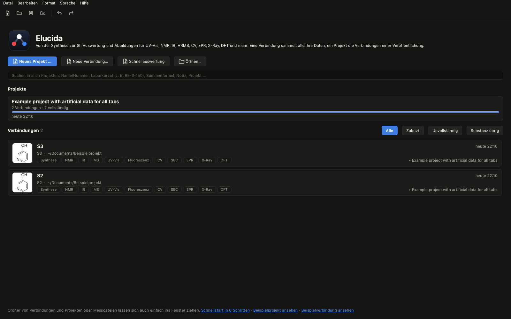
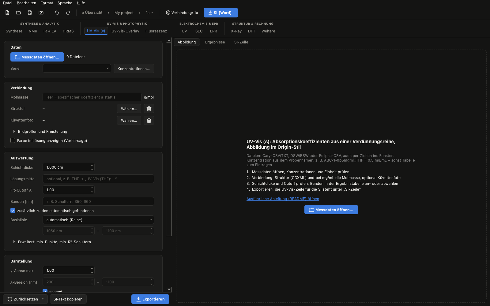
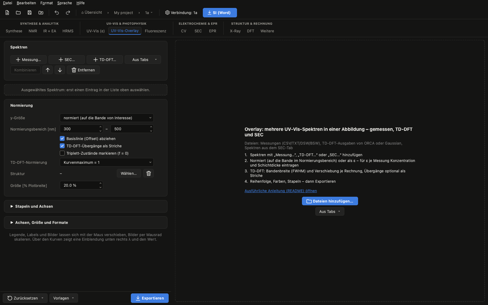
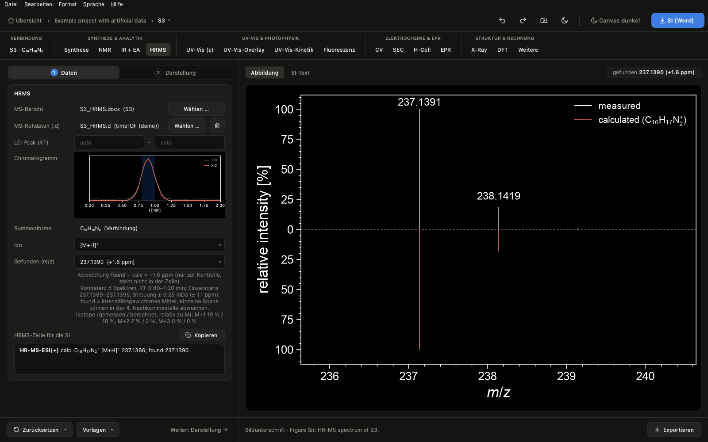
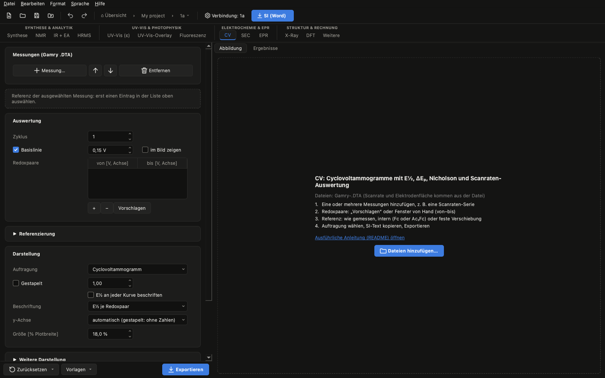
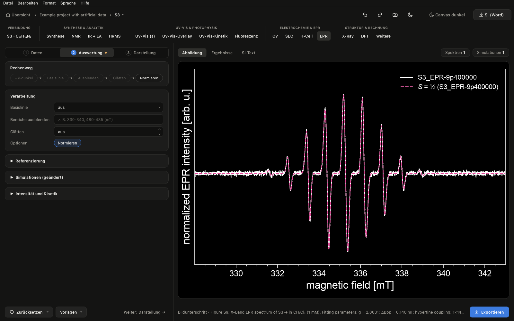
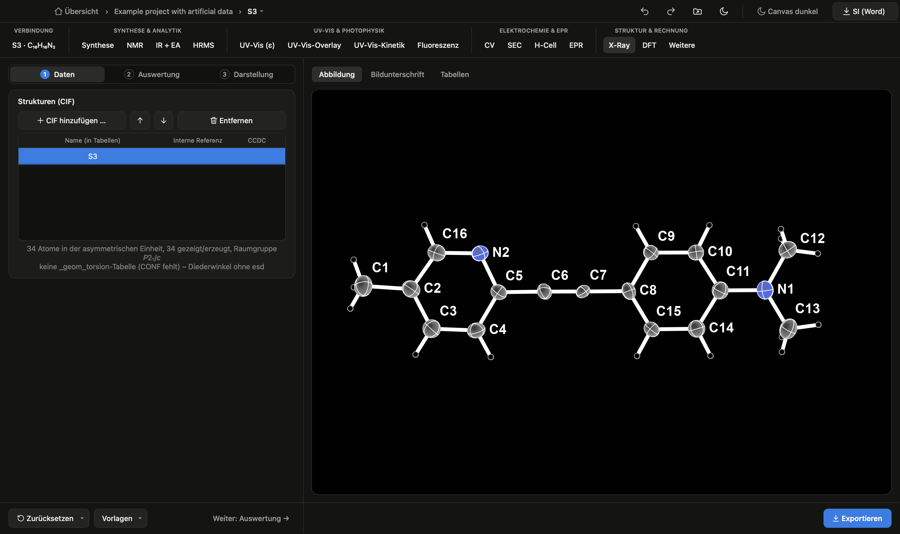
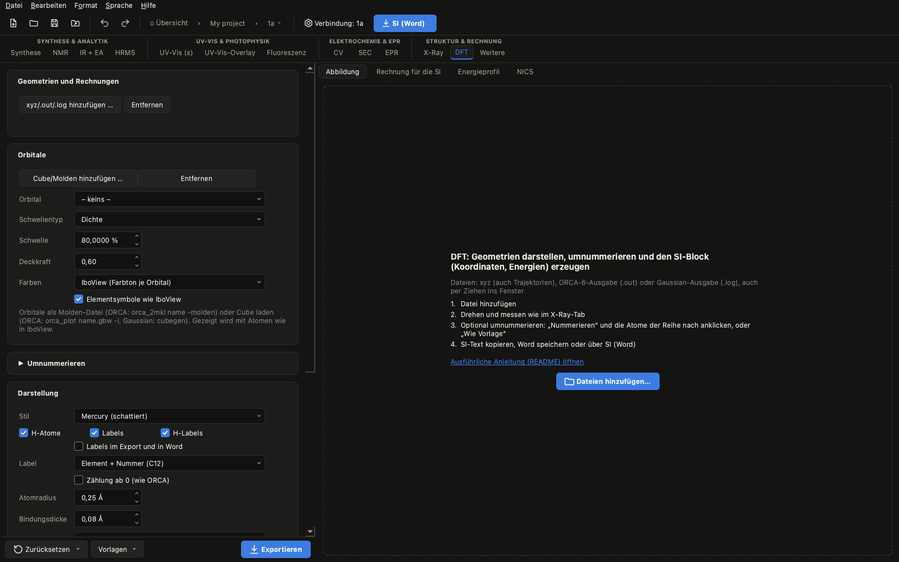
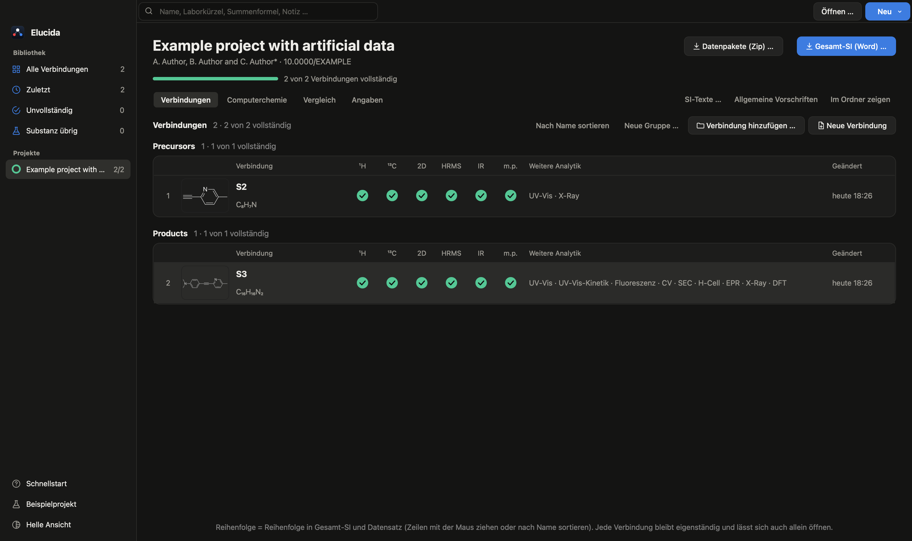

<p align="center">
  <picture>
    <source media="(prefers-color-scheme: dark)" srcset="assets/icon-dark.png">
    
  </picture>
</p>

<h1 align="center">Elucida</h1>

<p align="center">
  <b>Von der Synthese zur Supporting Information.</b><br>
  Ein Programm für die Analytik neuer Verbindungen: auswerten, darstellen und eine vollständige SI nach Word exportieren.
</p>

<p align="center">
  <a href="https://github.com/robinesken97/elucida/releases/latest"></a>
  <a href="https://github.com/robinesken97/elucida/actions/workflows/build.yml"></a>
  
  <a href="LICENSE"></a>
</p>

<p align="center">
  <a href="#herunterladen">Herunterladen</a> &nbsp;·&nbsp;
  <a href="#funktionen">Funktionen</a> &nbsp;·&nbsp;
  <a href="#schnellstart">Schnellstart</a> &nbsp;·&nbsp;
  <a href="docs/manual.de.md">Handbuch</a> &nbsp;·&nbsp;
  <a href="CHANGELOG.de.md">Änderungen</a> &nbsp;·&nbsp;
  <a href="README.md">English</a>
</p>

<p align="center">
  
</p>

## Warum Elucida

Eine neue Verbindung zu charakterisieren heißt: ein Dutzend Geräte, ein Dutzend Dateiformate und am Ende eine
Supporting Information, in der alles zusammenpassen muss. Elucida hält das an einem Ort zusammen.

- **Ein Ordner je Verbindung.** Spektren, Strukturen und Rechnungen liegen beieinander; ein Projekt fasst die
  Verbindungen eines Papers zusammen und zeigt, was noch fehlt.
- **Abbildungen fürs Paper.** Ein einheitlicher Stil, PDF und SVG als Vektorgrafik, passend für eine halbe A4-Seite.
  Die Vorschau ist maßstabsgetreu.
- **Die SI schreibt sich selbst.** Charakterisierungsabsatz, Unterschriften, Auswertungstext und Kristalldaten gehen
  direkt nach Word, mit Vorlagen für Wiley, ACS, RSC und Nature.
- **Nachvollziehbare Zahlen.** Jeder Fit steht in einem Methodentext, und der UV-Vis-Report rechnet ε mit einfachen
  Excel-Formeln nach.
- **Rohdaten fürs Repositorium.** Datenpakete, aus denen Laborkürzel und Daten entfernt sind.

## Funktionen

| Bereich | Tabs | Das Wichtigste |
|---|---|---|
| **Verbindung** | Verbindung | Name, Formel und Zeichnung an einer Stelle; eingebauter Struktureditor (Octet Draw), ChemDraw-Dateien funktionieren weiter |
| **Synthese & Analytik** | Synthese · NMR · IR + EA · HRMS | Schema, Vorschrift und Mengenprüfung; Mnova- und TopSpin-Daten; OPUS; Bruker `.d` |
| **UV-Vis & Photophysik** | UV-Vis (ε) · Overlay · Kinetik · Fluoreszenz | Lambert-Beer-Fit mit Konfidenzintervall, TD-DFT-Overlay, Spektren über die Zeit mit Fit erster Ordnung, ORCA ESD |
| **Elektrochemie & EPR** | CV · SEC · H-Cell · EPR | E½, Nicholson, Randles-Ševčík, UV/Vis/NIR-SEC, H-Zelle (Kapazität, Coulomb-Effizienz), S = ½-Fit, thermischer Zerfall |
| **Struktur & Rechnung** | X-Ray · DFT · Reaktionspfade | ORTEP im Mercury-Stil, ORCA und Gaussian, Orbitale, Multireferenz, Energiediagramme |
| **Projekt** | Übersicht · Gesamt-SI · Datenpakete | Checkliste je Verbindung, Suche, Gesamt-SI für das ganze Paper, Datensatz fürs Repositorium |

<table>
  <tr>
    <td width="50%"><br><sub>UV-Vis: ε aus der Verdünnungsreihe</sub></td>
    <td width="50%"><br><sub>Overlay: Messung und TD-DFT</sub></td>
  </tr>
  <tr>
    <td><br><sub>HRMS: Spektrum, Isotopenmuster und LC-Spur</sub></td>
    <td><br><sub>CV: E½ und Nicholson-Verhältnis</sub></td>
  </tr>
  <tr>
    <td><br><sub>EPR: Radikalkation mit gefitteter Simulation</sub></td>
    <td><br><sub>X-Ray</sub></td>
  </tr>
  <tr>
    <td><br><sub>DFT: Geometrie mit dem HOMO</sub></td>
    <td><br><sub>Projekt mit Checklisten</sub></td>
  </tr>
</table>
<sub>Alle Bilder zeigen das Beispielprojekt (Hilfe → Beispielprojekt ansehen) mit erfundenen Daten.</sub>

## Herunterladen

Die Datei für dein System aus dem [aktuellen Release](https://github.com/robinesken97/elucida/releases/latest) laden
und entpacken. Keine Installation, kein Python nötig.

| System | Datei | Starten |
|---|---|---|
| Windows | `Elucida-windows-x64.zip` | `Elucida\Elucida.exe` |
| macOS, Apple Silicon | `Elucida-macos-arm64.zip` | `Elucida.app` |
| macOS, Intel (ab macOS 14) | `Elucida-macos-x64.zip` | `Elucida.app` |
| Linux | `Elucida-linux-x64.AppImage` oder `.tar.gz` | ausführbar machen, dann starten |

<details>
<summary><b>Erster Start: Die App ist nicht signiert</b></summary>

- **Windows:** „Weitere Informationen“ → „Trotzdem ausführen“. Den ganzen Ordner `Elucida` zusammenlassen.
- **macOS:** `Elucida.app` in „Programme“ ziehen und einmal öffnen. Dann Systemeinstellungen → Datenschutz & Sicherheit → „Dennoch öffnen“.
  Oder im Terminal: `xattr -dr com.apple.quarantine /Applications/Elucida.app`
- **Linux:** `chmod +x Elucida-linux-x64.AppImage`. Braucht `fuse3`, sonst `--appimage-extract-and-run` anhängen. Ab Ubuntu 22.04.

</details>

<details>
<summary><b>Aktualisieren, auch von Versionen vor 1.0</b></summary>

Elucida prüft einmal am Tag auf neue Versionen. Zum Aktualisieren die App ersetzen; Verbindungen, Projekte und
Einstellungen bleiben.

Versionen vor 1.0 (gezählt bis 2.7.1, früher Spectravolt und UVVisTool) bieten 1.0 nicht als Update an: einmal von
Hand herunterladen. Alte Daten und Einstellungen werden automatisch übernommen.

</details>

## Schnellstart

1. **Neue Verbindung** auf dem Startbildschirm. Sie öffnet im Tab **Verbindung**: Namen eintragen und die Struktur
   zeichnen oder eine ChemDraw-Datei laden.
2. **Dateien ins Fenster ziehen.** Elucida sortiert sie in den richtigen Tab.
3. **Links einstellen, rechts die Abbildung sehen.** Labels, Strukturen und Insets lassen sich ziehen.
4. **SI (Word)** sammelt alles Fertige und nennt, was noch fehlt.

Keine Daten zur Hand? **Hilfe → Beispielverbindung öffnen** füllt alle Tabs mit künstlichen Daten.

Schritt für Schritt mit Bildern:
[Synthese bis SI](docs/anleitungen/synthese-bis-si.de.md) ·
[UV-Vis ε](docs/anleitungen/uvvis-epsilon.de.md) ·
[CV, SEC und H-Zelle](docs/anleitungen/elektrochemie.de.md) ·
[EPR](docs/anleitungen/epr.de.md) ·
[Kristallstruktur und DFT](docs/anleitungen/struktur-dft.de.md)

## Abläufe

**Vom Projekt zum Paper.** Projekt anlegen, Verbindungen hinzufügen und der Checkliste folgen. **Gesamt-SI** schreibt
Titelseite, Verzeichnis und Kapitel, **Datenpakete** den Datensatz.

**Reaktionspfade über mehrere Verbindungen.** Projekt → **Computerchemie**: Rechnungen hineinkopieren, dann
Energiediagramme, Moleküle und Orbitalansichten zusammenstellen. Diagramme sind maßstäblich, solange du nicht
schematisch wählst, und gehen in die Gesamt-SI. Mit Zugang zu einem Slurm-Cluster zeigt die Seite auch deine Jobs und
holt Ergebnisse direkt ins Projekt ([Einrichtung](docs/manual.de.md#cluster-anbindung)).

**Spektroelektrochemie ohne Zeitstempel.** Zusammengeführte UV/Vis/NIR-Exporte enthalten keine Zeiten. Elucida zeigt
sie nach Nummer und ordnet Potentiale erst zu, wenn du Zeitplan oder Tabelle bestätigt hast; die Herkunft steht dann
in der SI.

## Unterstützte Daten

| Methode | Dateien |
|---|---|
| Strukturen | ChemDraw **CDXML** (mit SVG/PDF/PNG-Export), Zeichnungen aus dem Programm |
| NMR | MestReNova **SVG/EMF** und Berichte, **TopSpin**-Datensätze, `.mnova` |
| IR | Bruker **OPUS**-Dateien und das OPUS-PDF |
| HRMS | Bericht der Massenabteilung (`.docx`), Bruker **`.d`** |
| UV-Vis, Fluoreszenz | **Cary** CSV/TXT, `.DSW`/`.BSW`, Cary **Eclipse** CSV und `.FBSW` |
| CV, SEC, H-Cell | **Gamry** `.DTA` (H-Cell: Cyclic Charge Discharge mit `CHARGE_DISCHARGE`), **B&W Tek BWSpec** |
| EPR | Bruker **BES3T**, Magnettech-MS400-Text, **EasySpin**-Simulationen |
| X-Ray | **CIF** (Olex2/SHELXL, CCDC) |
| Rechnungen | **xyz**, Ausgaben von **ORCA** und **Gaussian** (auch TD-DFT), **Molden**- und **Cube**-Dateien |

Einzelheiten und Grenzen je Format: [Handbuch → Unterstützte Daten](docs/manual.de.md#unterstützte-daten).

## Dokumentation

- [Handbuch](docs/manual.de.md): alle Tabs und Einstellungen, Probleme, Bauen aus dem Quellcode
- [Anleitungen](docs/manual.de.md#anleitungen): fünf Abläufe Schritt für Schritt
- [Änderungen](CHANGELOG.de.md)

## Aus dem Quellcode bauen

Python 3.12; für einen vollständigen Build braucht der Zeicheneditor zusätzlich Node.js.

```bash
pip install -r requirements.txt
python Elucida.py                                              # aus dem Quellcode starten
QT_QPA_PLATFORM=offscreen python Elucida.py --selftest out     # Selbsttest, muss mit „OK“ enden
python tools/build.py                                          # fertige App in dist/ (braucht pyinstaller)
```

Releases baut GitHub Actions für Windows, macOS (Apple Silicon und Intel) und Linux; die fertige App durchläuft auf
jedem System den Selbsttest, bevor ein Release erscheint.

## Rückmeldung

Fehler gefunden oder ein Dateiformat fehlt? Bitte ein [Issue](https://github.com/robinesken97/elucida/issues) anlegen
und Gerät und Softwareversion nennen, aus denen die Datei stammt. Keine unveröffentlichten Messdaten anhängen; eine
Beschreibung oder ein künstliches Beispiel genügt.

## Lizenz

[AGPL-3.0](LICENSE), ohne Gewährleistung. Mitgelieferte Bibliotheken und ihre Lizenzen stehen im
[Handbuch](docs/manual.de.md#lizenz). Der Zeicheneditor basiert auf
[Octet Draw](https://github.com/SamChemMan/Octet-Draw) (Apache-2.0).
