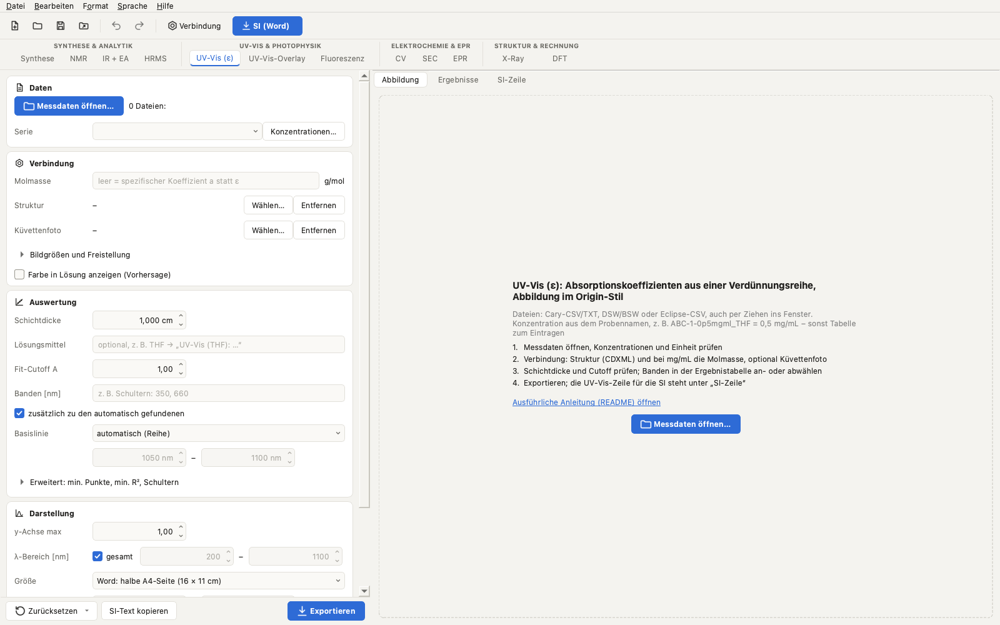
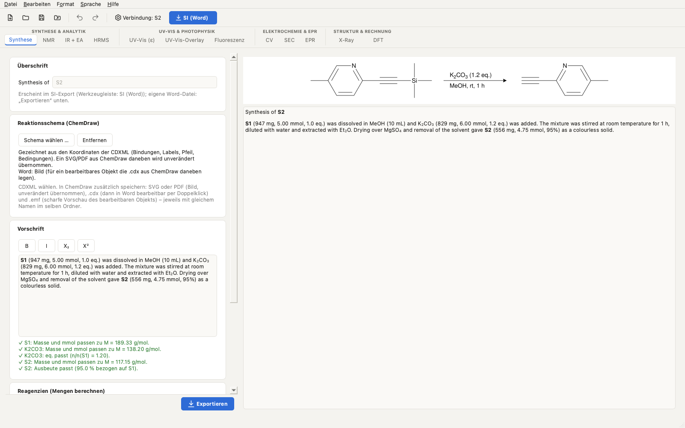
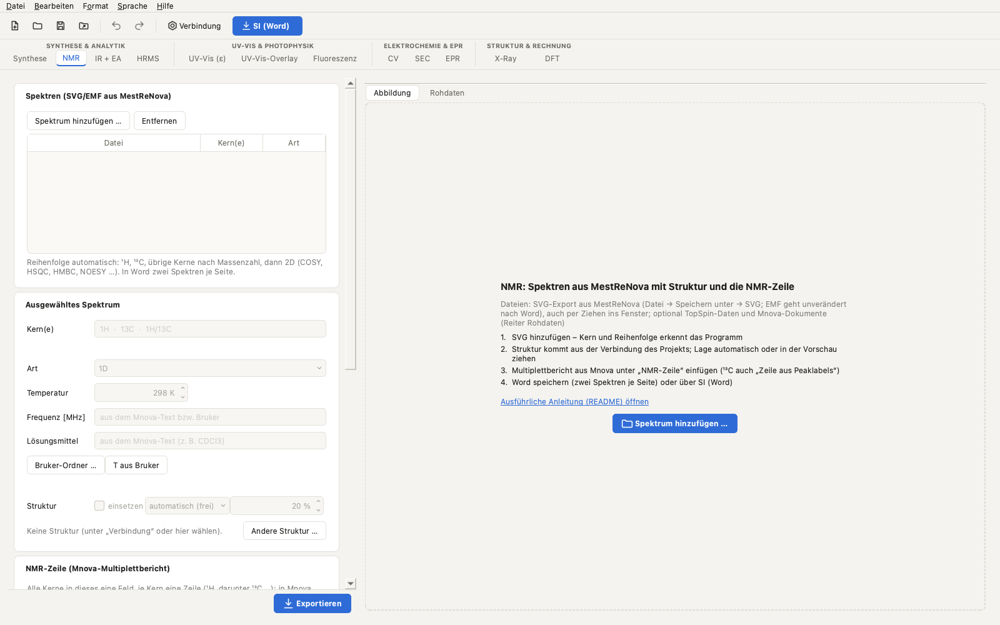
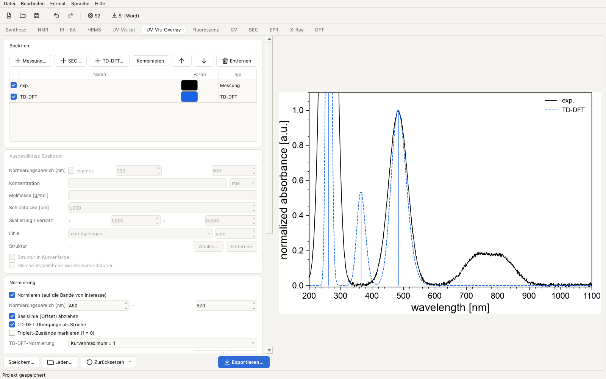
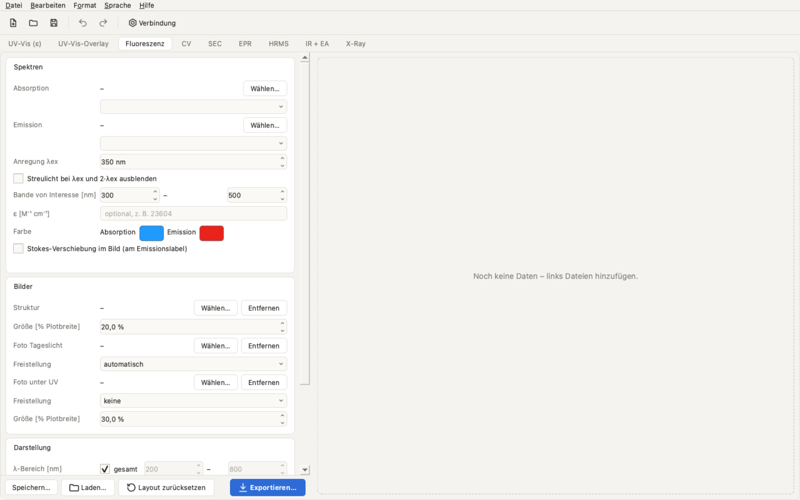
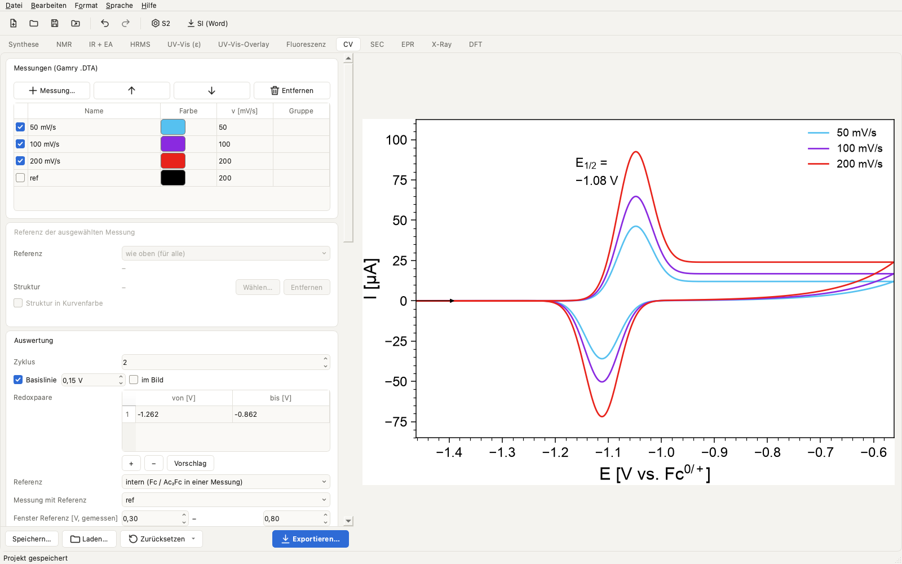
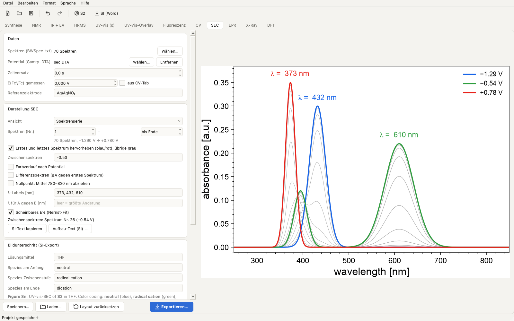
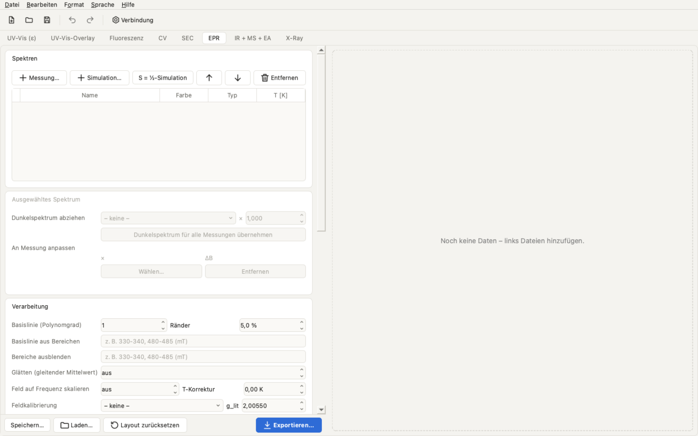
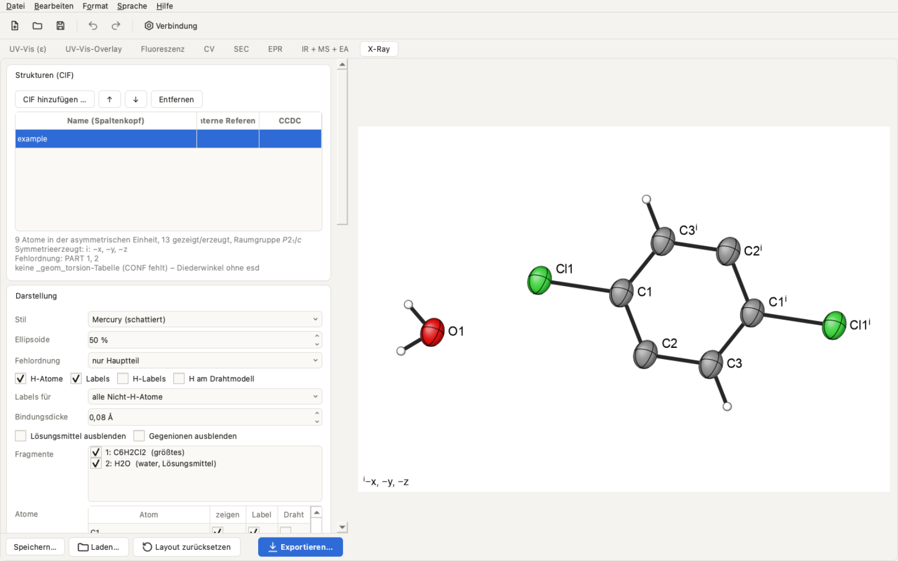
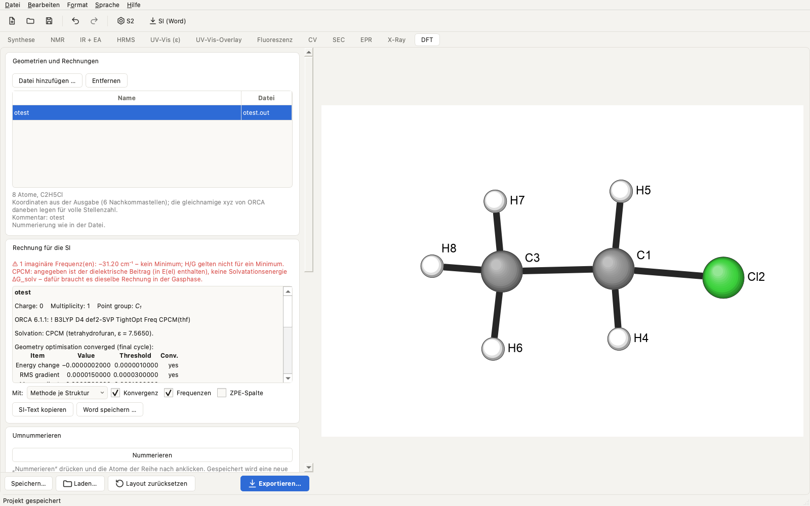

[English](README.md) | **Deutsch** · [Änderungen](CHANGELOG.de.md)

# Elucida – von der Synthese zur SI

*Früher **Spectravolt** (davor **UVVisTool**). Projekte, Einstellungen und heruntergeladene Daten werden automatisch übernommen.*

<p align="center"></p>

**Von der Synthese zur SI:** Auswertung und publikationsfertige Abbildungen für UV-Vis, NMR, IR, HRMS, Fluoreszenz, CV,
SEC, EPR, Röntgenstruktur und DFT – exportiert als vollständiger SI-Abschnitt in Word (Synthese mit bearbeitbarem
ChemDraw-Schema, Charakterisierungsabsatz, Spektren zu zweit je Seite, Kristalldaten und DFT-Koordinaten).

Im ε-Tab bestimmt Elucida molare Absorptionskoeffizienten (ε) aus UV-Vis-Verdünnungsreihen
(Lambert-Beer: A/d gegen c) und erzeugt publikationsfertige Abbildungen im gewohnten Origin-Stil:
Spektren, λ/ε-Labels an den Banden, ein Inset mit den linearen Regressionen und R², die Struktur
(CDXML/SVG/PDF) und ein freigestelltes Foto der Küvette. Die Oberfläche gibt es auf Deutsch und
Englisch.

<p align="center">
  <picture>
    <source media="(prefers-color-scheme: dark)" srcset="docs/screenshots/eps_dark_de.png">
    
  </picture>
</p>

### Auf einen Blick

| Tab | Was er macht |
|---|---|
| **Synthese** | „Synthesis of …“ mit dem ChemDraw-Schema (bearbeitbares ChemDraw-Objekt in Word), Vorschrift mit Formatierung, Mengenprüfung (mmol/Äquivalente/Ausbeute gegen die Reagenzientabelle) |
| **NMR** | Spektren aus MestReNova (SVG oder EMF), TopSpin-Rohdaten nach Experiment sortiert, Kern aus der Achse, NMR-Zeile aus dem Mnova-Bericht mit Zuordnungen, Struktur automatisch platziert, Bruker-Parameter, zwei Spektren je Seite in Word |
| **UV-Vis (ε)** | Lambert-Beer-Fit von Verdünnungsreihen → ε (bzw. a) mit Konfidenzintervall; Abbildung im Origin-Stil mit Struktur und Küvettenfoto; Excel-Report; UV-Vis-Zeile für die SI |
| **UV-Vis-Overlay** | Gemessene Spektren, TD-DFT (ORCA/Gaussian, SOC, Tripletts) und SEC-Serien in einer Abbildung, normiert oder als ε |
| **Fluoreszenz** | Absorption und Emission, Stokes-Verschiebung, Fotos bei Tageslicht und unter UV |
| **CV** | Gamry-Dateien, E½/ΔE_p, Basislinie, Nicholson-Verhältnis, Randles-Ševčík mit KI, Bezug auf Fc⁺/Fc, SI-Text |
| **SEC** | Spektrenserie mit Potential vom Potentiostaten, Differenzspektren, scheinbarer Nernst-Fit |
| **EPR** | Bruker BES3T, Dunkelspektrum, Basislinie, S = ½-Fit, EasySpin-Import, Kinetik und thermischer Zerfall |
| **HRMS** | HRMS-Zeile aus dem Bericht der Massenabteilung oder aus Bruker-Rohdaten (.d): Chromatogramm mit wählbarem LC-Bereich, gemitteltes Spektrum, Peak per Klick, berechnetes Isotopenmuster |
| **IR + EA** | IR-Peakliste aus Bruker OPUS (Datei oder PDF) und die Zeile der Elementaranalyse, fertig für die SI |
| **X-Ray** | CIF → drehbare ORTEP-Abbildung im Mercury-Stil (schattierte Ellipsoide, Labels je Atom), Bindungslängen/Winkel/Diederwinkel per Klick mit esd aus der CIF, Kristalldatentabelle für die SI |
| **DFT** | xyz, ORCA-6- und Gaussian-Ausgaben: Atome per Klick oder wie eine Vorlage (andere Geometrie oder CIF) umnummerieren, SI-Block mit Koordinaten, Energien und Konvergenz (Word, zweispaltig); Orbitale aus Molden- oder Cube-Dateien im Stil von IboView |

Die Tabs stehen in der Reihenfolge der SI, oben in vier Gruppen: **Synthese & Analytik** (Synthese · NMR · IR + EA ·
HRMS) · **UV-Vis & Photophysik** (UV-Vis (ε) · Overlay · Fluoreszenz) · **Elektrochemie & EPR** (CV · SEC · EPR) ·
**Struktur & Rechnung** (X-Ray · DFT). Ein leerer Tab zeigt, was er erzeugt, welche Dateien er braucht und die
Schritte bis zum Ergebnis.

Alle Exporte: PDF/SVG (vektoriell) und PNG, standardmäßig 16 × 11 cm (halbe A4-Seite in Word). Helles und dunkles
Erscheinungsbild; Deutsch und Englisch.

<table>
<tr><td width="50%" valign="top"><br><sub>Synthese</sub></td><td width="50%" valign="top"><br><sub>NMR</sub></td></tr>
<tr><td width="50%" valign="top"><br><sub>UV-Vis-Overlay</sub></td><td width="50%" valign="top"><br><sub>Fluoreszenz</sub></td></tr>
<tr><td width="50%" valign="top"><br><sub>Cyclovoltammetrie</sub></td><td width="50%" valign="top"><br><sub>Spektroelektrochemie</sub></td></tr>
<tr><td width="50%" valign="top"><br><sub>CW-EPR</sub></td><td width="50%" valign="top"><br><sub>X-Ray</sub></td></tr>
<tr><td width="50%" valign="top"><br><sub>DFT</sub></td></tr>
</table>

## Herunterladen und starten

Lade unter **Releases** (rechts auf der Repository-Seite) die Datei für dein System herunter und entpacke sie.

| System | Datei | Starten |
|---|---|---|
| Windows | `Elucida-windows-x64.zip` | `Elucida\Elucida.exe` |
| macOS (Apple Silicon) | `Elucida-macos-arm64.zip` | `Elucida.app` |
| macOS (Intel, ab macOS 14) | `Elucida-macos-x64.zip` | `Elucida.app` |
| Linux (AppImage) | `Elucida-linux-x64.AppImage` | ausführbar machen, dann doppelklicken |
| Linux (Ordner) | `Elucida-linux-x64.tar.gz` | `Elucida/Elucida` |

Die App ist nicht signiert, deshalb warnt das Betriebssystem beim ersten Start:

- **Windows (SmartScreen):** „Weitere Informationen“ → „Trotzdem ausführen“.
- **macOS (Gatekeeper):** `Elucida.app` in „Programme“ ziehen und einmal doppelklicken (wird blockiert).
  Dann Systemeinstellungen → Datenschutz & Sicherheit → ganz unten „Dennoch öffnen“ → mit Passwort/Touch ID
  bestätigen. Ab macOS 15 funktioniert der frühere Weg „Rechtsklick → Öffnen“ nicht mehr. Alternativ im
  Terminal: `xattr -dr com.apple.quarantine /Applications/Elucida.app`. Welcher Mac? Apple-Menü → Über diesen Mac: „Chip Apple M…“ = Apple Silicon,
  „Prozessor Intel…“ = Intel. Die Intel-Version braucht macOS 14 (Sonoma) oder neuer.

**Updates:** Beim Start prüft das Programm einmal am Tag, ob es auf GitHub eine neuere Version gibt,
und bietet an, die Release-Seite zu öffnen (Hilfe → „Nach Updates suchen…“; im Hilfe-Menü abschaltbar).
Zum Aktualisieren die neue Datei herunterladen und die alte App ersetzen; Projekte und Einstellungen
bleiben erhalten.

**Linux-AppImage:** `chmod +x Elucida-linux-x64.AppImage` (oder Dateieigenschaften → „Als Programm
ausführen“), dann starten. Es braucht `fusermount` (Paket `fuse3`, bei den meisten aktuellen
Distributionen vorinstalliert); ohne startet man mit `./Elucida-linux-x64.AppImage --appimage-extract-and-run`.
Wie beim tar.gz ist eine Distribution mindestens so neu wie Ubuntu 22.04 (glibc 2.35) nötig.

Unter Windows immer den ganzen Ordner `Elucida` zusammenlassen. Die `.exe` funktioniert nicht ohne den Ordner `_internal` daneben.

## Schnellstart: vom leeren Projekt zur SI

1. **Projekt anlegen:** Ohne Projekt zeigt das Programm einen Startbildschirm: **Neues Projekt…** und einen leeren
   Ordner wählen oder im Dialog neu anlegen (oder **Datei → Neues Projekt…**). Ein
   Projekt steht für eine Verbindung. Alle Dateien, die du lädst, werden hineinkopiert, gespeichert wird automatisch.
2. **Verbindung festlegen:** **Verbindung …** in der Werkzeugleiste: Name (z. B. die Probennummer) und die
   ChemDraw-Datei (CDXML). Summenformel und Molmasse kommen daraus. Das ist die Vorgabe für alle Tabs und die SI.
3. **Daten laden:** Dateien einfach ins Fenster ziehen – Elucida legt sie in den passenden Tab:
   CIF → **X-Ray**, SVG aus MestReNova → **NMR**, xyz/ORCA/Gaussian/Molden/Cube → **DFT**, MS-Bericht (.docx) oder Bruker-.d →
   **HRMS**, OPUS-Datei → **IR + EA**, UV-Vis-Messdaten (CSV, DSW/BSW) → **UV-Vis (ε)**. CV, SEC, EPR, Overlay und
   Fluoreszenz lädst du im Tab über **Dateien hinzufügen…**. Ein leerer Tab zeigt, was er braucht und woher es kommt.
4. **Auswerten:** Links stehen die Einstellungen (Seltenes ist eingeklappt; **„(geändert)“** zeigt, wo etwas vom
   Standard abweicht), rechts die Abbildung. Labels, Strukturen und Insets lassen sich mit der Maus verschieben.
   **Strg+Z** / **⌘Z** macht alles rückgängig.
5. **Exportieren:** **Exportieren** unten im Tab schreibt die Abbildung (PDF/SVG/PNG, 16 × 11 cm für eine halbe
   A4-Seite) und die Daten in den Projektordner (`figures/`, `tables/`, `SI/`).
6. **SI erstellen:** **SI (Word)** in der Werkzeugleiste sammelt alles Fertige in einer Word-Datei: Synthese,
   Charakterisierungsabsatz (m.p., NMR, IR, HR-MS, UV-Vis, Elementaranalyse), Abbildungen zu zweit je Seite,
   Kristalldaten und DFT-Koordinaten. Was noch fehlt, zählt das Programm danach auf.

## Anleitungen

Schritt für Schritt durch einen Arbeitsablauf, mit Bildern:

- [Synthese und Charakterisierung bis zur SI](docs/anleitungen/synthese-bis-si.de.md) – Schema, Vorschrift, NMR, IR,
  HRMS, Elementaranalyse, SI-Abschnitt
- [UV-Vis: ε aus einer Verdünnungsreihe](docs/anleitungen/uvvis-epsilon.de.md)
- [Elektrochemie: CV und SEC](docs/anleitungen/elektrochemie.de.md)
- [EPR: Spektren, Simulation und Fit](docs/anleitungen/epr.de.md)
- [Kristallstruktur und DFT](docs/anleitungen/struktur-dft.de.md)

Zum Ausprobieren ohne eigene Daten: **Hilfe → Beispielprojekt ansehen** legt ein Projekt mit künstlichen Daten für alle
Tabs an. **Hilfe → Anleitung zu diesem Tab** (F1) öffnet den passenden Abschnitt unten.

Alle Einstellungen der einzelnen Tabs stehen weiter unten zum Nachschlagen.

## Ablauf

1. **Daten öffnen:** Datei → Messdaten öffnen, oder Dateien ins Fenster ziehen. Unterstützt werden
   Cary-CSV/TXT-Exporte und die gerätenahen **.DSW/.BSW**-Dateien. **Mehrere Dateien auf einmal**
   (z. B. jede Konzentration einzeln gemessen) werden zu einem Datensatz zusammengeführt.
2. **Konzentrationen:** Die Konzentrationen werden aus den Probennamen gelesen, z. B.
   `ABC-1-0p5mgml_THF` → Serie `ABC-1`, 0,5 mg/mL. Erkannt werden
   `mgml`/`mg_ml`/`mg/ml`, `mM`, `uM`/`µM`; `p` steht für das Dezimalkomma.
   - Stehen keine Konzentrationen im Namen (z. B. `c0` … `c4`), öffnet sich eine Tabelle zum Eintragen.
     Die **Einheit** (mM, µM, mg/mL, M) muss ausdrücklich gewählt werden, es ist nichts vorbelegt.
   - „Verdünnungsreihe ausfüllen“ setzt in die markierten Zeilen (oder alle) von oben nach unten Start, Start/Faktor, … ein.
     Der Startwert gehört immer zur **obersten** markierten Zeile (meist die Stammlösung).
   - Proben ohne Wert, z. B. eine Blindprobe, werden ignoriert.
   - Über die Spalte „Serie“ lassen sich mehrere Verbindungen in einer Datei trennen.
   - Später ändern geht über den Knopf **Konzentrationen…**.
3. **Verbindung (je Serie):**
   - **Struktur:** CDXML, SVG, PDF oder eine Bilddatei. Bei CDXML wird die **Molmasse automatisch
     berechnet** (Isotope wie D eingeschlossen), die Summenformel wird zur Kontrolle angezeigt.
     Damit die Zeichnung **exakt wie in ChemDraw** aussieht, die Struktur in ChemDraw zusätzlich
     als SVG, PDF oder PNG mit gleichem Namen neben die CDXML speichern (z. B. `6g.cdxml` +
     `6g.svg`). Die Zeichnung kommt dann unverändert aus dieser Datei, die Molmasse aus der CDXML.
     Ohne eine solche Datei wird die Struktur neu gezeichnet (ACS-1996-Stil) und kann von ChemDraw
     abweichen.
   - **Küvettenfoto:** HEIC (iPhone), JPG, PNG und weitere. Der Hintergrund wird automatisch entfernt.
   - **Farbe in Lösung (Vorhersage, optional):** aus dem Spektrum berechnet – Transmission 10^(−A) unter
     Tageslicht, CIE-1931-Farbmetrik, als Farbfeld unter dem Foto. Konzentration und Schichtdicke sind
     wählbar (Lambert-Beer; Standard: höchste gemessene Konzentration in 1 cm). Fluoreszenz und Streuung
     bleiben unberücksichtigt, Bildschirme sind nicht kalibriert; nur Anzeige, nicht in der Abbildung.
     Beim ersten Mal bietet die App einen einmaligen Download des KI-Modells an (~180 MB).
   - **Molmasse:** nur bei Konzentrationen in mg/mL nötig. Wird aus der CDXML übernommen, sonst von
     Hand eintragen. Ohne Molmasse gibt das Tool den spezifischen Absorptionskoeffizienten *a* in
     L g⁻¹ cm⁻¹ statt ε aus, und das Feld wird rot markiert. Bei mM/µM wird die Molmasse nicht verwendet.
4. **Auswertung:** Schichtdicke und Fit-Cutoff eintragen. Banden werden automatisch gefunden;
   zusätzliche Banden (z. B. Schultern) lassen sich als Liste eintragen („zusätzlich zu den
   automatisch gefundenen“ behält beide), optional mit Indizes **λ₁/ε₁ …** an den Labels, und **„Schultern automatisch suchen“** ergänzt Schultern
   (in der Abbildung optional mit „(sh)“ markiert). In der Ergebnistabelle entscheidet das Häkchen bei λ, ob eine Bande im Bild
   erscheint, und ein Doppelklick auf **„Cutoff A“** setzt einen eigenen Cutoff für diese Bande
   (z. B. um einen Punkt knapp über A = 1 mitzunehmen). Banden mit eigenem Cutoff sind farbig
   hinterlegt; optional zeigt das Inset ausgeschlossene Punkte als offene Symbole.
5. **Layout:**
   - **Mit der Maus ziehen:** Inset, Struktur, Küvette und jedes λ/ε-Label lassen sich verschieben.
   - **Mausrad bzw. Trackpad** über Inset oder Bild ändert die Größe. Alternativ die Felder „Größe [% Plotbreite]“ nutzen.
   - **Maus über den Spektren:** Eine Einblendung unten rechts zeigt λ und A des nächsten Messpunkts (und seine
     Konzentration), in der Vorschau mit rotem Kreis markiert (nicht im Export) – praktisch zum Prüfen der
     Daten. **Doppelklick** auf einen Punkt fügt seine Wellenlänge als Bande hinzu, erneuter Doppelklick
     entfernt sie. Overlay- und Fluoreszenz-Tab zeigen λ und den gezeichneten Wert genauso an.
   - **Zurücksetzen ▾** → „Layout zurücksetzen“ stellt die automatische Anordnung wieder her; „Alles auf Standard“ setzt
     alle Einstellungen des Tabs (Darstellung und Auswertung) auf Standard – Daten und Angaben zur Messung (Dateien,
     Referenz/Kalibrierung, Schichtdicke, eingegebene Werte, Bildunterschrift, Exportgröße) bleiben, Rückgängig holt alles
     zurück. X-Ray und DFT haben zusätzlich „Darstellung auf Standard“ neben „Ansicht zurücksetzen“ (Stil, Ellipsoide,
     Bindungsdicke, Labels, ausgeblendete Atome …).
6. **Exportieren:** Datei → Exportieren (oder der Knopf). Das schreibt die gewählten Formate (PDF/SVG/PNG),
   `<Serie>_results.csv` und den Excel-Report für **alle** Serien ins Projekt (siehe unten).

## Erscheinungsbild

Das Programm folgt dem hellen oder dunklen Modus des Systems; unter **Format → Erscheinungsbild** lässt sich dauerhaft
hell oder dunkel wählen. Selten gebrauchte Karten der linken Spalte sind eingeklappt (Klick auf den Titel klappt sie
auf); ein Titel mit **„(geändert)“** bedeutet, dass dort ein Wert vom Standard abweicht. Ergebnisse, Tabellen und
SI-Texte stehen als Reiter neben der Abbildung. Das Mausrad scrollt die Spalte; ein Feld ändert es erst, wenn es
angeklickt ist. Hinweise beim Zeichnen (z. B. ausgelassene Kurven) stehen unter der Vorschau, **Hilfe → Protokoll…**
zeigt alle Meldungen. **Vorlagen ▾** unten speichert die Einstellungen eines Tabs für andere Projekte. Die Abbildungen
sind vom Erscheinungsbild nicht betroffen.

## Verbindung des Projekts

Ein Projekt steht meist für **eine Verbindung** (oder einen Vergleich). **Verbindung …** in der Werkzeugleiste legt
Name/Probennummer, ChemDraw-Datei, Summenformel und Molmasse fest (aus der CDXML, Isotope wie D inklusive, änderbar).
Das ist die Vorgabe für den ε-Tab (Struktur, Molmasse), den Fluoreszenz-Tab, IR + EA und HRMS; Tabs mit eigener Struktur oder
Molmasse behalten diese. Der Name steht im Fenstertitel. Der dort eingetragene Schmelzpunkt beginnt den
Charakterisierungsabsatz im SI-Abschnitt.

## Synthese-Tab

„Synthesis of **Name**“ (Name standardmäßig der der Verbindung bzw. des Projekts), Reaktionsschema und Vorschrift,
als eigene Word-Datei oder im SI-Abschnitt.

- **Schema:** die CDXML wählen. Daneben (gleicher Name, gleicher Ordner) kann man aus ChemDraw speichern: **SVG/PDF**
  (Bild unverändert übernommen), **.cdx** (das Schema wird in Word ein bearbeitbares ChemDraw-Objekt – Doppelklick
  öffnet ChemDraw; mit einer CDXML kann Word das nicht) und **.emf** (scharfe Vektorvorschau dieses Objekts). Ohne
  SVG/PDF wird das Schema aus den CDXML-Koordinaten gezeichnet, mit Pfeil und Bedingungen.
- **Vorschrift** mit fett, kursiv, tief- und hochgestellt.
- **Mengenprüfung:** Angaben wie „(1.03 g, 5.00 mmol, 1.0 eq.)“, „(99%)“ werden mit der Reagenzientabelle verglichen
  (M oder Summenformel, Masse, Volumen, Konzentration, Dichte); Abweichungen jenseits der Rundung der angegebenen Stellen
  werden markiert. **Aus Schema** füllt die Tabelle mit den Edukten (erstes = Bezug 1.0 eq.), den Reagenzien über/unter
  dem Pfeil (z. B. K2CO3), Lösungsmitteln und dem Produkt; **Klammer einfügen** setzt die berechnete Klammer der gewählten
  Zeile an der Schreibmarke ein.

## NMR-Tab

- **Spektren:** SVG-Exporte aus MestReNova (Drag & Drop). Der Kern kommt aus der Achsenbeschriftung („δ ¹H (ppm)“);
  fehlt sie, von Hand eintragen. Reihenfolge: ¹H, ¹³C, übrige Kerne nach Massenzahl, dann 2D (COSY, HSQC, HMBC,
  NOESY …).
- **Struktur** in jedem Spektrum als Vektorgrafik: automatisch an einer freien Stelle (nichts verdeckt), oder oben
  links/mittig/rechts, oder in der Vorschau gezogen; das Mausrad über der Struktur ändert die Größe, für alle Spektren
  gleich.
- **NMR-Zeile:** den Mnova-Multiplettbericht einfügen („Multiplets → Copy“, Journal-Format) – alle Kerne in das eine
  Feld, je Kern eine Zeile. **Zeile aus Peaklabels** baut die ¹³C-Zeile (oder andere) aus den beschrifteten Peaks des
  gewählten Spektrums; ein mit Namen beschriftetes Lösungsmittelsignal („77.16 CDCl3“) fällt weg. Zuordnungen je Signal
  in der Tabelle (*kursiv*, _{tief}, ^{hoch}).
- **Temperatur** standardmäßig 298 K, oder aus dem Bruker-Experimentordner (acqus, mit Übersicht der Parameter wie
  Frequenz, O1P, Pulsprogramm, Scans).
- **Rohdaten** (Reiter neben der Abbildung): **TopSpin-Daten …** nimmt ein Experiment, einen Datensatz (10, 11, …) oder
  einen Ordner mit mehreren Datensätzen – auch per Ziehen ins Fenster – und übernimmt jedes Experiment vollständig ins
  Projekt, nach Art sortiert (`data/nmr/1H`, `13C`, `DEPT135`, `HSQC` …). Passt genau ein Experiment zu einem Spektrum,
  wird es automatisch zugeordnet (Parameter, Temperatur). **Mnova-Dokumente** (`.mnova`) liegen in `data/nmr/mnova`;
  Doppelklick öffnet sie.
- Spektren können auch **EMF** aus Mnova sein: Sie gehen unverändert nach Word (Vektor, ohne eingesetzte Struktur); für
  Vorschau und Struktur SVG verwenden.
- **Word:** zwei Spektren je Seite, „Figure Sn: ¹H NMR (500 MHz, CDCl₃, 298 K) of **Name**.“

## HRMS-Tab

- Den **Word-Bericht** der Massenabteilung und/oder den Bruker-**Messordner** (`.d`) laden; was jeweils gelesen wird, steht
  in den Punkten unten. Mit Rohdaten zeigt der Tab:
  - ein **Chromatogramm** (Gesamt-Ionenstrom grau, Ionenstrom des gesuchten Ions rot, ± 10 ppm); das blaue Band ist der
    LC-Bereich für das Spektrum – mit der **Maus ziehen**, um einen anderen Bereich zu wählen;
  - das **gemittelte Spektrum** über diesen Bereich (Mittel der Linienspektren des Geräts) mit m/z an den größten Peaks
    und dem **berechneten Isotopenmuster** des Ions gespiegelt darunter (rot; Feinstruktur, die das TOF nicht trennt,
    z. B. ¹³C/¹⁵N, zusammengefasst); die gemessenen/berechneten Isotopenverhältnisse (M+1, M+2 …) stehen dabei;
  - **Peak anklicken**, um ihn als *found* zu übernehmen (neben dem Wert aus dem Bericht und dem Mittel über den LC-Peak).
- Export: Spektrum als Abbildung (PDF/SVG/PNG), `…_sticks.csv` (gemessen und berechnet) und `…_SI.txt`.
- Alte Projekte: Die MS-Daten aus dem früheren Tab IR + MS werden automatisch übernommen.

## IR + EA-Tab

- **IR:** Bruker-**OPUS**-Datei (`*.0`, Spektrum) und/oder den **OPUS-PDF**-Ausdruck (Peakbeschriftung) laden. Mit dem
  PDF sind die Werte genau die OPUS-Peakliste; mit der Datei allein sucht Elucida die Banden selbst
  (Empfindlichkeit einstellbar). Bereich frei wählbar (Standard: der ganze gemessene Bereich); Banden, die nicht in die
  Liste sollen, abhaken; Intensitäten w/m/s/br optional. Ausgabe: **IR** [cm⁻¹]: ṽ = 2961, 2866, … (ganze Zahlen,
  absteigend).
- **HRMS:** den **Word-Bericht** der Massenabteilung laden; Formel, Ionisierung, Polarität und die gemessenen m/z (aus
  den eingebetteten Spektren) werden ausgelesen. Die Formel kommt aus der Verbindung des Projekts (Warnung, wenn der
  Bericht etwas anderes sagt), das Ion ist wählbar ([M+H]⁺, [M+Na]⁺, [M]⁺, [M−H]⁻ …), vorgewählt ist das nächste
  gemessene m/z. calc. mit Elektronenmasse, vier Nachkommastellen: **HR-MS-ESI(+)** calc. C₁₈H₂₁N₂⁺ [M+H]⁺ 265.1699;
  found 265.1703. Die Abweichung in ppm steht zur Kontrolle daneben (found − calc). Die Formel wird gegen das im
  Bericht **eingebettete ChemDraw-Objekt** geprüft; ohne Verbindung im Projekt setzt **Verbindung aus dem MS-Bericht
  übernehmen** Name, Formel und Molmasse daraus (die Zeichnung ist dann eine RDKit-Ersatzzeichnung – für Abbildungen
  die eigene CDXML nehmen).
- **HRMS aus Rohdaten:** alternativ (oder zusätzlich) den Bruker-**Messordner** (`.d`, z. B. timsTOF; Knopf oder
  Drag & Drop) laden. Elucida liest die Linienspektren des Geräts selbst (ohne Bruker-Software, auch unter macOS)
  und mittelt das Ion über den **LC-Peak** (automatisch: zusammenhängende Scans mit ≥ 50 % des Maximums, oder ein
  gewählter RT-Bereich). found = intensitätsgewichtetes Mittel; Anzahl der Scans, Bereich der Einzelscans und ihre
  Streuung (± mDa/ppm) stehen dabei, weil Einzelscans in der 4. Nachkommastelle abweichen können. Mit Bericht bleibt
  dessen Wert vorgewählt, das Mittel aus den Rohdaten ist wählbar. Ins Projekt kommen nur `analysis.baf` und
  `analysis.sqlite`.
- **Elementaranalyse:** Formel aus der Verbindung des Projekts, optional plus Solvat (`0.5 CH2Cl2`, mehrere mit
  Komma); berechnet mit den konventionellen mittleren Atommassen, gefundene C/H/N/S-Werte eintragen. Abweichungen über
  0.4 % werden markiert (übliche Grenze der Journals). Ausgabe: **Elemental analysis** calcd (%) for C₁₈H₂₀N₂: C 81.78,
  H 7.63, N 10.60; found: C 81.52, H 7.70, N 10.41.
- **In Zwischenablage** behält Fettdruck, Hoch- und Tiefstellung beim Einfügen in Word. Der Export schreibt die
  Spektrenabbildung und `…_SI.txt` mit allen Zeilen.

## SI-Abschnitt (Word)

**SI (Word)** in der Werkzeugleiste (oder **Datei → SI-Abschnitt exportieren (Word) …**) fragt, welche Teile hinein
sollen (Charakterisierung, NMR-Spektren, Abbildungen aller Tabs, X-Ray, DFT), und sammelt alles Fertige zur Verbindung des Projekts in
`SI/<Verbindung>_SI.docx`, im Stil der SI: ein Charakterisierungsabsatz **m.p. …; IR …; HR-MS …; UV-Vis …;
Elemental analysis …** (Schmelzpunkt aus **Verbindung …**, UV-Vis-Zeile von der Seite **SI-Zeile** im Tab UV-Vis (ε):
*λ*_max: 331 nm (*ε* = 8440 cm⁻¹ M⁻¹), … mit den Banden wie im Bild, aufsteigend, ε auf die Genauigkeit seines
Standardfehlers gerundet), danach Kristalldaten-Tabelle, ausgewählte Parameter und Bildunterschriften aus dem
X-Ray-Tab und die DFT-Rechnungen (zweispaltig). Was noch fehlt, wird nach dem Export aufgezählt. Zahl und Einheit sind
durch geschützte Leerzeichen verbunden, Word trennt also nie „298 nm“ oder „ε = 8440“.

**Abbildungen:** Die Abbildungen aller Tabs mit Daten (UV-Vis (ε) je Serie, IR, HR-MS, Overlay, Fluoreszenz, CV, SEC,
EPR) und die NMR-Spektren stehen immer **zu zweit auf einer Seite**; passen Bild und Unterschrift nicht, werden beide
Abbildungen der Seite verkleinert (Seitenverhältnis bleibt). Unterschriften wie in der SI: UV-Vis „UV-Vis spectra of
**X** in THF, measured in 0.1 cm quartz cuvettes.“ (Lösungsmittel unter „Auswertung“ im ε-Tab); CV, SEC und EPR nehmen
Vorschub, iR-Kompensation, Referenz, Potentialbereich, Band, g und Kopplungen aus den Daten und Konzentration,
Lösungsmittel, Leitsalz bzw. Spezies aus dem Kasten **Bildunterschrift (SI-Export)** des Tabs. **Aufbau-Text (SI) …**
neben „SI-Text kopieren“ speichert den allgemeinen Absatz zu Gerät und Aufbau nur auf diesem Rechner (nicht im Projekt,
nicht im Repository); er steht vor den Abbildungen dieses Tabs. Word öffnet die Dateien im normalen Modus (Word 2013+).

**SI-Text zu den Fits:** Jeder Tab, der etwas fittet (UV-Vis (ε), CV, SEC, EPR), hat den Knopf **SI-Text kopieren**:
ein englischer Methodenabsatz, der genau die benutzten Auswerteschritte mit ihren Einstellungen beschreibt (z. B. ε:
Basislinienfenster, OLS-Modell, Cutoff, SE/95-%-KI; EPR: Basislinienpolynom, Feldkalibrierung, S = ½-Fit, Kinetik), zum
Anhängen an den Aufbau-Absatz des passenden SI-Abschnitts, danach die Ergebnisse. Derselbe Text wird beim Export als
`…_methods.txt` geschrieben, und **SI (Word)** kann alle Texte als Abschnitt „Data processing and fitting“ (ein Absatz je
Technik) hinter die Abbildungen setzen – so ist dokumentiert, wie die Rohdaten verarbeitet wurden.

**Schriftart der Word-Exporte:** im Dialog SI (Word) wählbar (Standard Arial wie die SI der Gruppe), gilt für alle
Word-Exporte. Die Größe bleibt 11 pt, weil „zwei Abbildungen je Seite“ mit dieser Zeilenhöhe rechnet.

## X-Ray-Tab

- Eine oder mehrere **CIF**-Dateien laden (Knopf oder Drag & Drop); jeder `data_`-Block mit Atomen wird ein Eintrag
  (eine Spalte in den Tabellen). Elucida liest die CIF selbst (Zelle, Koordinaten, U_iso/U_ij, Besetzung, PART,
  Symmetrieoperationen, `_geom_bond`/`_geom_angle`/`_geom_torsion`); keine weitere Software nötig.
- **ORTEP-Abbildung im Mercury-Stil:** schattierte Schwingungsellipsoide mit 50 % Aufenthaltswahrscheinlichkeit
  (einstellbar), exakt projiziert, mit den Hauptachsen-Ellipsen; schwarze Bindungen, fette Labels (verschiebbar), H-Atome
  als kleine schattierte Kugeln. Weitere Stile (auch in PDF/SVG/PNG und
  Word): flacher Olex2-Stil. Einzelne Atome (z. B. einzelne H) lassen
  sich ausblenden und Labels **je Atom** an-/abschalten (Atomliste, Doppelklick auf das Atom oder **Shift + Rahmen
  ziehen** für mehrere Atome); Labelfarbe schwarz oder wie das Atom.
  **Ziehen dreht**, rechte Taste verschiebt, Mausrad zoomt; die Ansicht wird je Struktur gespeichert,
  **Ansicht zurücksetzen** führt zur Standardansicht (möglichst wenig überdeckte Atome). Atomfarben je Element frei wählbar
  (Standard: Olex2-Farben).
- Das Molekül wird **über die Symmetrie vervollständigt** (z. B. Molekül auf einem Inversionszentrum); erzeugte Atome
  tragen einen Zusatz (C1ⁱ), die Operation steht als Fußnote darunter. **Fehlordnung:** nur Hauptteil (Standard),
  alle Teile oder der Nebenteil. Getrennte Fragmente (Lösungsmittel, Gegenionen) und H-Atome lassen sich ausblenden;
  **Lösungsmittel** / **Gegenionen ausblenden** erkennt die üblichen über die Summenformel (THF, Et₂O, CH₂Cl₂, Toluol …;
  OTf⁻, BF₄⁻, PF₆⁻, BArF⁻ …).
- **Drahtmodell** für sperrige Gruppen (z. B. Dipp): die Bindung zum Substituenten anklicken (Atom am Kern zuerst, z. B.
  N, dann C_ipso) und **Als Drahtmodell** drücken – alles dahinter wird als dünne Linien in den Elementfarben gezeichnet,
  ohne H-Atome und Labels. Liegt die Bindung in einem Ring (Spiro-Atom), gilt das Ringsystem hinter dem ersten Atom.
  Die Startansicht vermeidet überdeckte Atome; Labels wahlweise nur für Heteroatome.
- **Vorschlag für die Bildunterschrift** (Englisch), z. B. „… Displacement ellipsoids are drawn at the 50 % probability
  level; co-crystallised THF omitted, Dipp groups shown as wireframe without hydrogen atoms for clarity. …“, mit den
  ausgewählten Parametern und Symmetriecodes; Kopieren mit einem Klick, beim Export als `…_captions.txt`.
- **Atome anklicken** (das vorderste gewinnt): 2 = Abstand, 3 = Winkel, 4 = Diederwinkel. Werte mit
  Standardabweichung kommen **genau aus der CIF** (z. B. 1.392(3)); Elucida schätzt nie selbst eine
  Standardabweichung. Fehlt ein Wert (Diederwinkel ohne `CONF`), wird er aus den Koordinaten berechnet, **ohne**
  Standardabweichung angezeigt und markiert – für Diederwinkel mit esd `CONF` in Olex2/SHELXL setzen und neu verfeinern.
- **Tabellen für die SI:** Kristalldaten und Strukturverfeinerung (eine Spalte je Verbindung; Zahlen genau wie in der
  CIF, Raumgruppe kursiv mit Tiefstellung, Restelektronendichte mit echtem Minuszeichen; interne Referenz und
  CCDC-Nummer editierbar) und ausgewählte Bindungslängen, Winkel und Diederwinkel (gleichnamige Atome nebeneinander).
  **Kopieren** behält Kursivschrift und Hoch-/Tiefstellung in Word; der Export schreibt zusätzlich CSV und Excel.
  Die Tabellen sind englisch beschriftet (wie in SI üblich).
- Export: je Struktur eine Abbildung (PDF/SVG vektoriell, PNG) sowie `…_crystal_data.csv`, `…_parameters.csv` und
  `…_tables.xlsx`. Die Labelgröße ist je Tab einstellbar, der **Hintergrund** wählbar (weiß, transparent, Farbe; gilt
  auch für Word).

## DFT-Tab

- **xyz**-Dateien (auch Trajektorien; gezeigt wird das letzte Bild) oder Ausgaben von **ORCA 6** (`.out`) und
  **Gaussian** (`.log`) laden. Dateien aus einer PowerShell-Umleitung (UTF-16) werden erkannt. Stile: Mercury, Olex2,
  **Kugel-Stab wie im ORCA-Handbuch**, **IboView** und eine **Strichzeichnung** (weiße Kugeln, hohle Stäbe, wie in klassischen
  Zeitschriftenabbildungen); Maus wie im X-Ray-Tab.
- **Messen und Ausrichten** wie im X-Ray-Tab: 2/3/4 Atome anklicken für Abstand, Winkel oder Diederwinkel (Werte aus der
  Geometrie, 3 bzw. 1 Nachkommastelle); Bindung nach unten/oben/links/rechts, Ebene von vorn, schrittweise drehen,
  wenden, ChemDraw-Vorlage.
- **Umnummerieren:** **Nummerieren** drücken und die Atome in der gewünschten Reihenfolge anklicken; **Übernehmen**
  stellt sie nach vorn, die übrigen behalten ihre Reihenfolge (wahlweise H direkt hinter ihrem Atom). **xyz speichern**
  schreibt eine neue Datei mit unveränderten Zeilen (nur umsortiert); die geladene Datei wird nie überschrieben.
  Zählung ab 0 (ORCA) wählbar. Atomradius und Bindungsdicke wirken auch in den Kugel-Stab-Stilen (relativ zum Standard);
  Hintergrund wählbar wie im X-Ray-Tab.
- **Wie Vorlage:** übernimmt die Nummerierung einer anderen Geometrie im Tab oder einer Kristallstruktur im X-Ray-Tab
  (dann mit den Atomnamen der CIF, z. B. C1, H3A). Schweratome über das Bindungsnetz, symmetrische Moleküle über die
  kleinste Abweichung nach Überlagerung; eine gleich gute Alternative wird mit den betroffenen Atomen gemeldet, H folgen
  ihrem Nachbaratom.
- **Rechnung für die SI** (ORCA 6, Gaussian): Name, Abbildung, Ladung/Multiplizität/Punktgruppe, kartesische Koordinaten
  und E_el/H/G (ZPE-Spalte optional), wahlweise Eingabezeile (je Struktur oder einmal als „Computational details“),
  Konvergenztabelle des letzten Zyklus und Frequenzergebnis. Alle Werte exakt wie in der Ausgabe. Das Programm warnt bei
  abgebrochenen Rechnungen, nicht konvergierter Optimierung und imaginären Frequenzen; bei CPCM steht nur der
  dielektrische Beitrag da (eine Solvatationsenergie braucht die Gasphasenrechnung). **SI-Text kopieren**, **Word
  speichern** (zweispaltig) oder über den SI-Abschnitt.

## Projekte, Export, Rückgängig

Jeder Export aus den Tabs Overlay, Fluoreszenz, CV, SEC und EPR schreibt zusätzlich `…_data.csv` mit genau den
gezeichneten Kurven (ein x/y-Spaltenpaar pro Kurve, Werte ohne Stapelversatz) – für Origin, Excel oder MATLAB.

Alles passiert in einem **Projektordner** (der Ordner-Knopf in der Werkzeugleiste öffnet ihn im Finder, Explorer bzw.
im Dateimanager des Linux-Desktops):

1. **Datei → Neues Projekt…** – einen Ordner wählen oder im Dialog neu anlegen.
2. Messdaten, Strukturen, Fotos und TD-DFT-Dateien von beliebigen Orten laden – sie werden **ins
   Projekt kopiert** (`data/<Analytik>/`, `structures/`; ChemDraw-Exporte mit gleichem Namen wie eine CDXML kommen
   mit). Dateien, die schon im Projekt liegen, werden nicht erneut kopiert.
3. Normal arbeiten – das Projekt wird **automatisch gespeichert**. Beim Öffnen eines Projekts wird
   jeweils eine Sicherung angelegt (`.elucida/project.elucida.bak`). Projekte älterer Versionen (`project.uvvis`)
   öffnen wie bisher und werden ab dann als `project.elucida` gespeichert.
4. **Exportieren** schreibt direkt ins Projekt (vorhandene Dateien werden überschrieben):

```
MeinProjekt/
  project.elucida        Einstellungen (Pfade relativ zum Ordner)
  elucida.json           Zusammenfassung für das Programm Characterization (liest nur)
  SI/                    Word-Dateien und SI-Texte: S2_SI.docx, S2_NMR.docx, S2_UV-Vis_methods.txt …
  figures/               Abbildungen (PDF/SVG/PNG): S2_CV.pdf, S2_X-ray.svg, <Serie>_UV-Vis.png …
  tables/                Tabellen und Datendateien: S2_CV_results.csv, <Serie>_UV-Vis_report.xlsx, xyz …
  data/nmr/ data/cv/ …   Kopien der Messdaten, ein Ordner je Analytik
  structures/            ChemDraw-Strukturen (mit ihren Exporten), Schemata, Fotos
  .elucida/              Zwischenbilder für Word, Cache, Sicherung (versteckt)
```

Dateinamen beginnen mit der Verbindung des Projekts (**Verbindung …**; ohne sie der Ordnername). Ordner entstehen erst,
wenn etwas hineinkommt. Projekte aus Versionen vor 2.1 (`data/`, `images/`, `exports/`) öffnen wie bisher; ihre
Dateien bleiben liegen, neue Dateien und Exporte kommen in den neuen Aufbau.

Das Programm startet ohne Projekt. Projekte öffnen über **Datei → Projekt öffnen**, **Zuletzt
geöffnet** oder indem man den Ordner ins Fenster zieht. **Datei → Projekt als Kopie speichern** legt
eine vollständige Kopie an (z. B. als Zwischenstand). **Bearbeiten → Rückgängig / Wiederholen**
(⌘Z / ⌘⇧Z, Strg+Z / Strg+Y) gilt für alle Tabs.

## Excel-Report

Für jede Serie enthält `<Serie>_report.xlsx`:

- **Übersicht:** Parameter (Einheit, Molmasse, Schichtdicke, Cutoffs, Basislinienfenster und Offsets
  je Probe), Ergebnisse aller Banden (Steigung, Achsenabschnitt, Standardfehler, R², ε ± SE,
  **95 %-Konfidenzintervall** über die t-Verteilung) und die Methodik mit allen Formeln.
- **Spektren:** A(λ) aller Proben, basislinienkorrigiert und roh, mit Diagramm.
- **Ein Blatt pro Bande:** Messpunkte, Kennzeichen „im Fit“ (1/0, änderbar), die vollständige Regression
  als **Excel-Formeln** (x̄, ȳ, Sxx, Sxy, m, b, RSS, s, SE, R², ε, t, KI) neben den Werten des Tools
  samt Abweichung, Residuen und Diagramm (A/d gegen c mit Regressionsgerade).

Blaue Zahlen sind Messwerte bzw. Tool-Ergebnisse, schwarze Zellen sind Formeln. Ändert man ein
Kennzeichen in „im Fit“, rechnet Excel die Bande neu.

## UV-Vis-Overlay-Tab

Mehrere Spektren in einer Abbildung vergleichen, gemessen und berechnet:

- **Messung…** fügt Spektren aus CSV/TXT/DSW/BSW-Dateien hinzu (ein Eintrag pro Probe);
  **TD-DFT…** fügt Ausgabedateien von ORCA (4–6) oder Gaussian hinzu.
- **SEC…** übernimmt Spektren aus dem SEC-Tab, z. B. um eine Reduktion oder Oxidation mit dem isolierten UV-Vis-Spektrum
  und TD-DFT zu vergleichen. Als **Serie** (alle Spektren oder nur Anfang und Ende, Bereich nach Potential) wird alles
  mit **einem gemeinsamen Faktor** auf das Startspektrum normiert, Intensitätsverhältnisse und isosbestische Punkte
  bleiben also erhalten; Zwischenspektren grau, Anfang blau, Ende rot, Legende mit den Potentialen. **Einzelne
  Spektren** werden jedes für sich normiert (Formvergleich). SEC wird nie als ε gezeigt: Schichtdicke und umgesetzte
  Konzentration der Dünnschichtzelle sind nicht genau bekannt.
- TD-DFT-Übergänge werden mit Gaußfunktionen in der Energie verbreitert (Breite FWHM und eine
  empirische Energieverschiebung pro Rechnung einstellbar, Standard 0,3 eV); ε folgt aus den
  Oszillatorstärken (ε(ν̃) = 1,306·10⁸ · Σ f/σ · exp(−((ν̃−ν̃ᵢ)/σ)²), wie in GaussView). Übergänge
  lassen sich als Striche anzeigen.
- **y-Achse** (Häkchen „Normieren“): *normiert auf Bande* – jedes Spektrum wird auf sein Maximum im Normierungsbereich
  skaliert (global oder pro Spektrum, z. B. wenn die berechnete Bande verschoben ist), oder
  **ε [10³ M⁻¹ cm⁻¹]** – gemessene Spektren brauchen dann Konzentration (bei mg/mL auch Molmasse)
  und Schichtdicke.
- Pro Spektrum: Farbe, Name, **Linienart und -stärke**, **Skalierungsfaktor und vertikaler Versatz**
  (z. B. für gestapelte Spektren); **Reihenfolge** mit ↑/↓ (auch die der Legende).
- ORCA-Rechnungen mit **Spin-Bahn-Kopplung**: pro Rechnung „mit SOC“ oder „ohne SOC“ wählbar.
- **Farbe in Lösung** je TD-DFT-Rechnung (Details des Eintrags): A = ε·c·d mit der eingestellten Verbreiterung,
  Standard 1 mM in 1 cm – nur qualitativ, TD-DFT-Energien liegen oft 0,2–0,3 eV daneben.
- **Triplett-Zustände** (ohne SOC, f = 0) lassen sich als gestrichelte Marken fester Höhe anzeigen; sie
  tragen nicht zur Kurve bei (ORCA 4–6, Gaussian).
- Rechnungen **kombinieren**: zwei oder mehr TD-DFT-Einträge markieren (Strg/Shift-Klick) → „Kombinieren“.
  Die Übergänge werden zusammengeführt und dann gemeinsam verbreitert; ein Gewicht pro Rechnung (Standard
  1 = Summe, z. B. 0,7/0,3 für Konformere). Die Rechnungen sollten auf demselben Theorieniveau sein; gleiche
  Zustände in beiden Rechnungen lösen eine Warnung aus (sie würden doppelt zählen).
- **TD-DFT-Normierung:** Kurve und Striche haben immer denselben Skalierungsfaktor (jeder Strich ist
  die Höhe seiner eigenen Gaußbande, die Kurve ist deren Summe). Bezug: „Kurvenmaximum = 1“ oder
  „stärkster Übergang = 1“; alternativ zeigen die Striche die Oszillatorstärke f auf einer rechten Achse.
- Eine **Struktur pro Spektrum**, optional in der Kurvenfarbe.
- Struktur mit einstellbarer Größe; die Legende wird in freie Fläche gesetzt und lässt sich verschieben.
- **Gestapelt** (wie in Papern üblich): Die Kurven werden in Listenreihenfolge um einen gemeinsamen
  Abstand senkrecht versetzt (oben in der Liste = oberste Kurve). „Gleiche Stapelebene wie die Kurve
  darüber“ hält z. B. eine TD-DFT-Kurve auf der Ebene ihrer Messung. Die **y-Achse** lässt sich mit
  Zahlen, ohne Zahlen und Teilstriche (Standard beim Stapeln – bei versetzten Kurven wären die Zahlen
  irreführend) oder gar nicht anzeigen. Optional stehen die **Namen direkt an den Kurven** statt in einer
  Legende, und eine gestrichelte Nulllinie markiert jede Ebene.

## CV-Tab (Cyclovoltammetrie)

- Liest **Gamry-.DTA**-Dateien (Framework 6/7, beide Tabellenvarianten); Scanrate, Elektrodenfläche und
  Zyklen kommen aus der Datei. Mehrere Messungen (z. B. eine Scanraten-Serie) werden überlagert, optional mit
  Farbverlauf blau → rot nach Scanrate, Pfeil für die Scanrichtung und E½ im Bild.
- **Redoxpaare** werden in Potentialfenstern ausgewertet („Vorschlag“ schlägt sie vor, die Fenster sind
  änderbar): E_pa (Strommaximum im Hinlauf), E_pc (Minimum im Rücklauf), E½, ΔE_p, i_pa, i_pc und das
  Peakstromverhältnis nach **Nicholson** (berücksichtigt den abklingenden Strom des Hinlaufs; ≈ 1 = chemisch
  reversibel). Peaks am Fensterrand werden rot markiert.
- **Basislinie** (Standard an): i_p gegen eine Gerade durch den Strom vor dem Hinpeak (Ladestrom + Untergrund),
  extrapoliert unter den Peak; für den Rückpeak um den Sprung des Ladestroms am Umkehrpunkt (2·C·v) verschoben, den
  abklingenden Hinlaufstrom korrigiert Nicholson. Abstand zum Peak einstellbar (Standard 0,15 V), Basislinien optional im
  Bild. Peakpotentiale bleiben unverändert. Fehlt Vorlauf im Fenster, wird das markiert und die Messung nicht in die
  Regressionen genommen.
- Ab 3 Scanraten je Gruppe und Paar: Regression **i_p gegen √v** (Randles-Ševčík) und **log i_p gegen log v**
  (Steigung 0,5 = diffusionskontrolliert, 1 = adsorbiert), jeweils mit **95-%-Konfidenzintervall**.
- **SI-Text kopieren:** englischer Absatz zur Auswertung (Referenzierung, Peakbestimmung, Basislinie, Nicholson,
  Regressionen) zum Anhängen an den Aufbau-Absatz „Cyclic Voltammetry“ der SI, dazu die Ergebnisse je Redoxpaar.
- **Referenzierung:** wie gemessen (Referenzelektrode, z. B. Ag/AgNO₃), **intern** (Fc- oder Ac₂Fc-Paar in einer
  der Messungen; E½ der Referenz gegen Fc⁺/Fc ist änderbar – Vorgabe Ac₂Fc +0,49 V, mit eurer Literatur abgleichen)
  oder Verschiebung von Hand. Die Achse heißt dann „E [V vs. Fc⁰/⁺]“.
- **Referenz je Messung** („Referenz der ausgewählten Messung“): eigener interner Standard (auch das Fc/Ac₂Fc-Paar in
  derselben Datei, z. B. „mit Ac₂Fc“) oder eigene Verschiebung – nötig beim Lösungsmittelvergleich, jedes gegen seinen
  eigenen Standard. Die Fenster der Redoxpaare folgen der Referenz der jeweiligen Messung.
- **Gruppe** je Messung (z. B. das Lösungsmittel): Datenreihe in den Auftragungen gegen die Scanrate.
- **Struktur je Messung** (optional in Kurvenfarbe) und **Beschriftung** wahlweise E½ je Paar oder **E_pa/E_pc als Zahl
  an den Peaks** (z. B. Probe und Ac₂Fc in einer Messung); y-Achse mit Zahlen, ohne oder ausgeblendet.
- **Gestapelte** CVs (Listenreihenfolge von oben nach unten, Abstand einstellbar, y-Achse ohne Zahlen) mit **E½ an jeder
  Kurve** neben ihrem anodischen Peak (E¹½, E²½ bei mehreren Paaren).
- **Auftragung:** Cyclovoltammogramm, **elektrochemische Reversibilität** (ΔE_p gegen v), **Randles-Ševčík** (i_pa und
  i_pc gegen √v mit Ausgleichsgerade ab 3 Scanraten), **Diffusion** (log |i_p| gegen log v), **chemische Reversibilität**
  (i_r/i_f nach Nicholson gegen v, Linie bei 1) oder **Trumpet-Plot** (E_pa und E_pc gegen log v), eine Datenreihe je Gruppe.
  Hinweis: ΔE_p enthält auch den iR-Abfall (v. a. in THF); der Trumpet-Plot wird ohne k⁰-Auswertung gezeichnet, dafür
  wären mehrere Dekaden Scanrate nötig.
- Strom wie aufgezeichnet (Gamry: IUPAC, anodisch positiv) oder invertiert; optional als Stromdichte.
- Export: Abbildung (PDF/SVG/PNG), `…_results.csv` mit allen Werten (inkl. Gruppe, Referenzverschiebung, dem
  iR-Kompensations-Eintrag der Gamry-Datei, Strömen mit/ohne Basislinie und Ladestromsprung) und `…_methods.txt` (SI-Text).

## SEC-Tab (Spektroelektrochemie)

- Liest eine **Spektrenserie aus B&W-Tek-BWSpec**-Textexporten (Wellenlängen aus den Kalibrierkoeffizienten der
  Datei) und die **Gamry-.DTA**-Datei des Potentialscans. Jedes Spektrum bekommt sein Potential über die Uhrzeit
  (Spektrumzeit − Start der Gamry-Messung, plus einstellbarer Zeitversatz).
- **Spektrenserie:** erstes und letztes Spektrum hervorgehoben (blau/rot), die übrigen grau – oder Farbverlauf nach
  Potential; optional Differenzspektren (ΔA gegen das erste Spektrum) und Nullpunkt (Mittel 780–820 nm); λ-Labels in
  der Farbe des passenden Spektrums. Spektrenbereich wählbar (z. B. nur die erste Welle).
- **Zwischenspezies:** Ein oder mehrere Spektren dazwischen lassen sich grün hervorheben (weitere orange, violett,
  türkis), z. B. das Radikalkation zwischen Neutralverbindung (blau) und Dikation (rot) – Eingabe als Potential
  (Achsenskala, nächstliegendes Spektrum) oder ohne Potentialdatei als Nummer des Spektrums. Die Unterschrift lautet dann
  „Color coding: **neutral** (blue), **radical cation** (green), **dication** (red).“ (Namen aus den Feldern der
  Unterschrift).
- **A bei λ gegen E** mit scheinbarem Nernst-Fit (E½, n). Bei kontinuierlichem Scan hinkt die Elektrolyse in der
  Dünnschichtzelle nach (E½ verschoben, n < 1); echte Nernst-Werte brauchen Potentialstufen im Gleichgewicht –
  CV-Werte haben Vorrang.
- Potentialachse wie gemessen, um E(Fc⁺/Fc) verschoben oder mit der Referenzierung des CV-Tabs.

## EPR-Tab (CW-EPR)

- Liest **Bruker BES3T** (.dsc + .DTA, z. B. Magnettech ESR5000/ESRStudio, Elexsys; 2D-Dateien ergeben ein Spektrum pro
  Zeile) und **zweispaltigen Text** (Magnettech-MS400-Export; Mikrowellenfrequenz aus Dateinamen wie `…-9p404368-…`).
  Frequenz, Temperatur, Modulation und Leistung werden pro Spektrum angezeigt.
- **Dunkelspektrum:** Die Messung vor dem Bestrahlen lässt sich von jedem Spektrum abziehen (hell − k·dunkel, auf
  dasselbe Feldraster interpoliert); Warnung, wenn Frequenz, Modulation oder Leistung abweichen.
- **Verarbeitung:** Polynom-Basislinie (Grad 0–5) aus den Rändern des Sweeps oder aus gewählten signalfreien Bereichen,
  Feldbereiche ausblenden (z. B. das scharfe Radikalsignal), Glätten per gleitendem Mittelwert.
- **EasySpin-Simulationen** als zweispaltiger Text (B in mT, Intensität), z. B. `writematrix([B(:) spc(:)], 'sim.txt',
  'Delimiter', '\t')`; per kleinsten Quadraten an eine Messung angepasst (oder von Hand skaliert) und im Feld
  verschiebbar; gestrichelt auf derselben Ebene. Eine **Parameterdatei** (die MATLAB-Zeilen `Sys.D = [D E]; …`) wird
  angezeigt, D und |E| in cm⁻¹ umgerechnet, optional im Bild.
- Darstellung in mT oder G, überlagert oder gestapelt, normiert, y-Achse standardmäßig ohne Zahlen, freie Labels wie
  `Z⁻@122, Y⁺@400`. Beim Überfahren: B, g-Wert und Intensität.
- **Mehrere Spezies:** Alle einer Messung zugeordneten Simulationen (EasySpin oder eigene S = ½) werden *gemeinsam* per
  linearen kleinsten Quadraten skaliert; die Anteile (Doppelintegral) werden angezeigt, optional die Summe und der Rest
  (Messung − Summe) – also die Subtraktion einzelner Spezies. Nichtlineare Parameter (g, A, D/E, Linienbreiten von
  Pulverspektren) werden in EasySpin gefittet; das Tool bestimmt nur die Anteile.
- **Eigene isotrope S = ½-Simulation mit Fit** (Lösung, erste Ordnung): g, Gruppen äquivalenter Kerne (z. B.
  `2 14N 0.65; 4 1H 0.32`, a in mT), Peak-zu-Peak-Linienbreite und Lorentz-Anteil; „Fitten“ verfeinert g, a und ΔB_pp
  (Levenberg-Marquardt nach einer Grobsuche, Amplitude linear).
- **Feldkalibrierung mit TEMPO** (oder einer anderen Referenz): Referenz mit einer S = ½-Simulation fitten, als
  Kalibrierung mit ihrem Literatur-g wählen (Vorgabe 2,0055, TEMPO in MeCN); ΔB = B(g_fit) − B(g_lit) wird von allen
  anderen Messungen abgezogen, deren Fits dann kalibrierte g-Werte liefern.
- **Intensität gegen Zeit oder Temperatur** (z. B. Belichtungskinetik, thermischer Zerfall): Doppelintegral oder
  Peak-zu-Peak in einem Feldfenster für jede sichtbare Messung (nach Dunkelspektrum und Basislinie), optional × T
  (Curie), normiert; die Zeit zählt ab dem frühesten Spektrum im Tab (z. B. dem Dunkelspektrum). „Dunkelspektrum für
  alle Messungen übernehmen“ setzt den Hintergrund für eine ganze Serie auf einmal.
- **Thermischer Zerfall bei konstanter Heizrate** (Nachbau des MATLAB-Skripts der Gruppe): Intensität je Spektrum als
  Peak-zu-Peak, Doppelintegral oder **Gauß + Gerade an ein Merkmal** (z. B. das X-Merkmal bei 487 mT), × T, Feld auf eine
  Referenzfrequenz skaliert (z. B. 9,3 GHz) und Temperaturkorrektur (z. B. −1,5 K); dann **E_a und A** aus
  I(T) = exp(−A·∫exp(−E_a/RT)/β dT), β aus dem mittleren Temperatur- und Zeitschritt. Zielfunktion kleinste Quadrate (Standard;
  belastbares 95-%-Intervall mit t-Quantil) oder „wie Skript“ (√|r|, zum Vergleich mit alten Zahlen – empfindlich
  gegenüber dem Optimierer, ihr Intervall unterschätzt die Unsicherheit stark). E_a und ln A sind fast vollständig korreliert.
- **Export für EasySpin:** Neben der Abbildung wird jede Messung als zweispaltige Textdatei (B in mT, Intensität) in
  voller Auflösung nach Dunkelspektrum, Basislinie und Glättung geschrieben – ohne Normierung und ohne ausgeblendete
  Bereiche – mit `%`-Kopfzeilen zu Frequenz, Temperatur und Verarbeitung (`load(...)` in MATLAB, direkt für `esfit`).
  Die Intensitätsreihe wird als `…_intensity.csv` gespeichert.

## Fluoreszenz-Tab

Absorption und Emission in einer Abbildung, wie in Publikationen üblich:

- Absorption (beliebige UV-Vis-Datei) und Emission (Cary-Eclipse-CSV oder .FBSW), λex wird aus der
  Emissionsdatei übernommen; beide auf 1
  normiert; die Absorption auf das Maximum in der „Bande von Interesse“.
- Labels mit λabs des Absorptionsmaximums (plus ε, wenn eingetragen) und λem des Emissionsmaximums.
- **Stokes-Verschiebung** Δν̃ = 1/λabs − 1/λem in cm⁻¹ (auf 10 cm⁻¹ gerundet, genauer sind Peaklagen aus
  Spektren mit ~1 nm Raster nicht) und in nm; optional auch im Bild am Emissionslabel.
- **Absorbanz bei λex** mit Warnung ab A = 0,1: Dann verzerrt der Innenfiltereffekt das Emissionsspektrum
  und senkt Quantenausbeuten (nur relevant, wenn beides an derselben Lösung gemessen wurde).
- Streulicht bei λex und 2·λex optional ausblenden.
- Zwei Küvettenfotos (Tageslicht und unter UV) werden mit Pfeil und Anregungswellenlänge
  kombiniert; beim UV-Foto ist die Freistellung standardmäßig aus (dunkler Hintergrund bleibt).
- Struktur wie im ε-Tab.


## Abbildungsgröße für Word

Unter „Darstellung“ → „Größe“:

- **Word: halbe A4-Seite (16 × 11 cm)** (Standard). Die Abbildung wird exakt in dieser Größe gebaut,
  Schrift, Linien und Layout werden passend skaliert. Zwei Abbildungen mit einzeiliger
  Bildunterschrift passen bei Word-Standardrändern auf eine A4-Seite.
- **Benutzerdefiniert:** Breite und Höhe in cm, z. B. wenn eure Vorlage andere Ränder hat.
- **Standard:** größeres Format, eng zugeschnitten.

In Word: Einfügen → Bilder → SVG wählen, dann Rechtsklick → Beschriftung einfügen.
SVG funktioniert in Word 2019, 2021 und Microsoft 365. Bei älteren Versionen das PNG (600 dpi) nehmen.

In PDF und SVG bleibt die Struktur eine Vektorgrafik. Text steht im SVG als Pfade, sieht also
überall gleich aus, lässt sich in Word aber nicht bearbeiten.

## Schrift und Rahmen

Format → „Schrift und Rahmen…“ gilt für **alle Tabs** (Standard) oder **nur für den offenen Tab** („Gilt für“), wird
im Projekt gespeichert und zeigt nur, was der offene Tab im Bild hat (z. B. keine Symbolschrift in CV, keine Rahmen in
X-Ray):

- **Textschrift** und **Symbolschrift**. λ und ε stehen standardmäßig in der Symbolschrift
  (Times New Roman), wie in Origin; abschaltbar.
- **Bandenlabels:** Schriftgröße (standardmäßig automatisch), fett, kursiv, Farbe.
- **Rahmen:** geschlossener Rahmen um den Plot (auch oben und rechts; seit 1.24 Standard, wie die Origin-Abbildungen)
  und abgerundeter Rahmen um die Strukturformel.

## Was bei der Auswertung automatisch passiert

- **Basislinie** („automatisch (Reihe)“, Standard): Das Fenster liegt dort, wo die konzentrierteste
  Probe am wenigsten absorbiert. Abgezogen wird nur der Teil des Fensterwerts, der *nicht* mit der
  Konzentration skaliert (Geräte- bzw. Küvettenoffset). Ein zu c proportionaler Rest gilt als echte
  Absorption und bleibt erhalten. „automatisch (einfach)“ zieht den kompletten Fensterwert ab.
  Die Basislinie nutzt immer den vollen Datenbereich, unabhängig vom dargestellten λ-Bereich.
- **Fit-Cutoff:** Punkte oberhalb des Cutoffs (Standard A = 1,0) gehen nicht in den Fit ein.
- **Banden:** automatisch im dargestellten λ-Bereich gesucht oder als Liste vorgegeben.
- **Rundung:** ε (M⁻¹ cm⁻¹) erscheint nie mit Nachkommastellen; gerundet wird auf die Genauigkeit,
  die sein Standardfehler hergibt. Die Ergebnis-CSV enthält die vollen Werte.
- **Warnungen** (Ergebnistabelle und Protokoll): weniger als 4 Fitpunkte, signifikanter
  Achsenabschnitt (> 2σ), R² unter der Schwelle (Standard 0,98, einstellbar unter Auswertung →
  „min. R² fürs Bild“; 0 = alle zeigen; die Bande bleibt in Tabelle – R²-Zelle rot markiert –, CSV und
  Excel-Report, erscheint aber nicht im Bild), weniger als 3 Punkte (dann gar kein ε). Bei 4 Punkten
  sagt R² allein wenig: vor dem Absenken der Schwelle das 95-%-Konfidenzintervall im Excel-Report prüfen.

## Hinweise zu CDXML

- Exaktes ChemDraw-Aussehen: einen SVG/PDF/PNG-Export mit gleichem Namen neben die CDXML legen
  (siehe oben). Sonst zeichnet Elucida die Struktur selbst aus den CDXML-Koordinaten: Bindungen, Labels wie
  geschrieben (Abkürzungen wie TMS oder Dipp bleiben), Pfeile und Texte von Reaktionsschemata; Schrift Helvetica
  (gleiche Maße wie Arial). Nur wenn die Datei etwas enthält, das diese Zeichnung nicht kann (eingebettete Bilder,
  Klammern, gebogene Pfeile …), zeichnet RDKit neu, mit Hinweis.
- Molmasse = Summe aller Fragmente (Gegenionen zählen mit).
- Lassen sich Abkürzungen wie Dipp oder Mes nicht auflösen, wird **keine** Molmasse gesetzt und eine
  Warnung angezeigt. Dann bitte die Molmasse von Hand eintragen.
- Binäre `.cdx`-Dateien werden nicht gelesen. In ChemDraw als `.cdxml` speichern.

## Unterstützte Daten

- **Cary-CSV/TXT-Exporte** (Agilent Cary 60 u. a.): erste Zeile = Probennamen, zweite Zeile =
  `Wavelength (nm),Abs` je Probe, danach die Daten. Dezimalkomma und -punkt werden beide erkannt,
  die Gerätemetadaten am Dateiende werden ignoriert. Einfache zweispaltige Dateien gehen auch; dann
  dient der Dateiname als Probenname.
- **Cary WinUV .DSW / .BSW** (Binärdateien der Gerätesoftware), gelesen mit dem Parser aus dem
  Open-Source-Projekt [parseuv](https://pypi.org/project/parseuv/). Gerätebasislinien
  („Baseline 100%T/0%T“) in Batch-Dateien werden übersprungen.
- **Cary Eclipse** Fluoreszenzdaten: CSV-Export und .FBSW-Dateien. Die Anregungswellenlänge wird
  aus den Metadaten der Datei übernommen.
- **CIF** (Kristallstrukturen, z. B. aus Olex2/SHELXL): eigener Leser, mehrere `data_`-Blöcke je Datei.
- **xyz**, **ORCA-6**-Ausgaben (`.out`, auch UTF-16) und **Gaussian**-Ausgaben (`.log`) für den DFT-Tab.
- **Mehrere Dateien** lassen sich zusammen öffnen und bilden einen Datensatz.

## Probleme

- **Absturz:** Die Details stehen in `crash.log`:
  - Windows: `%LOCALAPPDATA%\Elucida`
  - macOS: `~/Library/Application Support/Elucida`
  - Linux: `~/.local/share/Elucida`

  (bis Version 1.25 hieß der Ordner `Spectravolt`, bis 1.15 `UVVisTool`; er wird beim ersten Start automatisch
  umbenannt)
- **Selbsttest:** `Elucida --selftest <ordner>` prüft Einlesen, CDXML, Freistellung und Export und
  schreibt `selftest_report.txt`.

---

## Für Betreuer: Bauen und veröffentlichen

Die Apps baut GitHub Actions (`.github/workflows/build.yml`) für Windows, macOS und Linux.
Nach jedem Build läuft auf jedem System ein Selbsttest der fertigen App.

**Neue Version über die Weboberfläche:**

1. Geänderte Dateien hochladen: „Add file“ → „Upload files“ → „Commit changes“.
2. **Releases** → „Create a new release“ → bei „Choose a tag“ z. B. `v1.0.0` eintippen → „Create new tag“ → „Publish release“.
3. Nach etwa 20–40 Minuten hängen die drei App-Dateien am Release.

**Testbuild ohne Release:** Actions → „Build Elucida“ → „Run workflow“. Das Ergebnis liegt unten
im Lauf unter „Artifacts“ und wird nach 90 Tagen gelöscht.

**Lokal:**

```
pip install -r requirements.txt pyinstaller
python Elucida.py                      # direkt aus dem Quellcode starten (oder: python -m elucida)
python Elucida.py --selftest out       # Selbsttest
python tools/build.py                  # App bauen -> dist/
```

**Ohne GUI:** `python -m elucida.core.uvvis messung.csv` wertet mit Standardeinstellungen aus.

**Dateien:**

| Datei | Inhalt |
|---|---|
| `Elucida.py` | Startdatei (auch Einstieg für PyInstaller) |
| `elucida/app/` | Hauptfenster und UV-Vis-(ε-)Tab, Projektordner, Texte, Erscheinungsbild, Update-Prüfung, Beispielprojekt |
| `elucida/core/` | UV-Vis-Auswertung und Abbildungen, TD-DFT, Lösungsfarbe, Bilder, CDXML über RDKit |
| `elucida/tabs/` | Ein Modul je Tab (Synthese, NMR, IR + EA, HRMS, CV, SEC, EPR, X-Ray, DFT, Overlay, Fluoreszenz) |
| `elucida/formats/` | ChemDraw-Zeichnung, OLE-Objekte für Word, Leser für Cary .DSW/.BSW/.FBSW (aus parseuv, BSD-3-Clause) |
| `elucida/si/` | SI-Zeilen und Word-Schreiber, Excel-Report |
| `elucida/exchange/` | `elucida.json` für Characterization |
| `elucida/selftest.py` | Selbsttest (läuft auch in der gebauten App) |
| `tools/` | Build, Release Notes, Programmsymbol, README-Screenshots |

**Datenschutz:** Die `.gitignore` schließt CSV-, HEIC- und CDXML-Dateien aus, damit keine
unveröffentlichten Messdaten im Repository landen.

## Lizenz

Elucida steht unter der **GNU Affero General Public License v3.0** (siehe `LICENSE`).
Es gibt keine Gewährleistung.

Die App enthält folgende Bibliotheken unter ihren eigenen Lizenzen:
PySide6/Qt (LGPL-3.0), PyMuPDF (AGPL-3.0), RDKit (BSD-3-Clause), matplotlib (Matplotlib License),
NumPy (BSD-3-Clause), Pillow (MIT-CMU), pillow-heif (BSD-3-Clause, enthält libheif, LGPL-3.0),
OpenCV (Apache-2.0), ONNX Runtime (MIT), PyYAML (MIT), olefile (BSD-2-Clause), openpyxl (MIT).
Der Leser für .DSW/.BSW-Dateien in `parseuv_lite/` stammt aus parseuv 1.0.4
(© 2026 Ricardo J. Fernández-Terán, BSD-3-Clause, siehe `parseuv_lite/LICENSE`).
Das ISNet-Modell für die Freistellung (Apache-2.0) wird beim ersten Gebrauch aus dem
rembg-Projekt heruntergeladen und ist nicht Teil dieses Repositorys.
