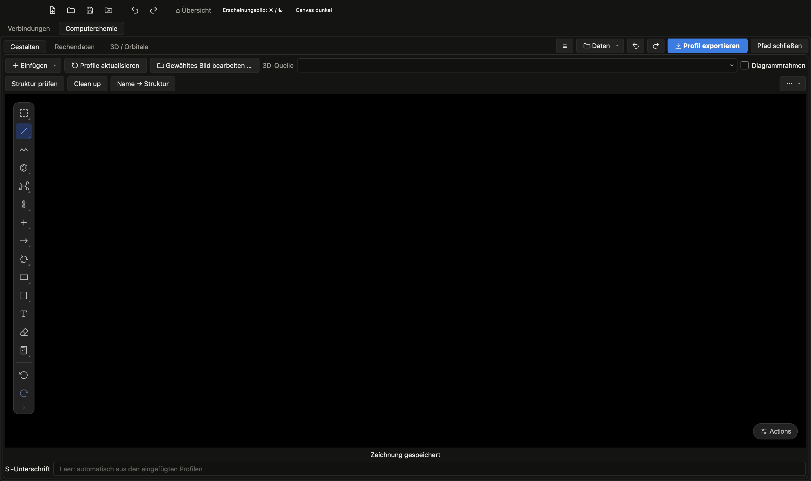
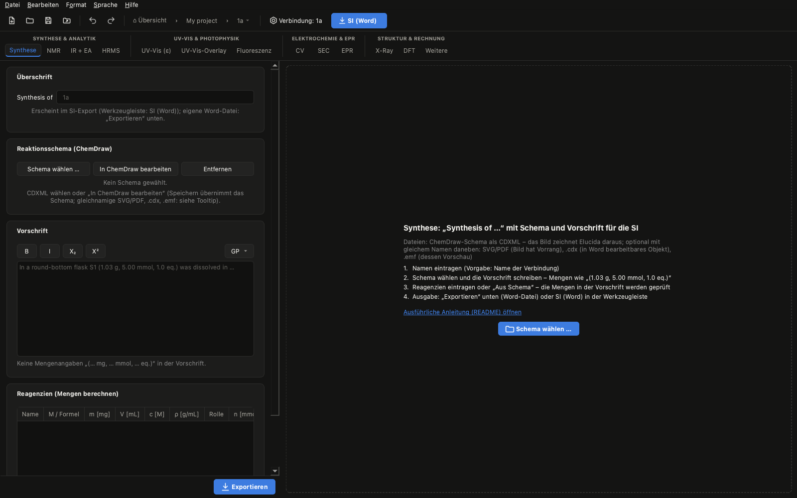
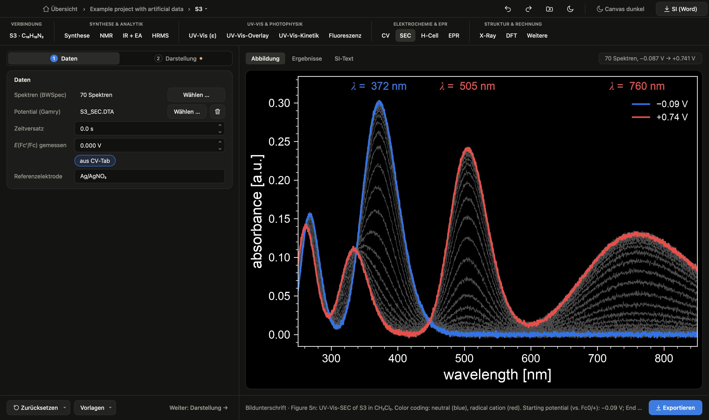

  <picture>
    <source media="(prefers-color-scheme: dark)" srcset="assets/icon-dark.png">
    
  </picture>

<h1 align="center">Elucida</h1>

  <b>Von der Synthese zur Supporting Information.</b> 
  Analytik neuer Verbindungen auswerten und publikationsreife Abbildungen samt vollständiger SI in Word erhalten.

  
  
  

  <a href="#herunterladen">Herunterladen</a> &nbsp;·&nbsp;
  <a href="#abläufe">Abläufe</a> &nbsp;·&nbsp;
  <a href="docs/manual.de.md">Handbuch</a> &nbsp;·&nbsp;
  <a href="CHANGELOG.de.md">Änderungen</a> &nbsp;·&nbsp;
  <a href="README.md">English</a>

  

## Was es kann

- **Ein Ort je Verbindung.** Spektren, Strukturen und Rechnungen liegen in einem Verbindungsordner; ein Projekt fasst die Verbindungen eines Papers zusammen und zeigt, was noch fehlt.
- **Abbildungen fürs Paper.** Ein einheitlicher Origin-Stil, PDF und SVG als Vektorgrafik, 16 × 11 cm für eine halbe A4-Seite.
- **Die SI schreibt sich selbst.** Charakterisierungsabsatz, Unterschriften, Auswertungstext und Kristalldaten gehen direkt nach Word, mit Vorlagen für Wiley, ACS, RSC und Nature.
- **Rohdaten fürs Repositorium.** Datenpakete für TUDOdata und ähnliche Dienste, Laborkürzel und Daten entfernt.
- **Direkt in der App zeichnen.** Der eingebaute Editor (Octet Draw) kann Strukturen, Schemata und Reagenzientabellen; ChemDraw-Dateien funktionieren weiter.

| Bereich | Tabs | Das Wichtigste |
|---|---|---|
| **Synthese & Analytik** | Synthese · NMR · IR + EA · HRMS | Zeicheneditor, Mengenprüfung, Mnova- und TopSpin-Daten, OPUS, Bruker `.d` |
| **UV-Vis & Photophysik** | UV-Vis (ε) · Overlay · Fluoreszenz | Lambert-Beer-Fit mit Konfidenzintervall, TD-DFT-Overlay, ORCA ESD |
| **Elektrochemie & EPR** | CV · SEC · EPR | E½, Nicholson, Randles-Ševčík, UV/Vis/NIR-SEC, S = ½-Fit, thermischer Zerfall |
| **Struktur & Rechnung** | X-Ray · DFT · Reaktionspfade | ORTEP im Mercury-Stil, ORCA und Gaussian, Orbitale, Multireferenz, Energieprofile |

## Abläufe

**Von der Verbindung zur SI**

1. **Neue Verbindung** auf dem Startbildschirm, dann **Verbindung …** für Name und Struktur: zeichnen oder eine ChemDraw-Datei laden.
2. Dateien ins Fenster ziehen; Elucida sortiert sie in den richtigen Tab.
3. Links einstellen, rechts die Abbildung sehen. Labels, Strukturen und Insets lassen sich ziehen.
4. **SI (Word)** sammelt alles Fertige und nennt, was noch fehlt.

**Vom Projekt zum Paper**

**Projekt** anlegen, Verbindungen hinzufügen und der Checkliste folgen. **Gesamt-SI** schreibt Titelseite, Verzeichnis und Kapitel, **Datenpakete** den Datensatz.

**Reaktionspfade über mehrere Verbindungen**

Projekt → **Computerchemie**: Rechnungen hineinkopieren, dann Profile, Moleküle und Orbitalansichten auf einer freien Zeichenfläche anordnen. Diagramme sind maßstäblich, solange du nicht ausdrücklich schematisch wählst, und gehen in die Gesamt-SI. Mit Zugang zu einem Slurm-Cluster zeigt der Reiter auch deine Jobs und holt Ergebnisse direkt ins Projekt ([Einrichtung](docs/manual.de.md#cluster-anbindung)).

**Spektroelektrochemie ohne Zeitstempel**

Zusammengeführte UV/Vis/NIR-Exporte enthalten keine Zeiten. Elucida zeigt sie nach Nummer und ordnet Potentiale erst zu, wenn du Zeitplan oder Tabelle bestätigt hast; die Herkunft steht dann in der SI.

Schritt für Schritt mit Bildern: [Synthese bis SI](docs/anleitungen/synthese-bis-si.de.md) · [UV-Vis ε](docs/anleitungen/uvvis-epsilon.de.md) · [CV und SEC](docs/anleitungen/elektrochemie.de.md) · [EPR](docs/anleitungen/epr.de.md) · [Kristallstruktur und DFT](docs/anleitungen/struktur-dft.de.md)

Keine Daten zur Hand? **Hilfe → Beispielverbindung öffnen** füllt alle Tabs mit künstlichen Daten.

## Screenshots

<table>
  <tr>
    <td width="50%"> Reaktionspfade</td>
    <td width="50%"> Projekt mit Checklisten</td>
  </tr>
  <tr>
    <td> Synthese</td>
    <td> Spektroelektrochemie</td>
  </tr>
</table>

## Herunterladen

Die Datei für dein System aus dem [aktuellen Release](https://github.com/robinesken97/elucida/releases/latest) laden und entpacken.

| System | Datei | Starten |
|---|---|---|
| Windows | `Elucida-windows-x64.zip` | `Elucida\Elucida.exe` |
| macOS, Apple Silicon | `Elucida-macos-arm64.zip` | `Elucida.app` |
| macOS, Intel (ab macOS 14) | `Elucida-macos-x64.zip` | `Elucida.app` |
| Linux | `Elucida-linux-x64.AppImage` oder `.tar.gz` | ausführbar machen, dann starten |

<b>Erster Start: Die App ist nicht signiert</b>

- **Windows:** „Weitere Informationen“ → „Trotzdem ausführen“. Den ganzen Ordner `Elucida` zusammenlassen.
- **macOS:** `Elucida.app` in „Programme“ ziehen und einmal öffnen. Dann Systemeinstellungen → Datenschutz & Sicherheit → „Dennoch öffnen“.
  Oder im Terminal: `xattr -dr com.apple.quarantine /Applications/Elucida.app`
- **Linux:** `chmod +x Elucida-linux-x64.AppImage`. Braucht `fuse3`, sonst `--appimage-extract-and-run` anhängen. Ab Ubuntu 22.04.

Elucida prüft einmal am Tag auf neue Versionen. Zum Aktualisieren die App ersetzen; Verbindungen, Projekte und Einstellungen bleiben. Früher hieß es Spectravolt und UVVisTool, alte Daten werden automatisch übernommen.

## Dokumentation

- [Handbuch](docs/manual.de.md): alle Tabs und Einstellungen, unterstützte Daten, Probleme, Bauen aus dem Quellcode
- [Änderungen](CHANGELOG.de.md)

## Lizenz

[AGPL-3.0](LICENSE), ohne Gewährleistung. Mitgelieferte Bibliotheken und ihre Lizenzen stehen im [Handbuch](docs/manual.de.md#lizenz). Der Zeicheneditor basiert auf [Octet Draw](https://github.com/SamChemMan/Octet-Draw) (Apache-2.0).
