**English** | [Deutsch](README.de.md) · [Changelog](CHANGELOG.md)

# Elucida – from synthesis to SI

<p align="center"><picture><source media="(prefers-color-scheme: dark)" srcset="assets/icon-dark.png"></picture></p>

Elucida turns the analytical data of new compounds into a finished **Supporting Information**: evaluation and
publication-ready figures for synthesis, NMR, IR, HRMS, elemental analysis, UV-Vis, fluorescence, cyclic voltammetry,
spectroelectrochemistry, EPR, X-ray and DFT – exported to Word in the layout of a real SI.

- **Compounds and projects:** a compound folder collects all data of one compound; a project groups the compounds of a
  paper, shows what is still missing for each of them and writes the **complete SI** (title page, table of contents,
  chapters as in a typical SI; templates for Wiley, ACS, RSC and Nature) and the **raw-data packages** for a repository
  such as TUDOdata (lab codes and dates removed).
- **Figures** in a consistent Origin-like style, PDF/SVG as vector graphics, 16 × 11 cm for half an A4 page; SI texts
  (characterisation paragraph, captions, data processing) are written alongside.
- Light and dark theme, German and English; Windows, macOS and Linux.

<p align="center">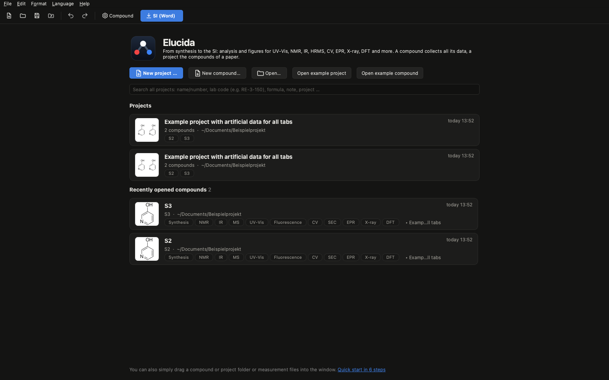</p>

### At a glance

| Tab | What it does |
|---|---|
| **Synthesis** | "Synthesis of …" with the ChemDraw scheme (editable ChemDraw object in Word), procedure with formatting, amount check (mmol/eq./yield against the reagent table) |
| **NMR** | Spectra from MestReNova (SVG or EMF), TopSpin raw data sorted by experiment, nucleus from the axis, NMR line from the Mnova report with assignments, structure placed automatically, Bruker parameters, two spectra per page in Word |
| **UV-Vis (ε)** | Beer–Lambert fit of dilution series → ε (or a) with confidence interval; Origin-style figure with structure and cuvette photo; Excel report; UV-Vis line for the SI |
| **UV-Vis overlay** | Measured spectra, TD-DFT (ORCA/Gaussian, SOC, triplets) and SEC series in one figure, normalised or as ε |
| **Fluorescence** | Absorption and emission, Stokes shift, photos in daylight and under UV |
| **CV** | Gamry files, E½/ΔE_p, baseline, Nicholson ratio, Randles–Ševčík with CI, reference to Fc⁺/Fc, SI text |
| **SEC** | Spectra series with potential from the potentiostat, difference spectra, apparent Nernst fit |
| **EPR** | Bruker BES3T, dark spectrum, baseline, S = ½ fit, EasySpin import, kinetics and thermal decay |
| **HRMS** | HRMS line from the mass-spectrometry report or Bruker raw data (.d): chromatogram with selectable LC range, averaged spectrum, peak by click, calculated isotope pattern |
| **IR + EA** | IR peak list from Bruker OPUS (file or PDF) and the elemental-analysis line, ready for the SI |
| **X-Ray** | CIF → rotatable ORTEP figure in the Mercury style (shaded ellipsoids, labels per atom), bond lengths/angles/torsions by click with s.u. from the CIF, crystal-data table for the SI |
| **DFT** | xyz, ORCA 6 and Gaussian outputs: renumber atoms by click or like a template (other geometry or CIF), SI block with coordinates, energies and convergence (Word, two columns); orbitals from Molden or cube files drawn like IboView |

The tabs are ordered as in the SI, in four groups on top: **Synthesis & analysis** (synthesis · NMR · IR + EA · HRMS) ·
**UV-Vis & photophysics** (UV-Vis (ε) · overlay · fluorescence) · **Electrochemistry & EPR** (CV · SEC · EPR) ·
**Structure & computation** (X-Ray · DFT). An empty tab shows what it produces, which files it needs and the steps to
the result.

All exports: PDF/SVG (vector) and PNG, 16 × 11 cm by default (half an A4 page in Word). Light and dark theme;
German and English.

<table>
<tr><td width="50%" valign="top">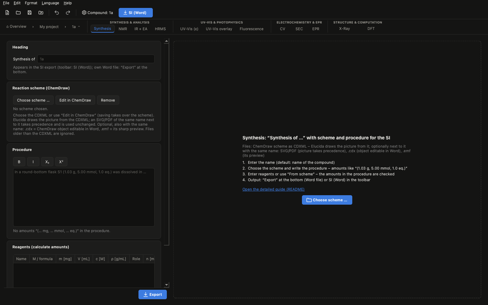<br><sub>Synthesis</sub></td><td width="50%" valign="top">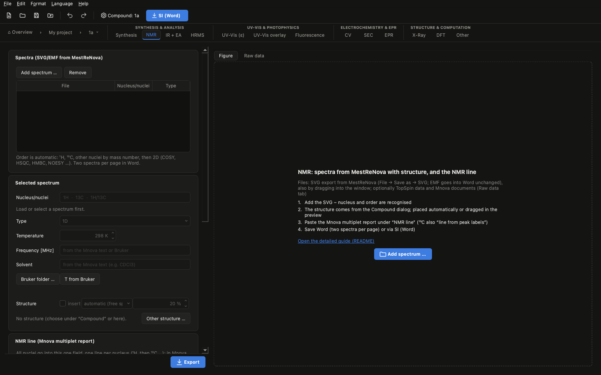<br><sub>NMR</sub></td></tr>
<tr><td width="50%" valign="top">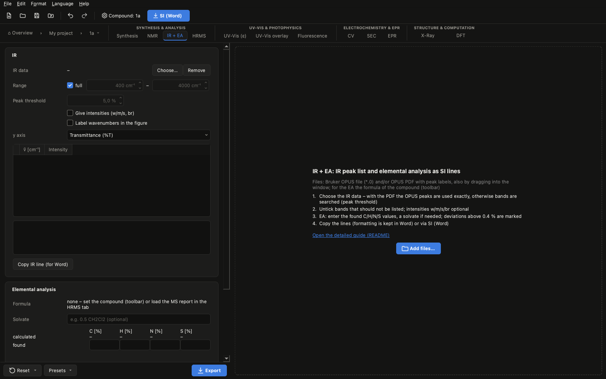<br><sub>IR + EA</sub></td><td width="50%" valign="top">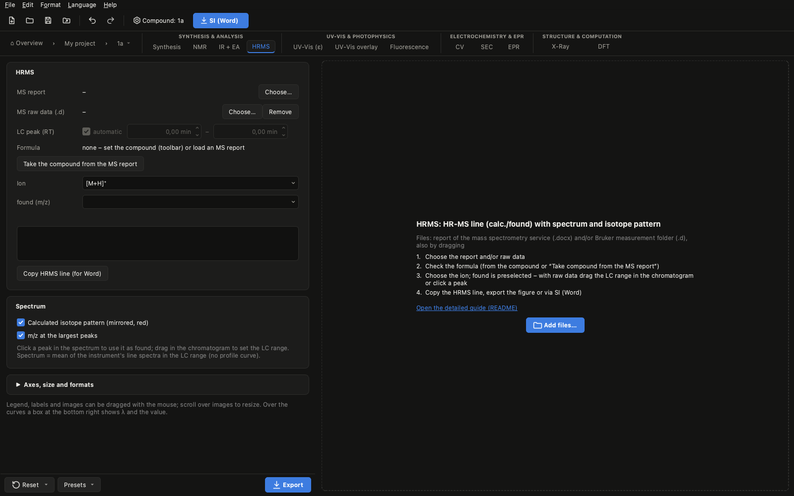<br><sub>HRMS</sub></td></tr>
<tr><td width="50%" valign="top">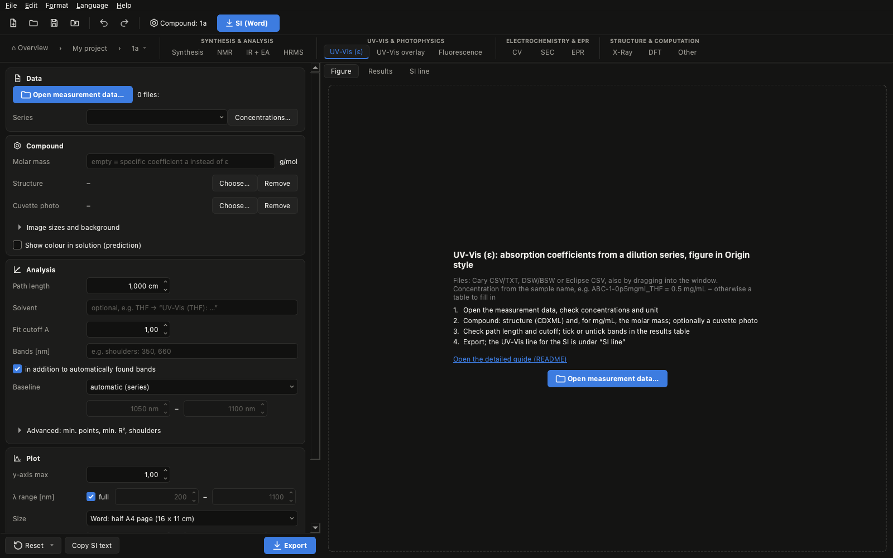<br><sub>UV-Vis (ε)</sub></td><td width="50%" valign="top">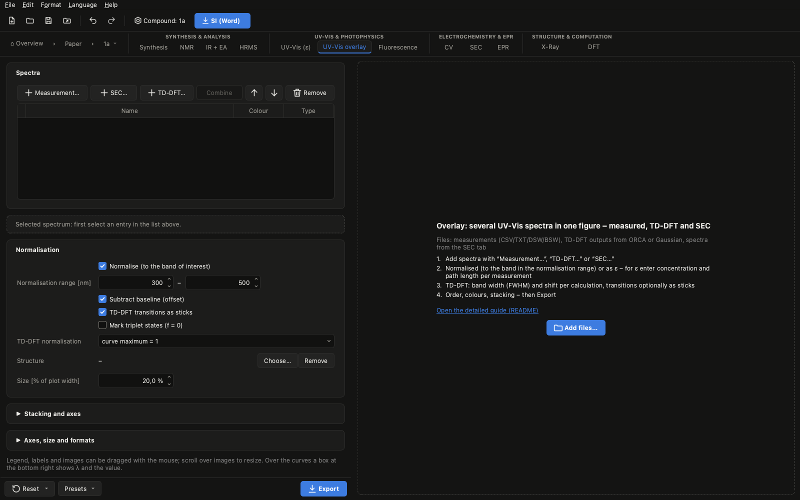<br><sub>UV-Vis overlay</sub></td></tr>
<tr><td width="50%" valign="top">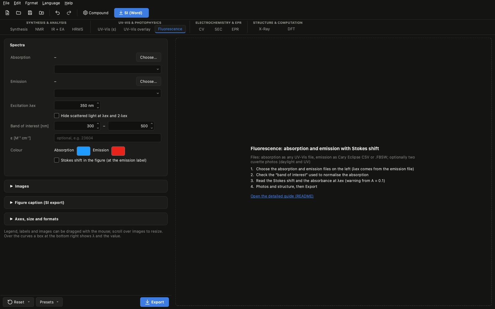<br><sub>Fluorescence</sub></td><td width="50%" valign="top">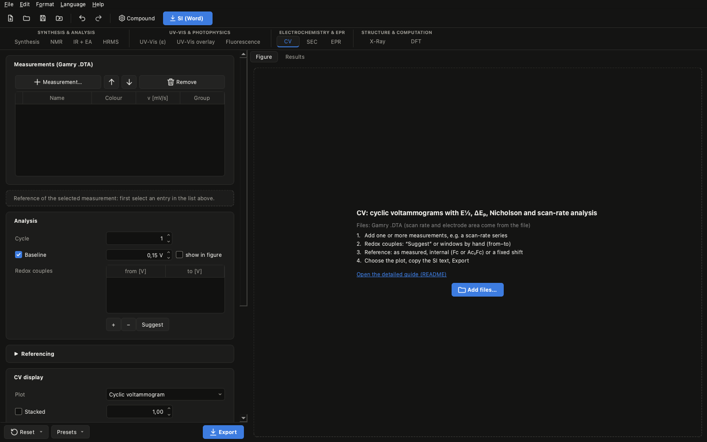<br><sub>Cyclic voltammetry</sub></td></tr>
<tr><td width="50%" valign="top">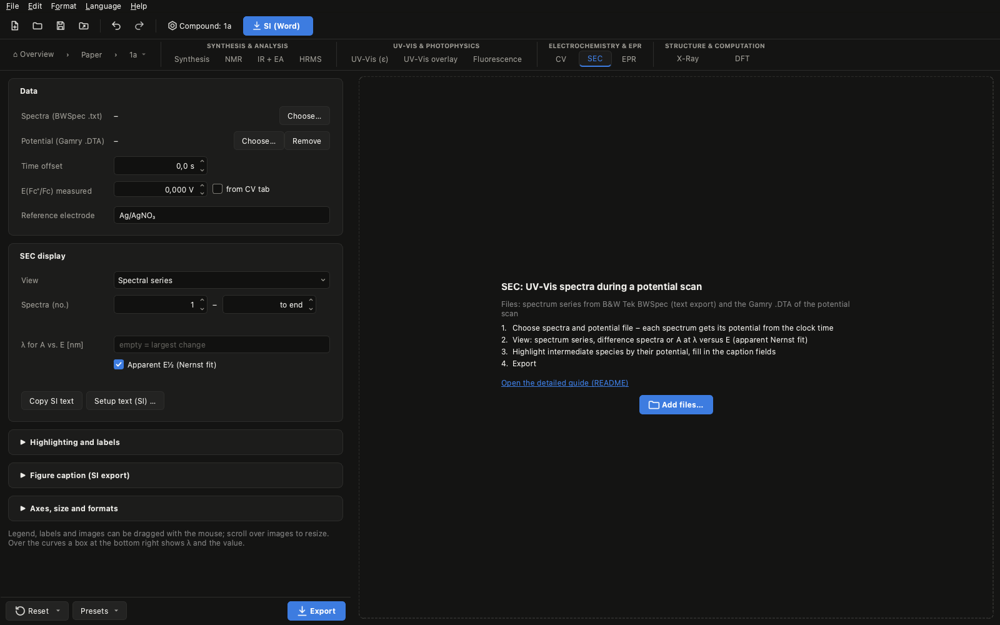<br><sub>Spectroelectrochemistry</sub></td><td width="50%" valign="top">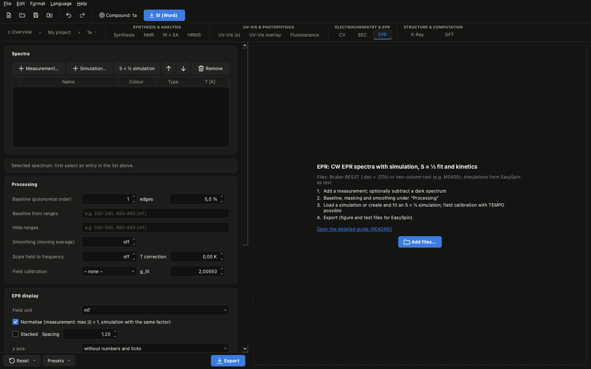<br><sub>CW EPR</sub></td></tr>
<tr><td width="50%" valign="top">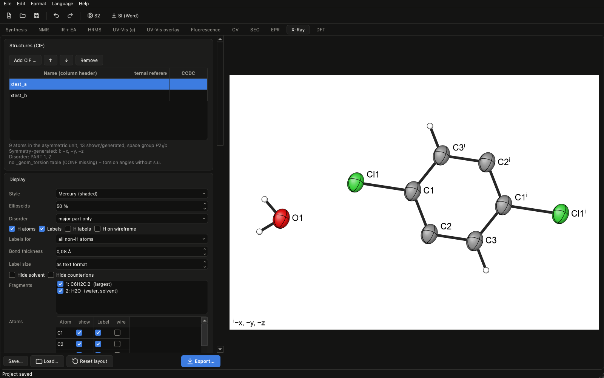<br><sub>X-Ray</sub></td><td width="50%" valign="top">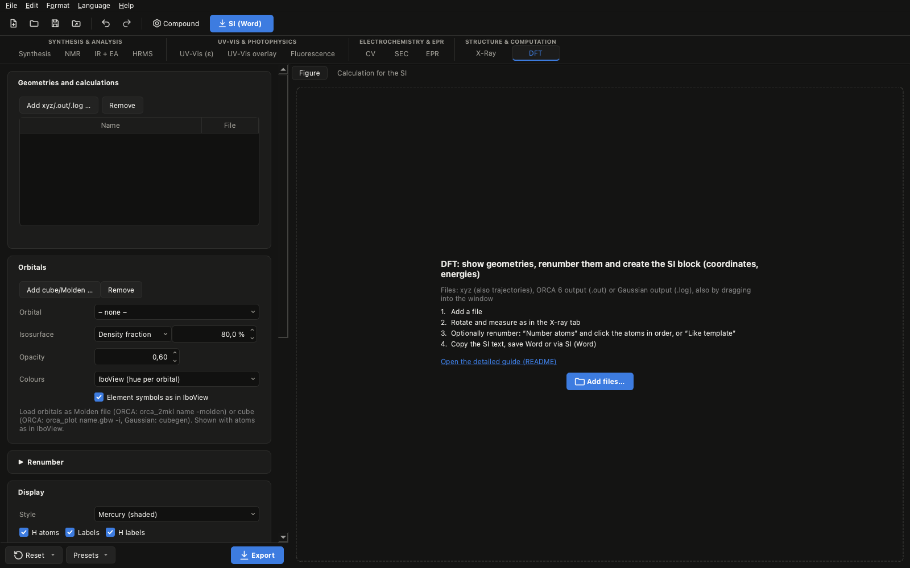<br><sub>DFT</sub></td></tr>
</table>

## Download and start

Download the file for your system from **Releases** (right-hand side of the repository page) and unzip it.

| System | File | Start |
|---|---|---|
| Windows | `Elucida-windows-x64.zip` | `Elucida\Elucida.exe` |
| macOS (Apple Silicon) | `Elucida-macos-arm64.zip` | `Elucida.app` |
| macOS (Intel, macOS 14 or newer) | `Elucida-macos-x64.zip` | `Elucida.app` |
| Linux (AppImage) | `Elucida-linux-x64.AppImage` | make executable, then double-click |
| Linux (folder) | `Elucida-linux-x64.tar.gz` | `Elucida/Elucida` |

The app is not code-signed, so the operating system will warn you on first launch:

- **Windows (SmartScreen):** "More info" → "Run anyway".
- **macOS (Gatekeeper):** drag `Elucida.app` to Applications and double-click it once (it gets blocked).
  Then System Settings → Privacy & Security → at the bottom "Open Anyway" → confirm with password/Touch ID.
  Since macOS 15 the old "right-click → Open" route no longer works. Alternatively in Terminal:
  `xattr -dr com.apple.quarantine /Applications/Elucida.app`. Not sure which Mac you have? Apple menu → About This Mac: "Chip Apple M…" = Apple Silicon,
  "Processor Intel…" = Intel. The Intel version needs macOS 14 (Sonoma) or newer.

**Updates:** on startup the app checks once a day whether a newer version is on GitHub and offers to
open the release page (Help → "Check for updates…"; can be switched off in the Help menu). To update,
download the new file and replace the old app; compounds, projects and settings are kept.

**Linux AppImage:** `chmod +x Elucida-linux-x64.AppImage` (or file properties → "Allow executing"),
then start it. It needs `fusermount` (package `fuse3`, preinstalled on most current distributions);
without it, start with `./Elucida-linux-x64.AppImage --appimage-extract-and-run`. Requires a
distribution at least as new as Ubuntu 22.04 (glibc 2.35), as does the tar.gz.

On Windows, always keep the whole `Elucida` folder together. The `.exe` does not work without the `_internal` folder next to it.

*Elucida was called **Spectravolt** before (and **UVVisTool** before that, when it only evaluated UV-Vis dilution
series). Compounds, settings and downloaded data are taken over automatically.*

## Quick start: from an empty compound to the SI

Elucida has two levels: a **compound** is a folder with all data of one compound, a **project** groups the compounds of
a paper (complete SI, dataset; see the next quick start). Every compound belongs to a project: it lives in the
project folder.

1. **Create a compound:** **New compound…** on the welcome page (or **File → New compound…**) first asks for the project
   (a recent one, another one or a new one), then for the name; inside a project **New compound** on its page. All
   files you load are copied into it; it is saved automatically.
2. **Set the compound:** **Compound …** in the toolbar: name (e.g. the sample number) and the ChemDraw file (CDXML).
   Formula and molar mass are taken from it. This is the default for all tabs and the SI. No ChemDraw file yet?
   **Edit in ChemDraw** opens the empty file that every compound already has – draw, save, and Elucida takes over the
   structure with formula and molar mass by itself (the same for the reaction scheme in the synthesis tab).
3. **Load data:** simply drag files into the window – Elucida puts them into the right tab: CIF → **X-Ray**, SVG from
   MestReNova → **NMR**, xyz/ORCA/Gaussian/Molden/cube → **DFT**, MS report (.docx) or Bruker .d → **HRMS**, OPUS file →
   **IR + EA**, UV-Vis measurement data (CSV, DSW/BSW) → **UV-Vis (ε)**. For CV, SEC, EPR, overlay and fluorescence use
   **Add files…** in the tab. An empty tab shows what it needs and where it comes from.
4. **Evaluate:** settings on the left (rarely used ones are collapsed; **"(changed)"** shows where something differs
   from the default), the figure on the right. Labels, structures and insets can be dragged with the mouse.
   **Ctrl+Z** / **⌘Z** undoes everything.
5. **Export:** **Export** at the bottom of the tab writes the figure (PDF/SVG/PNG, 16 × 11 cm for half an A4 page) and
   the data into the compound folder (`figures/`, `tables/`, `SI/`).
6. **Create the SI:** **SI (Word)** in the toolbar collects everything that is ready in one Word file: synthesis,
   characterisation paragraph (m.p., NMR, IR, HR-MS, UV-Vis, elemental analysis), figures two per page, crystal data
   and DFT coordinates. Afterwards the program lists what is still missing.

## Quick start: a project with several compounds

1. **Create a project:** **New project…** on the welcome page (or **File → New project…**) and choose a
   folder – empty, or one that already contains compounds (they are added automatically).
2. **Fill in the details:** **Details …** – title of the paper (title page of the SI; italics with `<i>…</i>`), authors,
   affiliation, DOI of the dataset, related publication, descriptions, license. They end up in `README.txt` of the
   dataset and on the title page.
3. **Add compounds:** **New compound** creates a subfolder (name = compound, e.g. `6m`); click a
   compound to open it and work as in the quick start above. The path at the left of the tab bar,
   **⌂ Overview › <project> › <compound> ▾**, leads back to the project or the overview and switches directly to another
   compound of the project (also File → Back to project, Ctrl+Shift+P; File → Back to overview, Ctrl+Shift+H).
   **New group …** organises the compounds (e.g. precursors, salts, NHOs; right-click a compound → Group, or drag it
   into a group); in the complete SI the groups become sub-chapters of synthesis and NMR (2.1, 2.2 …).
   Drag the rows or use **Sort by name** to change the order – it is the order in the SI and in the dataset. The
   search field at the top of the welcome page finds compounds in all your projects (name/number, lab code such as
   RE-3-150, formula, note); Ctrl+F jumps there. Each compound shows a **checklist**: ¹H, ¹³C, 2D NMR, HRMS, IR and
   m.p. are required; for compounds marked **known from the literature** in the Compound dialog (with the reference)
   only ¹H and ¹³C. **Oil** next to the melting point gives "m.p. <25 °C".
4. **SI texts:** **SI texts …** – "Materials and Methods" (or insert the setup texts stored in the tabs) and an
   optional introduction for each chapter.
5. **Complete SI:** **Complete SI (Word) …** – choose chapters, compounds and template (group, Wiley, ACS, RSC, Nature);
   the Word file lands in `SI/` of the project.
6. **Dataset:** **Data packages (zip) …** – one zip per compound, `CompChem.zip`, `README.txt` and license text in
   `datapack/`, ready for the upload (e.g. TUDOdata).

To try it: **Help → Open example project** creates a project with two compounds (artificial data).

## Guides

Step by step through one workflow, with pictures:

- [Synthesis and characterisation to the SI](docs/anleitungen/synthese-bis-si.en.md) – scheme, procedure, NMR, IR,
  HRMS, elemental analysis, SI section
- [UV-Vis: ε from a dilution series](docs/anleitungen/uvvis-epsilon.en.md)
- [Electrochemistry: CV and SEC](docs/anleitungen/elektrochemie.en.md)
- [EPR: spectra, simulation and fit](docs/anleitungen/epr.en.md)
- [Crystal structure and DFT](docs/anleitungen/struktur-dft.en.md)

To try it without your own data: **Help → Open example compound** creates a compound with artificial data for all tabs.
**Help → Guide for this tab** (F1) opens the matching section below.

All settings of the individual tabs are described further down for reference.

## Compounds, projects, export

Everything happens in the **compound folder** (the folder button in the toolbar opens it in Finder, Explorer or the file
manager of your Linux desktop):

1. **File → New compound…** – choose the project, then the name; the compound becomes a subfolder of the project.
2. Load measurements, structures, photos and TD-DFT files from anywhere – they are **copied into the
   compound** (`data/<technique>/`, `structures/`; ChemDraw exports with the same name as a CDXML come along).
   Files that are already inside the compound are not copied again.
3. Work as usual – the compound is **saved automatically**. A backup (`.elucida/project.elucida.bak`) is made
   each time it is opened. Folders from older versions (`project.uvvis`) open as before and are saved as
   `project.elucida` from then on (the file name keeps "project" for compatibility).
4. **Export** writes directly into the compound folder (existing files are overwritten):

```
S2/
  project.elucida        settings (paths relative to the folder)
  elucida.json           summary for the Characterization program (read-only for it)
  SI/                    Word files and SI texts: S2_SI.docx, S2_NMR.docx, S2_UV-Vis_methods.txt …
  figures/               figures (PDF/SVG/PNG): S2_CV.pdf, S2_X-ray.svg, <series>_UV-Vis.png …
  tables/                tables and data files: S2_CV_results.csv, <series>_UV-Vis_report.xlsx, xyz …
  data/nmr/ data/cv/ …   copies of the measurement data, one folder per technique
  structures/            ChemDraw structures (with their exports), schemes, photos
  .elucida/              intermediate images for Word, cache, backup (hidden)
```

File names start with the name of the compound (**Compound …**; without one, the folder name). Folders appear only when
something goes into them. Folders from versions before 2.1 (`data/`, `images/`, `exports/`) open as before; their
files stay where they are, new files and exports use the new layout.

The program starts with the welcome page. Open compounds and projects via **File → Open**, **Recently opened**
or by dragging the folder onto the window. **File → Save compound copy** writes a complete copy (e.g.
an intermediate state). **Edit → Undo / Redo** (⌘Z / ⌘⇧Z, Ctrl+Z / Ctrl+Y) covers all tabs.

**File → Export data package (zip)** writes the raw data of the compound for a data repository (e.g. TUDOdata), laid
out like published datasets: `6m.zip` with `6m/NMR/1H/10/` (complete TopSpin experiments), `NMR/HSQC + HMBC/12/`,
`IR/`, `MS/` (report, Bruker .d), `UV-Vis/`, `Fluorescence/`, `CV/<solvent>/`, `SEC/`, `EPR/`; DFT and Elucida's own
figures/SI optional. X-ray (CCDC) and synthesis are not included. Every file can be deselected; the choice is
remembered per compound. **Lab codes** such as `RE-3-150` are found automatically and replaced – in file and folder
names by the compound (`6m`), in the contents by „Compound 6m“ (both editable) – and **dates and times are deleted**:
in all text files (CSV, Gamry DTA, EPR, TopSpin parameters, title and audit trail), in the MS report (text, file
author and dates, labels in its spectra) and in OPUS files (same length). The measured values (FID, ser, spectra) stay
byte-identical. PDF, Mnova and Bruker .d cannot be edited; if a code remains in one of them, the log names it.

Every export from the Overlay, Fluorescence, CV, SEC and EPR tabs also writes `…_data.csv` with exactly the
plotted curves (one x/y column pair per curve, values without stacking offset) – for Origin, Excel or MATLAB.

### Projects

<p align="center">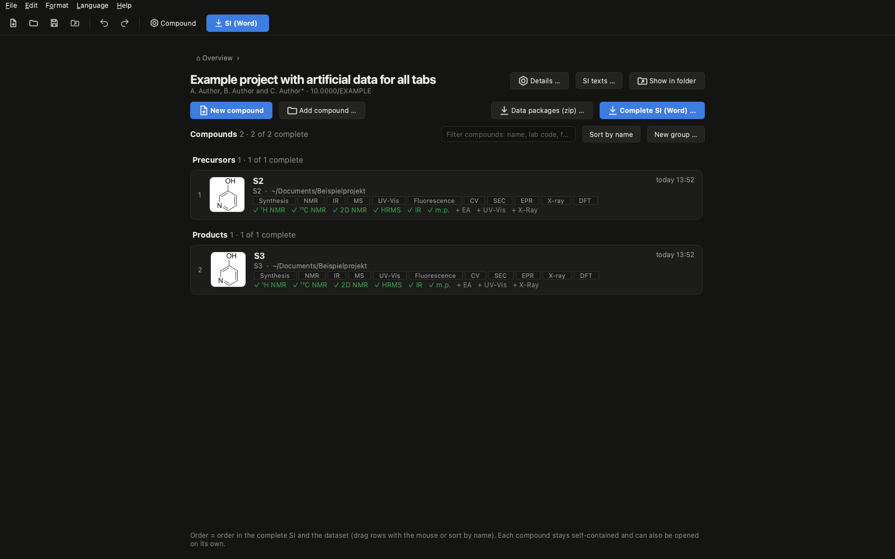</p>

**File → New project** turns a folder into a project: the parent folder for all compounds of a paper. The compounds
stay ordinary compound folders in its subfolders (each can still be opened on its own); `publication.elucida` keeps
their order, the details for the dataset and the SI texts. The project page lists the compounds with a checklist
(drag rows to reorder, **Sort by name**, right-click: move, copy, remove), **New compound** creates a subfolder, **Add compound** moves or copies one from
elsewhere into the project.

- **Move or duplicate:** right-click on a compound (project page or overview) or the menu of the compound in the path
  at the top → **Move to another project …** moves the folder; **Copy to another project …** makes an independent copy,
  e.g. when the same compound appears in two papers. Compounds from older versions without a project are offered for
  assignment when they are opened (path: "⚠ no project").
- **Search:** the field at the top of the welcome page searches all compounds of all known projects by name/number,
  lab code (e.g. RE-3-150, also from file names and procedures), formula, note, reference or project; the project page
  has a filter; Ctrl+F jumps there.
- **Move to trash …** (right-click in the overview) removes a compound or a whole project after a question with the
  number of files and the size; it can be restored from the trash.

- **Data packages (zip):** the whole dataset as on TUDOdata – one zip per compound (as above), the DFT calculations of
  all compounds in `CompChem.zip`, `README.txt` (title, authors, DOI, citation, related publication, descriptions,
  license; generated from **Details**) and the license text (CC BY 4.0 or CC0). Lab codes are assigned to the compound
  whose file names contain them.
- **Complete SI (Word):** one file with title page and table of contents, chapters as in the group's SI – 1. Materials
  and Methods, 2. Synthetic Procedures and Characterization Data, 3. NMR Spectra, 4. UV-Vis Spectroscopy, 5. EPR
  Spectroscopy, 6. Cyclic Voltammetry, 7. Spectroelectrochemistry, 8. X-Ray Characterization Data, 9. Computational
  Section (empty chapters are left out). Within each chapter the compounds follow the order of the project;
  figures two per page and numbered throughout, crystal data of all structures in common tables. **SI texts** holds
  "Materials and Methods" and an optional introduction per chapter.
- **Templates** for the complete SI: group (as the group's Angewandte SI: "Supplementary Materials for",
  Figure S1:), Wiley ("Supporting Information for", Figure S1.; Angewandte requires the SI to start with a table of
  contents), ACS ("Supporting Information for", Figure S1., pages S1, S2 …; JOC asks for a table of contents with page
  numbers), RSC ("Supplementary Information for", Fig. S1 as in RSC articles), Nature ("Supplementary Information
  for", Supplementary Figure 1 |, numbered separately from the article). Publishers hardly prescribe a layout for the
  SI, so only the title page, labels and page numbers change; chapters, font and page layout stay as in the group's
  SI. The complete SI has page numbers and a table of contents that is already filled in (estimated page numbers;
  Word updates them when opening, ONLYOFFICE via "Update table of contents"). The SI of a single compound keeps the
  group's style.

## Compound

A compound folder usually stands for **one compound** (or one comparison). **Compound …** in the toolbar sets its name/sample
number, the ChemDraw file, formula and molar mass (taken from the CDXML, isotopes such as D included, editable). This is
the default for the ε tab (structure, molar mass), the fluorescence tab, IR + EA and HRMS; tabs that already have their own
structure or molar mass keep it. The name appears in the window title. The melting point entered there starts the
characterisation paragraph of the SI section.

**Edit in ChemDraw:** every compound folder already contains empty ChemDraw files for the structure and the reaction
scheme (`structures/<name>.cdxml`, `…_scheme.cdxml`, document settings ACS 1996). **Edit in ChemDraw** (Compound dialog,
synthesis tab) opens the file in ChemDraw; as soon as you save there, Elucida takes over the structure (formula, molar
mass, pictures) or the scheme by itself.

## SI section (Word)

**SI (Word)** in the toolbar (or **File → Export SI section (Word) …**) asks which parts to include
(characterisation, NMR spectra, figures of all tabs, X-ray, DFT) and collects everything that is ready for the compound into
`SI/<compound>_SI.docx`, in the style of the SI: one characterisation paragraph **m.p. …; IR …; HR-MS …;
UV-Vis …; Elemental analysis …** (melting point from **Compound …**, UV-Vis line from the **SI line** page of the
UV-Vis (ε) tab: *λ*_max: 331 nm (*ε* = 8440 cm⁻¹ M⁻¹), … with bands as in the figure, ascending, ε rounded to the
precision of its standard error), followed by the crystal-data table, the selected parameters and the captions of the
X-Ray tab and the DFT calculations (two columns). Parts that are still missing are listed after the export. Numbers
and units are joined by non-breaking spaces, so Word never separates "298 nm" or "ε = 8440".

**Figures:** the figures of all tabs with data (UV-Vis (ε) per series, IR, HR-MS, overlay, fluorescence, CV, SEC, EPR)
and the NMR spectra always come **two per page**; where figure and caption would not fit, both figures of the page are
scaled down (aspect ratio kept). Captions follow the SI: UV-Vis "UV-Vis spectra of **X** in THF, measured in 0.1 cm
quartz cuvettes." (solvent under Analysis in the ε tab); CV, SEC and EPR take scan rate, iR compensation, reference,
potential range, band, g and couplings from the data and concentration, solvent, electrolyte or species from the
**Figure caption (SI export)** box of the tab. **Setup text (SI) …** next to "Copy SI text" stores your general
instrument/setup paragraph on this computer only (not in the compound, not in the repository); it is placed before the
figures of that tab. Word files open in normal mode (Word 2013+).

**SI text on the fits:** every tab that fits something (UV-Vis (ε), CV, SEC, EPR) has a **Copy SI text** button: an
English methods paragraph describing exactly the evaluation steps used, with their settings (e.g. ε: baseline window,
OLS model, cut-off, SE/95% CI; EPR: baseline polynomial, field calibration, S = 1/2 fit, kinetics), to append to the
setup paragraph of the matching SI section, followed by the results. The same text is written as `…_methods.txt` on
export, and **SI (Word)** can add all of them as a section "Data processing and fitting" (one paragraph per technique)
behind the figures – so it is documented how the raw data were processed.

**Font of the Word exports:** selectable in the SI (Word) dialog (default Arial as in the group's SI) and used for all
Word exports. The size stays 11 pt, because "two figures per page" is calculated with this line height.

## Synthesis tab

"Synthesis of **Name**" (the name defaults to the compound or folder), the reaction scheme and the procedure, exported
to Word or as part of the SI section.

- **Scheme:** **Edit in ChemDraw** opens the empty scheme file of the compound (saving is taken over automatically), or
  choose an existing CDXML. Next to it (same name, same folder) you can save from ChemDraw: **SVG/PDF** (picture
  taken unchanged), **.cdx** (the scheme becomes an editable ChemDraw object in Word – double-click opens ChemDraw; Word
  cannot do this with a CDXML) and **.emf** (sharp vector preview of that object). Without an SVG/PDF the scheme is drawn
  from the CDXML coordinates, including arrow and conditions.
- **Procedure** with bold, italic, sub- and superscript.
- **Amount check:** amounts written as "(1.03 g, 5.00 mmol, 1.0 eq.)", "(99%)" are compared with the reagent table
  (M or formula, mass, volume, concentration, density); deviations beyond the rounding of the given digits are flagged.
  **From scheme** fills the table with the reactants (first = reference 1.0 eq.), reagents above/below the arrow (e.g.
  K2CO3), solvents and the product; **Insert amounts** inserts the calculated bracket of the selected row at the cursor.

## NMR tab

- **Spectra:** SVG exports from MestReNova (drag and drop). The nucleus is read from the axis label ("δ ¹H (ppm)");
  if it is missing, enter it. Order: ¹H, ¹³C, other nuclei by mass number, then 2D (COSY, HSQC, HMBC, NOESY …).
- **Structure** in every spectrum as vector graphics: placed automatically in a free spot (nothing covered), or top
  left/centre/right, or dragged in the preview; the mouse wheel over the structure changes its size, the same for all
  spectra.
- **NMR line:** paste the Mnova multiplet report ("Multiplets → Copy", journal format) – all nuclei into the one
  field, one line per nucleus. **Line from peak labels** builds the ¹³C (or other) line from the labelled peaks of the
  selected spectrum; a solvent signal labelled with its name ("77.16 CDCl3") is dropped. Assignments per signal in the
  table (*italic*, _{sub}, ^{sup}).
- **Temperature** 298 K by default, or from the Bruker experiment folder (acqus, with an overview of the parameters
  such as frequency, O1P, pulse program, scans).
- **Raw data** (tab next to the figure): **TopSpin data …** takes an experiment, a dataset (10, 11, …) or a folder with
  several datasets – also by drag & drop – and copies each experiment completely into the compound, sorted by kind
  (`data/nmr/1H`, `13C`, `DEPT135`, `HSQC` …). If exactly one experiment fits a spectrum, it is assigned automatically
  (parameters, temperature). **Mnova documents** (`.mnova`) are kept in `data/nmr/mnova`; double-click opens them.
- Spectra can also be **EMF** from Mnova: they go into Word unchanged (vector, without the inserted structure); for the
  preview and the structure use SVG.
- **Word:** two spectra per page, "Figure Sn: ¹H NMR (500 MHz, CDCl₃, 298 K) of **Name**."

## IR + EA tab

- **IR:** load a Bruker **OPUS** file (`*.0`, spectrum) and/or the **OPUS PDF** print-out (peak labels). With the PDF the
  values are exactly the OPUS peak list; with the file alone Elucida picks the bands itself (adjustable
  sensitivity). Range freely selectable (default: the whole measured range); untick bands that should not be listed;
  intensities w/m/s/br optional. Output: **IR** [cm⁻¹]: ṽ = 2961, 2866, … (integers, descending).
- **HRMS:** load the **Word report** of the mass-spectrometry department; formula, ionisation, polarity and the measured
  m/z (from the embedded spectra) are read out. The formula comes from the compound (warning if the report
  says something else), the ion is selectable ([M+H]⁺, [M+Na]⁺, [M]⁺, [M−H]⁻ …), and the closest measured m/z is
  preselected. calc. includes the electron mass; four decimals: **HR-MS-ESI(+)** calc. C₁₈H₂₁N₂⁺ [M+H]⁺ 265.1699;
  found 265.1703. The deviation in ppm is shown for checking (found − calc). The formula is checked against the
  **ChemDraw object embedded in the report**; without a compound set, **Take the compound from the MS report**
  sets name, formula and molar mass from it (the drawing is then an RDKit substitute – use your own CDXML for figures).
- **HRMS from raw data:** alternatively (or in addition) load the Bruker **measurement folder** (`.d`, e.g. timsTOF;
  button or drag & drop). Elucida reads the instrument's line spectra itself (no Bruker software needed, also on
  macOS) and averages the ion over the **LC peak** (automatic: contiguous scans with ≥ 50 % of the maximum, or a
  chosen RT range). found = intensity-weighted mean; the number of scans, the range of the single scans and their
  scatter (± mDa/ppm) are shown, because single scans can differ in the 4th decimal. With a report loaded its value
  stays preselected and the raw-data mean is selectable. Only `analysis.baf` and `analysis.sqlite` are copied into the
  compound.
- **Elemental analysis:** formula from the compound, optionally plus a solvate (`0.5 CH2Cl2`, several
  separated by commas); calculated values with conventional mean atomic masses, enter the found C/H/N/S values.
  Deviations above 0.4 % are flagged (the usual limit of the journals). Output, built like the HR-MS line: **Elemental analysis**
  (%) calc. C₁₈H₂₀N₂: C 81.78, H 7.63, N 10.60; found C 81.52, H 7.70, N 10.41. The elemental analysis is always
  optional (not reported as missing).
- **Copy to clipboard** keeps bold, sub- and superscripts when pasting into Word. Export writes the spectrum figure
  and `…_SI.txt` with all lines.

## HRMS tab

- Load the **Word report** of the mass-spectrometry department and/or the Bruker **measurement folder** (`.d`); see
  the bullet points below for what is read from each. With raw data the tab shows:
  - a **chromatogram** (total ion current grey, ion current of the target ion red, ± 10 ppm); the blue band is the
    LC range used for the spectrum – **drag with the mouse** to choose another range;
  - the **averaged spectrum** over this range (mean of the instrument's line spectra) with m/z at the largest peaks
    and the **calculated isotope pattern** of the ion mirrored below (red; fine structure that the TOF does not
    resolve, e.g. ¹³C/¹⁵N, merged); the measured/calculated isotope ratios (M+1, M+2 …) are listed;
  - **click a peak** to use it as *found* (besides the report value and the LC-peak mean).
- Export: spectrum figure (PDF/SVG/PNG), `…_sticks.csv` (measured and calculated) and `…_SI.txt`.
- Older compounds: the MS data of the former IR + MS tab are taken over automatically.

## UV-Vis (ε) tab

Molar absorption coefficients (ε) from UV-Vis dilution series (Beer–Lambert: A/d vs. c) with standard error and 95 %
confidence interval, and a figure in the Origin style: spectra, λ/ε labels at the bands, an inset with the linear
regressions and R², the structure and a photo of the cuvette with the background removed.

1. **Open data:** File → Open measurement data, or drag files onto the window. Cary CSV/TXT exports and the
   instrument's own **.DSW/.BSW** files are supported. **Several files at once** (e.g. each
   concentration measured separately) are combined into one data set.
2. **Concentrations:** Concentrations are read from the sample names, e.g.
   `ABC-1-0p5mgml_THF` → series `ABC-1`, 0.5 mg/mL. Recognised units are
   `mgml`/`mg_ml`/`mg/ml`, `mM`, `uM`/`µM`; `p` stands for the decimal point.
   - If the names contain no concentrations (e.g. `c0` … `c4`), a table opens where you enter them.
     Choose the **unit** explicitly (mM, µM, mg/mL, M) – nothing is pre-selected.
   - "Fill dilution series" fills the selected rows (or all of them) with start, start/factor, … from top to bottom.
     The start value always belongs to the **top** selected row (usually the stock solution).
   - Samples without a value, e.g. a blank, are ignored.
   - The "Series" column lets you split several compounds within one file.
   - You can change the values later with the **Concentrations…** button.
3. **Compound (per series):**
   - **Structure:** CDXML, SVG, PDF or an image file. With CDXML the **molar mass is calculated**
     automatically (isotopes such as D included); the formula is shown for checking. For the
     drawing to look **exactly as in ChemDraw**, also save the structure from ChemDraw as SVG, PDF
     or PNG with the same name next to the CDXML (e.g. `6g.cdxml` + `6g.svg`): the drawing is then
     taken unchanged from that file and the molar mass from the CDXML. Without such a file the
     drawing is regenerated (ACS 1996 style) and may differ from ChemDraw.
   - **Cuvette photo:** HEIC (iPhone), JPG, PNG and more. The background is removed automatically.
   - **Colour in solution (prediction, optional):** calculated from the spectrum – transmission 10^(−A)
     under daylight, CIE 1931 colorimetry, shown as a colour patch below the photo. Concentration and
     path length can be chosen (Beer–Lambert; default: highest measured concentration in 1 cm).
     Fluorescence and scattering are ignored, screens are not calibrated; display only, not in the figure.
     On first use the app offers a one-time download (~180 MB) of the AI model.
   - **Molar mass:** only needed for concentrations in mg/mL. Filled in automatically from CDXML,
     otherwise enter it by hand. Without it the tool reports the specific absorption coefficient
     *a* in L g⁻¹ cm⁻¹ instead of ε, and the field is marked red. For mM/µM the molar mass is not used.
4. **Analysis:** set path length and fit cutoff. Bands are found automatically; additional bands
   (e.g. shoulders) can be entered as a list ("in addition to automatically found" keeps both), and
   **"Find shoulders automatically"** adds shoulders (in the figure optionally marked "(sh)"); the labels can carry
   indices **λ₁/ε₁ …**.
   In the results table, the tick next to λ decides whether a band appears in the figure, and a
   double-click on **"Cutoff A"** sets an own cutoff for that band (e.g. to include a point just
   above A = 1). Bands with an own cutoff are highlighted; optionally, excluded points are shown as
   open symbols in the inset.
5. **Layout:**
   - **Drag** the inset, structure, cuvette and every λ/ε label with the mouse.
   - **Scroll** over the inset or an image to resize it, or use the "Size [% of plot width]" fields.
   - **Reset ▾** → "Reset layout" restores the automatic arrangement; "Reset all to defaults" sets all settings of
     the tab (display and analysis) back to the defaults – data and measurement details (files, reference/calibration,
     path length, entered values, caption, export size) stay, and Undo brings everything back. X-Ray and DFT also have
     "Reset display to defaults" next to "Reset view" (style, ellipsoids, bond thickness, labels, hidden atoms …).
   - **Hover** over the spectra: a box at the bottom right shows λ and A of the nearest data point (and its
     concentration), marked with a red circle in the preview only – handy to check the data.
     **Double-click** a point to add its wavelength as a band; double-click it again to remove it.
     The overlay and fluorescence tabs show λ and the plotted value the same way.
6. **Export:** File → Export (or the button). This writes the chosen formats (PDF/SVG/PNG),
   `<series>_results.csv` and the Excel report for **all** series into the compound (see below).

### What happens automatically during the analysis

- **Baseline** ("automatic (series)", default): the window is placed where the most concentrated
  sample absorbs least. Only the part of the window value that does *not* scale with concentration
  (instrument/cuvette offset) is subtracted. A residual proportional to c is treated as real
  absorption and kept. "automatic (simple)" subtracts the full window value. The baseline always
  uses the full data range, independent of the displayed λ range.
- **Fit cutoff:** points above the cutoff (default A = 1.0) are excluded from the fit.
- **Bands:** found automatically within the displayed λ range, or entered as a list.
- **Rounding:** ε (M⁻¹ cm⁻¹) is never shown with decimals; it is rounded to the precision its
  standard error supports. The results CSV keeps the full values.
- **Warnings** (results table and log): fewer than 4 fit points, significant intercept (> 2σ),
  R² below the threshold (default 0.98, adjustable under Analysis → "min. R² for figure"; 0 = show
  all; the band stays in the table – R² cell marked red –, CSV and Excel report but is not shown in the
  figure), fewer than 3 points (then no ε at all). With 4 points, R² alone says little: check the
  95 % confidence interval in the Excel report before lowering the threshold.

### Excel report

For every series, `<series>_report.xlsx` contains:

- **Summary:** parameters (unit, molar mass, path length, cutoffs, baseline window and per-sample
  offsets), results of all bands (slope, intercept, standard errors, R², ε ± SE, **95 % confidence
  interval** from the t-distribution) and the method with all equations.
- **Spectra:** A(λ) of all samples, baseline-corrected and raw, with chart.
- **One sheet per band:** data points, "in fit" flag (1/0, editable), the complete regression as
  **Excel formulas** (x̄, ȳ, Sxx, Sxy, m, b, RSS, s, SE, R², ε, t, CI) next to the program's values with
  their difference, residuals and a chart (A/d vs c with regression line).

Blue numbers are measured values or tool results, black cells are formulas. Changing a flag in "in
fit" recalculates the band in Excel.

## UV-Vis overlay tab

Compare several spectra in one figure, measured and calculated:

- **Measurement…** adds spectra from CSV/TXT/DSW/BSW files (one entry per sample);
  **TD-DFT…** adds ORCA (4–6) or Gaussian output files.
- **SEC…** takes spectra from the SEC tab, e.g. to compare a reduction or oxidation with the isolated UV-Vis
  spectrum and TD-DFT. As a **series** (all spectra or only start and end, range by potential) everything is
  normalised with **one common factor** to the start spectrum, so intensity ratios and isosbestic points are kept;
  intermediate spectra grey, start blue, end red, legend with the potentials. **Single spectra** are normalised each on
  their own (shape comparison). SEC is never shown as ε: path length and converted concentration in the thin-layer
  cell are not known exactly.
- TD-DFT transitions are broadened with Gaussians in energy (FWHM and an empirical energy shift
  can be set per calculation, default 0.3 eV); ε follows from the oscillator strengths
  (ε(ν̃) = 1.306·10⁸ · Σ f/σ · exp(−((ν̃−ν̃ᵢ)/σ)²), as in GaussView). Transitions can be shown as sticks.
- **y axis** ("Normalise" checkbox): *normalised to band* – every spectrum is scaled to its maximum within the
  normalisation range (globally or per spectrum, e.g. if the calculated band is shifted), or
  **ε [10³ M⁻¹ cm⁻¹]** – measured spectra then need concentration (and molar mass for mg/mL) and
  path length.
- Per spectrum: colour, name, **line style and width**, **scale factor and vertical offset**
  (e.g. for stacked spectra); **order** with ↑/↓ (also the legend order).
- ORCA calculations with **spin–orbit coupling**: choose "with SOC" or "without SOC" per calculation.
- **Colour in solution** per TD-DFT calculation (entry details): A = ε·c·d with the chosen broadening, default
  1 mM in 1 cm – qualitative only, TD-DFT energies are often off by 0.2–0.3 eV.
- **Triplet states** (without SOC, f = 0) can be marked as dashed marks of fixed height; they do not
  contribute to the curve (ORCA 4–6, Gaussian).
- **Combine** calculations: select two or more TD-DFT entries (Ctrl/Shift click) → "Combine". The
  transitions are merged and then broadened together; one weight per calculation (default 1 = sum,
  e.g. 0.7/0.3 for conformers). Calculations should be at the same level of theory; identical states in
  both calculations trigger a warning (they would be counted twice).
- **TD-DFT normalisation:** curve and sticks always share one scale factor (each stick is the height
  of its own Gaussian, the curve is their sum). Reference: "curve maximum = 1" or "strongest
  transition = 1"; alternatively the sticks show the oscillator strength f on a right axis.
- A **structure per spectrum**, optionally drawn in the curve colour.
- Structure with adjustable size; the legend is placed in free space and can be dragged.
- **Stacked** (as usual in papers): curves are offset vertically by a common spacing in list order
  (top of the list = top curve). "Same stacking level as the curve above" keeps e.g. a TD-DFT curve
  on the level of its measurement. The **y axis** can be shown with numbers, without numbers and
  ticks (default when stacked – offset curves make the numbers misleading) or hidden. Optionally
  the **names are written at the curves** instead of a legend, and a dashed zero line marks each level.

## Fluorescence tab

Absorption and emission in one figure, as commonly shown in papers:

- Absorption (any UV-Vis file) and emission (Cary Eclipse CSV or .FBSW), both normalised to 1;
  λex is filled in automatically from the emission file;
  the absorption to the maximum within the "band of interest".
- Labels with λabs of the absorption maximum (plus ε, if entered) and λem of the emission maximum.
- **Stokes shift** Δν̃ = 1/λabs − 1/λem in cm⁻¹ (rounded to 10 cm⁻¹, peak positions from ~1 nm data
  are not more precise) and in nm; optionally also in the figure at the emission label.
- **Absorbance at λex** with a warning above A = 0.1: the inner-filter effect then distorts the
  emission spectrum and lowers quantum yields (only relevant if both were measured on the same solution).
- Optionally hide scattered light at λex and 2·λex.
- Two cuvette photos (daylight and under UV) are combined with an arrow and the excitation
  wavelength; for the UV photo background removal is off by default (dark background stays).
- Structure as in the ε tab.


## CV tab (cyclic voltammetry)

- Reads **Gamry .DTA** files (Framework 6/7, both table variants); scan rate, electrode area and cycles
  come from the file. Several measurements (e.g. a scan-rate series) are overlaid, optionally with a
  blue → red colour gradient by scan rate, an arrow for the scan direction and E½ in the figure.
- **Redox couples** are analysed in potential windows ("Suggest" proposes them, the windows can be
  edited): E_pa (current maximum in the forward scan), E_pc (minimum in the reverse scan), E½, ΔE_p,
  i_pa, i_pc and the peak-current ratio after **Nicholson** (accounts for the decaying forward current;
  ≈ 1 = chemically reversible). Peaks at the window edge are marked red.
- **Baseline** (on by default): i_p against a straight line through the current before the forward peak (charging
  current + background), extrapolated beneath the peak; for the reverse peak shifted by the step of the charging current
  at the switching potential (2·C·v), the decaying forward current is corrected by Nicholson. Distance to the peak is
  adjustable (default 0.15 V), baselines optionally in the figure. Peak potentials are unchanged. If the window has too
  little current before the peak, this is flagged and the measurement is left out of the regressions.
- From 3 scan rates per group and couple: regression of **i_p vs. √v** (Randles–Ševčík) and **log i_p vs. log v**
  (slope 0.5 = diffusion-controlled, 1 = adsorbed), each with a **95% confidence interval**.
- **Copy SI text:** English paragraph on the data evaluation (referencing, peak determination, baseline, Nicholson,
  regressions) to append to the setup paragraph "Cyclic Voltammetry" of the SI, plus the results per redox couple.
- **Referencing:** as measured (reference electrode, e.g. Ag/AgNO₃), **internal** (Fc or Ac₂Fc couple in one
  of the measurements; E½ of the reference vs. Fc⁺/Fc is editable – default Ac₂Fc +0.49 V, check against your
  literature) or a manual shift. The axis then reads "E [V vs. Fc⁰/⁺]".
- **Reference per measurement** ("Reference of the selected measurement"): own internal standard (also the
  Fc/Ac₂Fc couple in the same file, e.g. "with Ac₂Fc") or own shift – needed when comparing solvents, each against
  its own standard. The couple windows follow each measurement's reference.
- **Group** per measurement (e.g. the solvent): data series in the plots against scan rate.
- **Structure per measurement** (optionally in the curve colour) and **labels** either E½ per couple or **E_pa/E_pc as
  numbers at the peaks** (e.g. sample and Ac₂Fc in one measurement); y axis with numbers, without or hidden.
- **Stacked** CVs (list order from top to bottom, adjustable gap, y axis without numbers) with **E½ at every curve**
  next to its anodic peak (E¹½, E²½ for several couples).
- **Plot:** cyclic voltammogram, **electrochemical reversibility** (ΔE_p vs. v), **Randles–Ševčík** (i_pa and i_pc vs.
  √v with fit lines from 3 scan rates), **diffusion** (log |i_p| vs. log v), **chemical reversibility** (i_r/i_f after
  Nicholson vs. v, line at 1) or **trumpet plot** (E_pa and E_pc vs. log v), one series per group. Note: ΔE_p also
  contains the iR drop (especially in THF); the trumpet plot is drawn without a k⁰ analysis, which would need
  several decades of scan rate.
- Current as recorded (Gamry: IUPAC, anodic positive) or inverted; optionally as current density.
- Export: figure (PDF/SVG/PNG), `…_results.csv` with all values (incl. group, reference offset, the iR
  compensation entry of the Gamry file, currents with/without baseline and the charging-current step) and
  `…_methods.txt` (SI text).

## SEC tab (spectroelectrochemistry)

- Reads a **spectral series from B&W Tek BWSpec** text exports (wavelengths from the calibration coefficients
  in the file) and the **Gamry .DTA** file of the potential scan. Each spectrum gets its potential via the
  clock time (spectrum time − start of the Gamry run, plus an adjustable time offset).
- **Spectral series:** first and last spectrum highlighted (blue/red), the others grey – or a colour gradient
  by potential; optionally difference spectra (ΔA vs. the first spectrum) and a zero point (mean 780–820 nm);
  λ labels in the colour of the matching spectrum. Spectrum range selectable (e.g. only the first wave).
- **Intermediate species:** one or more spectra in between can be highlighted in green (further ones orange, purple,
  teal), e.g. the radical cation between neutral (blue) and dication (red) – entered as potential (axis scale, nearest
  spectrum) or, without a potential file, as spectrum number. The caption then reads "Color coding: **neutral** (blue),
  **radical cation** (green), **dication** (red)." (species names from the caption fields).
- **A at λ vs. E** with an apparent Nernst fit (E½, n). In a continuous scan the electrolysis in the thin-layer
  cell lags behind (E½ shifted, n < 1); true Nernst values need potential steps at equilibrium – CV values take
  precedence.
- Potential axis as measured, shifted by E(Fc⁺/Fc) or with the referencing of the CV tab.

## EPR tab (CW EPR)

- Reads **Bruker BES3T** (.dsc + .DTA, e.g. Magnettech ESR5000/ESRStudio, Elexsys; 2D files give one spectrum
  per row) and **two-column text** (Magnettech MS400 export; microwave frequency from file names like
  `…-9p404368-…`). Frequency, temperature, modulation and power are shown per spectrum.
- **Dark spectrum:** the measurement before irradiation can be subtracted from each spectrum (light − k·dark,
  interpolated onto the same field grid); a warning appears if frequency, modulation or power differ.
- **Processing:** polynomial baseline (order 0–5) from the outer edges of the sweep or from chosen signal-free
  ranges, hide field ranges (e.g. the sharp radical signal), moving-average smoothing.
- **EasySpin simulations** as two-column text (B in mT, intensity), e.g. `writematrix([B(:) spc(:)], 'sim.txt',
  'Delimiter', '\t')`; scaled by least squares to a measurement (or by hand) and shifted in field; drawn dashed on
  the same level. A **parameter file** (the MATLAB lines `Sys.D = [D E]; …`) is shown with D and |E| converted to
  cm⁻¹ and can be written into the figure.
- Display in mT or G, overlaid or stacked, normalised, y axis without numbers by default, free labels such as
  `Z⁻@122, Y⁺@400`. Hover shows B, the g value and the intensity.
- **Several species:** all simulations assigned to a measurement (EasySpin or own S = ½) are scaled *together* by
  linear least squares; the fractions (double integral) are shown, optionally the sum and the residual
  (measured − sum) – i.e. subtraction of individual species. Non-linear parameters (g, A, D/E, linewidths of
  powder spectra) are fitted in EasySpin; Elucida only determines the fractions.
- **Own isotropic S = ½ simulation and fit** (solution, first order): g, groups of equivalent nuclei (e.g.
  `2 14N 0.65; 4 1H 0.32`, a in mT), peak-to-peak linewidth and Lorentzian fraction; "Fit" refines g, a and
  ΔB_pp (Levenberg–Marquardt after a coarse grid search, amplitude linear).
- **Field calibration with TEMPO** (or another reference): fit the reference with an S = ½ simulation, choose it as
  calibration with its literature g (default 2.0055, TEMPO in MeCN); ΔB = B(g_fit) − B(g_lit) is subtracted from all
  other measurements, whose fits then give calibrated g values.
- **Intensity vs. time or temperature** (e.g. illumination kinetics, thermal decay): double integral or
  peak-to-peak in a field window for every visible measurement (after dark spectrum and baseline), optionally
  × T (Curie), normalised; time counts from the earliest spectrum in the tab (e.g. the dark spectrum). "Use this
  dark spectrum for all measurements" sets the background for a whole series at once.
- **Thermal decay at constant heating rate** (port of the group's MATLAB script): intensity per spectrum as
  peak-to-peak, double integral or **Gaussian + line fitted to a feature** (e.g. the X feature at 487 mT), × T,
  field scaled to a reference frequency (e.g. 9.3 GHz) and a temperature correction (e.g. −1.5 K); then
  **E_a and A** from I(T) = exp(−A·∫exp(−E_a/RT)/β dT) with β from the mean temperature and time steps.
  Objective least squares (default; reliable 95 % interval with t quantile) or "as script" (√|r|, for comparison
  with old numbers – sensitive to the optimiser, its interval strongly underestimates the uncertainty). E_a and ln A are almost fully correlated.
- **Export for EasySpin:** besides the figure, every measurement is written as a two-column text file (B in mT,
  intensity) in full resolution after dark spectrum, baseline and smoothing – without normalisation or hidden
  ranges – with `%` header lines documenting frequency, temperature and processing (`load(...)` in MATLAB, ready
  for `esfit`). The intensity series is saved as `…_intensity.csv`.

## X-Ray tab

- Load one or more **CIF** files (button or drag & drop); each `data_` block with atoms becomes one entry (one
  column in the tables). Elucida reads the CIF itself (cell, coordinates, U_iso/U_ij, occupancy, PART, symmetry
  operations, `_geom_bond`/`_geom_angle`/`_geom_torsion`); no extra software needed.
- **ORTEP figure in the Mercury style:** shaded displacement ellipsoids at 50 % probability (adjustable), projected
  exactly, with the principal ellipses; black bonds, bold labels (draggable), H atoms as small shaded spheres. Further style (also in PDF/SVG/PNG and Word): flat Olex2 style. Single atoms (e.g. individual H) can be hidden and labels switched **per atom**
  (atom list, double-click on the atom, or **Shift + drag a box** for several atoms); label colour black or like the atom. **Drag to rotate**,
  right button to pan, mouse wheel to zoom; the view is stored per structure, **Reset view** goes back to the
  default orientation (least overlap of the atoms). Atom colours per element are freely selectable (Olex2
  colours by default).
- The molecule is **completed by symmetry** (e.g. a molecule on an inversion centre); generated atoms carry a
  superscript (C1ⁱ) and the operation is given as a footnote. **Disorder:** major part only (default), all parts or
  the minor part. Separate fragments (solvent, counter-ions) and H atoms can be hidden; **Hide solvent** / **Hide
  counterions** recognise common ones from the formula (THF, Et₂O, CH₂Cl₂, toluene …; OTf⁻, BF₄⁻, PF₆⁻, BArF⁻ …).
- **Wireframe** for bulky groups (e.g. Dipp): click the bond to the substituent (core atom first, e.g. N then
  C_ipso) and press **As wireframe** – everything behind it is drawn as thin lines in the element colours, without
  H atoms and labels. If the bond is part of a ring (spiro atom), the ring system behind the first atom is used. The
  start view avoids overlapping atoms; labels optionally for heteroatoms only.
- **Caption suggestion** (English), e.g. „… Displacement ellipsoids are drawn at the 50 % probability level;
  co-crystallised THF omitted, Dipp groups shown as wireframe without hydrogen atoms for clarity. …“, with the
  selected parameters and symmetry codes; copied with one click and written to `…_captions.txt` on export.
- **Click atoms** (the front-most one wins): 2 = distance, 3 = angle, 4 = torsion angle. Values with s.u. are taken
  **exactly from the CIF** (e.g. 1.392(3)); Elucida never estimates an s.u. itself. If a value is missing (torsion
  angles without `CONF`), it is calculated from the coordinates, shown **without** s.u. and marked – set `CONF` in
  Olex2/SHELXL and refine again to get torsion angles with s.u.
- **Tables for the SI:** crystal data and structure refinement (one column per compound; numbers exactly as in the
  CIF, space group in italics with subscripts, diff. peak/hole with a true minus sign; internal reference and CCDC
  number editable) and selected bond lengths, angles and torsion angles (same atom names side by side). **Copy**
  keeps italics and sub-/superscripts in Word; export also writes CSV and Excel. Table labels are in English
  (as usual for an SI).
- Export: one figure per structure (PDF/SVG vector, PNG) plus `…_crystal_data.csv`, `…_parameters.csv` and
  `…_tables.xlsx`. The label size can be set per tab and the **background** chosen (white, transparent, colour; also
  for Word).

## DFT tab

- Load **xyz** files (also trajectories; the last frame is shown) or outputs of **ORCA 6** (`.out`) and **Gaussian**
  (`.log`). Files written by a PowerShell redirect (UTF-16) are recognised. Styles: Mercury, Olex2, **ball and stick like the ORCA
  manual**, **IboView** and a **line drawing** (white balls, hollow sticks, as in classic journal figures); mouse as in the X-Ray tab.
- **Measure and align** as in the X-Ray tab: click 2/3/4 atoms for distance, angle or dihedral (values from the
  geometry, 3 or 1 decimals); bond pointing down/up/left/right, plane face-on, step rotation, flip, ChemDraw template.
- **Renumber:** press **Number atoms** and click the atoms in the desired order; **Apply** puts them in front, the
  remaining atoms keep their order (optionally H atoms right after their atom). **Save xyz** writes a new file with the
  lines unchanged (only reordered); the loaded file is never overwritten. Counting from 0 (ORCA) can be shown. Atom
  radius and bond thickness also apply in the ball-and-stick styles (relative to the default); the background is
  selectable as in the X-Ray tab.
- **Like template:** takes over the numbering of another geometry in the tab or of a crystal structure in the X-Ray
  tab (then with the CIF atom names, e.g. C1, H3A). Heavy atoms are matched by connectivity, symmetric molecules by
  the smallest deviation after superposition; an equally good alternative is reported with the atoms concerned, H
  atoms follow their neighbour atom.
- **Calculation for the SI** (ORCA 6, Gaussian): name, figure, charge/multiplicity/point group, Cartesian coordinates
  and E_el/H/G (ZPE column optional), optionally the input line (per structure or once as "Computational details"),
  the convergence table of the last cycle and the frequency result. All values exactly as in the output. The program
  warns about aborted runs, non-converged optimisations and imaginary frequencies; with CPCM only the dielectric
  contribution is given (a solvation energy needs the gas-phase calculation). **Copy SI text**, **Save Word** (two
  columns) or via the SI section.

## Appearance

The program follows the system's light or dark mode; **Format → Appearance** switches to light or dark permanently.
Rarely used cards of the left column are collapsed (click the title to open them); a title with **"(changed)"** means
that a value there differs from the default. Results, tables and SI texts sit in tabs next to the figure. The mouse
wheel scrolls the column and only changes a field after it has been clicked. Notes while drawing (e.g. curves left out)
appear below the preview, **Help → Log…** shows all messages. **Presets ▾** at the bottom saves a tab's settings for
other compounds. The figures are not affected by the theme.

## Figure size for Word

Under "Plot" → "Size":

- **Word: half A4 page (16 × 11 cm)** (default). The figure is built at exactly this size, with fonts,
  lines and layout scaled to match. Two figures with one-line captions fit on one A4 page with
  Word's default margins.
- **Custom:** width and height in cm, e.g. if your template uses different margins.
- **Standard:** larger format, tightly cropped.

In Word: Insert → Pictures → choose the SVG, then right-click → Insert Caption.
SVG works in Word 2019, 2021 and Microsoft 365. For older versions use the PNG (600 dpi).

In PDF and SVG the structure remains vector graphics. Text in the SVG is stored as paths, so it
looks identical everywhere but cannot be edited in Word.

## Fonts and frames

Format → "Fonts and frames…" applies to **all tabs** (default) or **only to the open tab** ("Applies to"), is saved
with the compound and shows only what the open tab has in its figure (e.g. no symbol font in CV, no frames in X-Ray):

- **Text font** and **symbol font**. By default λ and ε are set in the symbol font (Times New Roman),
  as in Origin; this can be switched off.
- **Band labels:** font size (automatic by default), bold, italic, colour.
- **Frames:** closed frame around the plot (top and right too; default since 1.24, like the Origin figures) and a
  rounded frame around the chemical structure.

## Notes on CDXML

- Exact ChemDraw appearance: put an SVG/PDF/PNG export with the same name next to the CDXML (see
  above). It is only used while it is not older than the CDXML – after editing in ChemDraw an old export would show the
  old drawing, so Elucida then draws from the CDXML and says so (export again for the exact picture). Otherwise Elucida draws the structure itself from the CDXML coordinates: bonds, labels as written
  (abbreviations such as TMS or Dipp stay), arrows and texts of reaction schemes; the font is Helvetica (same metrics
  as Arial). Only if the file contains something this drawing cannot show (embedded pictures, brackets, curved
  arrows …) RDKit redraws it, with a note.
- Molar mass = sum of all fragments (counter-ions are included).
- If abbreviations such as Dipp or Mes cannot be resolved, **no** molar mass is set and a warning is
  shown. Please enter it by hand in that case.
- Structures are read from `.cdxml` (save binary `.cdx` files as `.cdxml` in ChemDraw); a `.cdx` next to a synthesis scheme is only used for the editable object in Word.

## Supported data

| Tab | Files |
|---|---|
| Compound, structures | ChemDraw **CDXML** (formula and molar mass), with an SVG/PDF/PNG export of the same name for the exact ChemDraw drawing; photos as HEIC, JPG, PNG |
| Synthesis | Scheme as CDXML (+ SVG/PDF), **.cdx** next to it for an editable ChemDraw object in Word, **.emf** for a sharp preview |
| NMR | MestReNova **SVG** or **EMF** exports, Mnova report (text), **TopSpin** experiments/datasets (folder), **.mnova** documents |
| IR + EA | Bruker **OPUS** (`.0`, `.1` …) and the OPUS **PDF** with peak labels |
| HRMS | Report of the mass-spectrometry department (**.docx**), Bruker raw data (**.d** with analysis.baf) |
| UV-Vis (ε) | **Cary** CSV/TXT exports, Cary WinUV **.DSW/.BSW** (parser from [parseuv](https://pypi.org/project/parseuv/)); several files form one data set |
| Overlay | The UV-Vis formats above, TD-DFT outputs of **ORCA** (4–6, incl. SOC) and **Gaussian**, SEC series |
| Fluorescence | Cary **Eclipse** CSV and .FBSW (excitation wavelength from the metadata) |
| CV, SEC | **Gamry** .DTA; SEC spectra from **B&W Tek BWSpec** |
| EPR | Bruker **BES3T** (.dsc/.DTA, also 2D), Magnettech MS400 text, **EasySpin** simulations |
| X-Ray | **CIF** (Olex2/SHELXL, CCDC; several `data_` blocks per file) |
| DFT | **xyz** (also trajectories), **ORCA 6** outputs (`.out`, also UTF-16), **Gaussian** `.log`, orbitals from **Molden** and **cube** files |

## Troubleshooting

- **Crash:** the details are written to `crash.log`:
  - Windows: `%LOCALAPPDATA%\Elucida`
  - macOS: `~/Library/Application Support/Elucida`
  - Linux: `~/.local/share/Elucida`

  (up to version 1.25 the folder was called `Spectravolt`, up to 1.15 `UVVisTool`; it is renamed automatically on the
  first start)
- **Self-test:** `Elucida --selftest <folder>` checks all tabs (reading, analysis, figures, SI and data export),
  and writes `selftest_report.txt`.

---

## For maintainers: building and releasing

The apps are built by GitHub Actions (`.github/workflows/build.yml`) for Windows, macOS and Linux.
After each build the finished app runs a self-test on every system.

**New version via the web interface:**

1. Upload the changed files: "Add file" → "Upload files" → "Commit changes".
2. Click **Releases** → "Create a new release" → "Choose a tag" and type e.g. `v1.0.0` → "Create new tag" → "Publish release".
3. After about 20–40 minutes the three app files are attached to the release.

**Test build without a release:** Actions → "Build Elucida" → "Run workflow". The results appear
at the bottom of the run under "Artifacts", which are deleted after 90 days.

**Local:**

```
pip install -r requirements.txt pyinstaller
python Elucida.py                      # start directly from source (or: python -m elucida)
python Elucida.py --selftest out       # self-test
python tools/build.py                  # build the app -> dist/
```

**Without a GUI:** `python -m elucida.core.uvvis measurement.csv` runs the analysis with default settings.

**Files:**

| File | Content |
|---|---|
| `Elucida.py` | Start file (also the PyInstaller entry) |
| `elucida/app/` | Main window and UV-Vis (ε) tab, compound and project folders, texts, style, update check, examples |
| `elucida/core/` | UV-Vis analysis and figures, TD-DFT, solution colour, images, CDXML via RDKit |
| `elucida/tabs/` | One module per tab (synthesis, NMR, IR + EA, HRMS, CV, SEC, EPR, X-ray, DFT, overlay, fluorescence) |
| `elucida/formats/` | ChemDraw drawing, OLE objects for Word, reader for Cary .DSW/.BSW/.FBSW (from parseuv, BSD-3-Clause) |
| `elucida/si/` | SI lines and Word writer, Excel report |
| `elucida/exchange/` | `elucida.json` for Characterization |
| `elucida/selftest.py` | Self-test (also runs in the built app) |
| `tools/` | Build, release notes, icon, README screenshots |

**Data protection:** `.gitignore` excludes CSV, HEIC and CDXML files so that no unpublished
measurement data ends up in the repository.

## License

Elucida is licensed under the **GNU Affero General Public License v3.0** (see `LICENSE`).
It comes without any warranty.

The app bundles the following libraries under their own licenses:
PySide6/Qt (LGPL-3.0), PyMuPDF (AGPL-3.0), RDKit (BSD-3-Clause), matplotlib (Matplotlib License),
NumPy (BSD-3-Clause), Pillow (MIT-CMU), pillow-heif (BSD-3-Clause, contains libheif, LGPL-3.0),
OpenCV (Apache-2.0), ONNX Runtime (MIT), PyYAML (MIT), olefile (BSD-2-Clause), openpyxl (MIT).
The reader for .DSW/.BSW files in `parseuv_lite/` is taken from parseuv 1.0.4
(© 2026 Ricardo J. Fernández-Terán, BSD-3-Clause, see `parseuv_lite/LICENSE`).
The ISNet model for background removal (Apache-2.0) is downloaded on first use from the
rembg project and is not part of this repository.
