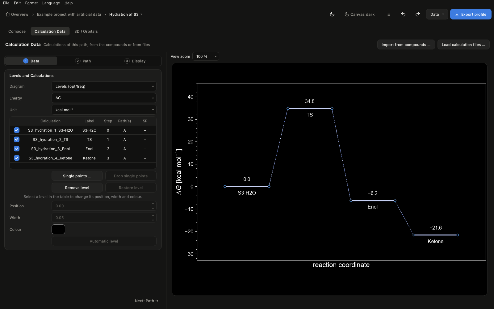
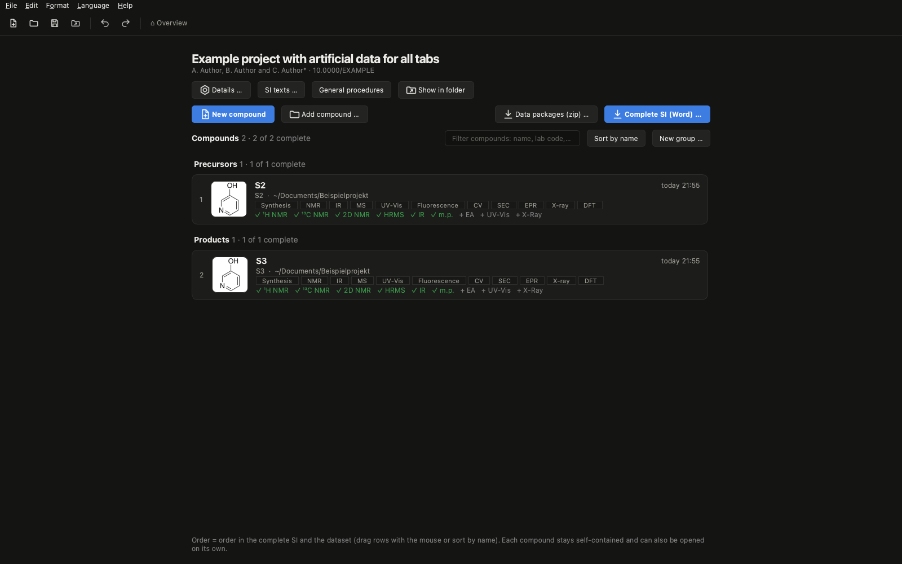
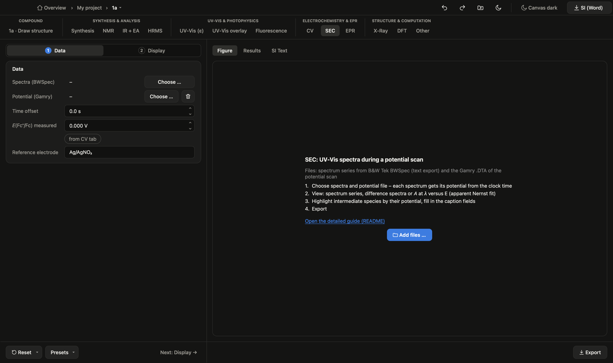

  <picture>
    <source media="(prefers-color-scheme: dark)" srcset="assets/icon-dark.png">
    
  </picture>

<h1 align="center">Elucida</h1>

  <b>From synthesis to Supporting Information.</b> 
  Evaluate the analytical data of new compounds and get publication-ready figures and a complete SI in Word.

  
  
  

  <a href="#download">Download</a> &nbsp;·&nbsp;
  <a href="#workflows">Workflows</a> &nbsp;·&nbsp;
  <a href="docs/manual.en.md">Manual</a> &nbsp;·&nbsp;
  <a href="CHANGELOG.md">Changelog</a> &nbsp;·&nbsp;
  <a href="README.de.md">Deutsch</a>

  

## What it does

- **One place per compound.** Spectra, structures and calculations live in a compound folder; a project groups the compounds of a paper and shows what is still missing.
- **Figures ready for the paper.** One consistent Origin-like style, PDF and SVG as vectors, 16 × 11 cm for half an A4 page.
- **The SI writes itself.** Characterisation paragraph, captions, data-processing text and crystal data go straight to Word, with templates for Wiley, ACS, RSC and Nature.
- **Raw data ready for a repository.** Data packages for TUDOdata and similar services, with lab codes and dates removed.
- **Draw right in the app.** The built-in editor (Octet Draw) handles structures, schemes and reagent tables; ChemDraw files keep working.

| Area | Tabs | Highlights |
|---|---|---|
| **Synthesis & analysis** | Synthesis · NMR · IR + EA · HRMS | Drawing editor, amount check, Mnova and TopSpin data, OPUS, Bruker `.d` |
| **UV-Vis & photophysics** | UV-Vis (ε) · Overlay · Fluorescence | Beer–Lambert fit with confidence interval, TD-DFT overlay, ORCA ESD |
| **Electrochemistry & EPR** | CV · SEC · EPR | E½, Nicholson, Randles–Ševčík, UV/Vis/NIR SEC, S = ½ fit, thermal decay |
| **Structure & computation** | X-Ray · DFT · Reaction paths | Mercury-style ORTEP, ORCA and Gaussian, orbitals, multireference, energy profiles |

## Workflows

**From compound to SI**

1. **New compound** on the welcome page, then **Compound …** for name and structure: draw it, or load a ChemDraw file.
2. Drag files into the window; Elucida sorts them into the right tab.
3. Adjust on the left, see the figure on the right. Labels, structures and insets can be dragged.
4. **SI (Word)** collects everything that is ready and lists what is missing.

**From project to paper**

Create a **project**, add compounds, and follow the checklist. **Complete SI** writes title page, contents and chapters; **Data packages** writes the dataset.

**Reaction paths across compounds**

Project → **Computational Chemistry**: copy calculations in, then compose profiles, molecules and orbital views on a free canvas. Diagrams are true to scale unless you explicitly choose a schematic layout, and they go into the complete SI.

**Spectroelectrochemistry without timestamps**

Merged UV/Vis/NIR exports contain no times. Elucida shows them by number and assigns potentials only after you confirm a schedule or a table, and it states that source in the SI.

Step-by-step guides with pictures: [synthesis to SI](docs/anleitungen/synthese-bis-si.en.md) · [UV-Vis ε](docs/anleitungen/uvvis-epsilon.en.md) · [CV and SEC](docs/anleitungen/elektrochemie.en.md) · [EPR](docs/anleitungen/epr.en.md) · [crystal structure and DFT](docs/anleitungen/struktur-dft.en.md)

No data at hand? **Help → Open example compound** fills all tabs with artificial data.

## Screenshots

<table>
  <tr>
    <td width="50%"> Reaction paths</td>
    <td width="50%"> Project with checklists</td>
  </tr>
  <tr>
    <td> Synthesis</td>
    <td> Spectroelectrochemistry</td>
  </tr>
</table>

## Download

Get the file for your system from the [latest release](https://github.com/robinesken97/elucida/releases/latest) and unzip it.

| System | File | Start |
|---|---|---|
| Windows | `Elucida-windows-x64.zip` | `Elucida\Elucida.exe` |
| macOS, Apple Silicon | `Elucida-macos-arm64.zip` | `Elucida.app` |
| macOS, Intel (macOS 14 or newer) | `Elucida-macos-x64.zip` | `Elucida.app` |
| Linux | `Elucida-linux-x64.AppImage` or `.tar.gz` | make executable, then start |

<b>First launch: the app is not code-signed</b>

- **Windows:** “More info” → “Run anyway”. Keep the whole `Elucida` folder together.
- **macOS:** move `Elucida.app` to Applications and open it once. Then System Settings → Privacy & Security → “Open Anyway”.
  Or in Terminal: `xattr -dr com.apple.quarantine /Applications/Elucida.app`
- **Linux:** `chmod +x Elucida-linux-x64.AppImage`. Needs `fuse3`; without it add `--appimage-extract-and-run`. Ubuntu 22.04 or newer.

Elucida checks once a day for a new version. To update, replace the app; compounds, projects and settings stay. It was called Spectravolt and UVVisTool before; old data is taken over automatically.

## Documentation

- [Manual](docs/manual.en.md): every tab and setting, supported data, troubleshooting, building from source
- [Changelog](CHANGELOG.md)

## License

[AGPL-3.0](LICENSE), without warranty. Bundled libraries and their licences are listed in the [manual](docs/manual.en.md#license). The drawing editor is based on [Octet Draw](https://github.com/SamChemMan/Octet-Draw) (Apache-2.0).
