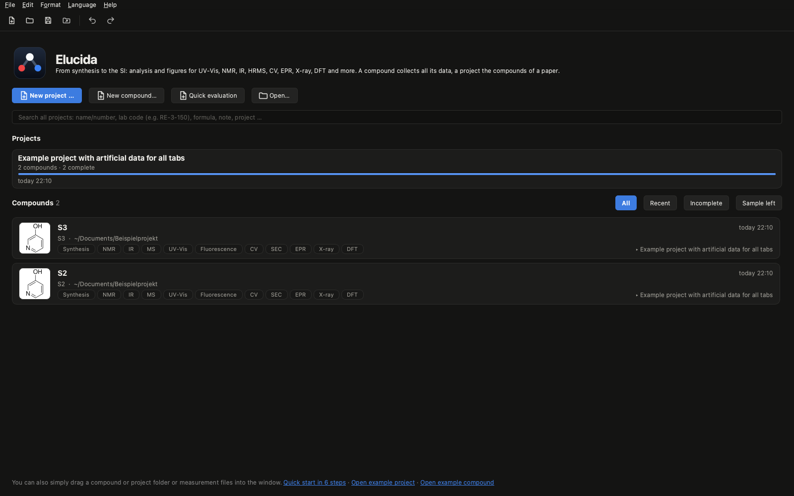
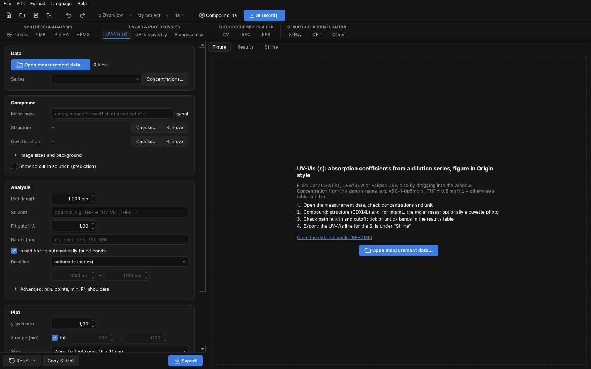
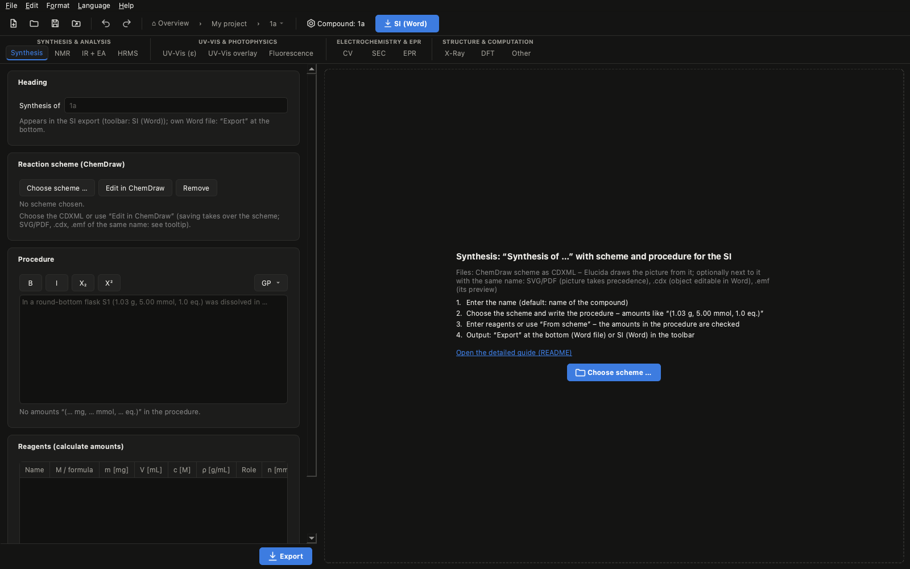
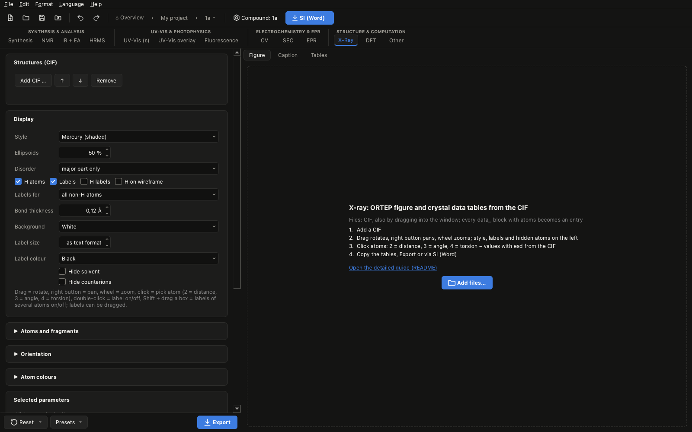

<p align="center">
  <picture>
    <source media="(prefers-color-scheme: dark)" srcset="assets/icon-dark.png">
    
  </picture>
</p>

<h1 align="center">Elucida</h1>

<p align="center">
  <b>From synthesis to Supporting Information.</b><br>
  One desktop app for the analytical data of new compounds: evaluate, plot, and export a complete SI in Word.
</p>

<p align="center">
  <a href="https://github.com/robinesken97/elucida/releases/latest"></a>
  <a href="https://github.com/robinesken97/elucida/actions/workflows/build.yml"></a>
  
  <a href="LICENSE"></a>
</p>

<p align="center">
  <a href="#download">Download</a> &nbsp;·&nbsp;
  <a href="#features">Features</a> &nbsp;·&nbsp;
  <a href="#quick-start">Quick start</a> &nbsp;·&nbsp;
  <a href="docs/manual.en.md">Manual</a> &nbsp;·&nbsp;
  <a href="CHANGELOG.md">Changelog</a> &nbsp;·&nbsp;
  <a href="README.de.md">Deutsch</a>
</p>

<p align="center">
  
</p>

## Why Elucida

Characterising a new compound means a dozen instruments, a dozen file formats and, at the end, one Supporting
Information that has to be consistent. Elucida keeps all of it in one place.

- **One folder per compound.** Spectra, structures and calculations live together; a project groups the compounds of a
  paper and shows what is still missing.
- **Figures ready for the paper.** One consistent style, PDF and SVG as vectors, sized for half an A4 page. The preview
  is true to scale.
- **The SI writes itself.** Characterisation paragraph, captions, data-processing text and crystal data go straight to
  Word, with templates for Wiley, ACS, RSC and Nature.
- **Numbers you can trace.** Every fit is described in a methods text, and the UV-Vis report recalculates ε with plain
  Excel formulas.
- **Raw data ready for a repository.** Data packages with lab codes and dates removed.

## Features

| Area | Tabs | Highlights |
|---|---|---|
| **Compound** | Compound | Name, formula and drawing in one place; built-in structure editor (Octet Draw), ChemDraw files keep working |
| **Synthesis & analysis** | Synthesis · NMR · IR + EA · HRMS | Scheme, procedure and amount check; Mnova and TopSpin data; OPUS; Bruker `.d` |
| **UV-Vis & photophysics** | UV-Vis (ε) · Overlay · Fluorescence | Beer–Lambert fit with confidence interval, TD-DFT overlay, ORCA ESD |
| **Electrochemistry & EPR** | CV · SEC · EPR | E½, Nicholson, Randles–Ševčík, UV/Vis/NIR SEC, S = ½ fit, thermal decay |
| **Structure & computation** | X-Ray · DFT · Reaction paths | Mercury-style ORTEP, ORCA and Gaussian, orbitals, multireference, energy diagrams |
| **Project** | Overview · Complete SI · Data packages | Checklist per compound, search, complete SI for the whole paper, dataset for the repository |

<table>
  <tr>
    <td width="50%"><br><sub>UV-Vis: every tab starts with a short guide</sub></td>
    <td width="50%"><br><sub>Project with checklists</sub></td>
  </tr>
  <tr>
    <td><br><sub>Synthesis with the drawing editor</sub></td>
    <td><br><sub>X-ray</sub></td>
  </tr>
</table>

## Download

Get the file for your system from the [latest release](https://github.com/robinesken97/elucida/releases/latest) and
unzip it. No installation, no Python required.

| System | File | Start |
|---|---|---|
| Windows | `Elucida-windows-x64.zip` | `Elucida\Elucida.exe` |
| macOS, Apple Silicon | `Elucida-macos-arm64.zip` | `Elucida.app` |
| macOS, Intel (macOS 14 or newer) | `Elucida-macos-x64.zip` | `Elucida.app` |
| Linux | `Elucida-linux-x64.AppImage` or `.tar.gz` | make executable, then start |

<details>
<summary><b>First launch: the app is not code-signed</b></summary>

- **Windows:** “More info” → “Run anyway”. Keep the whole `Elucida` folder together.
- **macOS:** move `Elucida.app` to Applications and open it once. Then System Settings → Privacy & Security → “Open Anyway”.
  Or in Terminal: `xattr -dr com.apple.quarantine /Applications/Elucida.app`
- **Linux:** `chmod +x Elucida-linux-x64.AppImage`. Needs `fuse3`; without it add `--appimage-extract-and-run`. Ubuntu 22.04 or newer.

</details>

<details>
<summary><b>Updating, also from versions before 1.0</b></summary>

Elucida checks once a day for a new version. To update, replace the app; compounds, projects and settings stay.

Versions before 1.0 (numbered up to 2.7.1, earlier called Spectravolt and UVVisTool) do not offer 1.0 as an update:
download it once by hand. Old data and settings are taken over automatically.

</details>

## Quick start

1. **New compound** on the welcome page. It opens in the **Compound** tab: enter the name and draw the structure, or
   load a ChemDraw file.
2. **Drag files into the window.** Elucida sorts them into the right tab.
3. **Adjust on the left, see the figure on the right.** Labels, structures and insets can be dragged.
4. **SI (Word)** collects everything that is ready and lists what is missing.

No data at hand? **Help → Open example compound** fills all tabs with artificial data.

Step-by-step guides with pictures:
[synthesis to SI](docs/anleitungen/synthese-bis-si.en.md) ·
[UV-Vis ε](docs/anleitungen/uvvis-epsilon.en.md) ·
[CV and SEC](docs/anleitungen/elektrochemie.en.md) ·
[EPR](docs/anleitungen/epr.en.md) ·
[crystal structure and DFT](docs/anleitungen/struktur-dft.en.md)

## Workflows

**From project to paper.** Create a project, add compounds and follow the checklist. **Complete SI** writes title page,
contents and chapters; **Data packages** writes the dataset.

**Reaction paths across compounds.** Project → **Computational Chemistry**: copy calculations in, then compose energy
diagrams, molecules and orbital views. Diagrams are true to scale unless you choose a schematic layout, and they go
into the complete SI. With access to a Slurm cluster the page also shows your jobs and fetches results straight into
the project ([setup](docs/manual.en.md#cluster-connection)).

**Spectroelectrochemistry without timestamps.** Merged UV/Vis/NIR exports contain no times. Elucida shows them by
number and assigns potentials only after you confirm a schedule or a table, and it states that source in the SI.

## Supported data

| Method | Files |
|---|---|
| Structures | ChemDraw **CDXML** (with SVG/PDF/PNG export), drawings made in the app |
| NMR | MestReNova **SVG/EMF** and reports, **TopSpin** datasets, `.mnova` |
| IR | Bruker **OPUS** files and the OPUS PDF |
| HRMS | Report of the MS department (`.docx`), Bruker **`.d`** |
| UV-Vis, fluorescence | **Cary** CSV/TXT, `.DSW`/`.BSW`, Cary **Eclipse** CSV and `.FBSW` |
| CV, SEC | **Gamry** `.DTA`, **B&W Tek BWSpec** |
| EPR | Bruker **BES3T**, Magnettech MS400 text, **EasySpin** simulations |
| X-ray | **CIF** (Olex2/SHELXL, CCDC) |
| Computation | **xyz**, **ORCA** and **Gaussian** outputs (incl. TD-DFT), **Molden** and **cube** files |

Details and limits per format: [manual → Supported data](docs/manual.en.md#supported-data).

## Documentation

- [Manual](docs/manual.en.md): every tab and setting, troubleshooting, building from source
- [Guides](docs/manual.en.md#guides): five workflows step by step
- [Changelog](CHANGELOG.md)

## Building from source

Python 3.12; the drawing editor additionally needs Node.js for a full build.

```bash
pip install -r requirements.txt
python Elucida.py                                              # start from source
QT_QPA_PLATFORM=offscreen python Elucida.py --selftest out     # self-test, must end with "OK"
python tools/build.py                                          # packaged app in dist/ (needs pyinstaller)
```

Releases are built by GitHub Actions for Windows, macOS (Apple Silicon and Intel) and Linux; the finished app runs the
self-test on every system before a release is published.

## Feedback

Found a bug or missing a file format? Please open an [issue](https://github.com/robinesken97/elucida/issues) and
describe the instrument and software version the file came from. Do not attach unpublished measurement data; a
description or an artificial example is enough.

## License

[AGPL-3.0](LICENSE), without warranty. Bundled libraries and their licences are listed in the
[manual](docs/manual.en.md#license). The drawing editor is based on
[Octet Draw](https://github.com/SamChemMan/Octet-Draw) (Apache-2.0).
