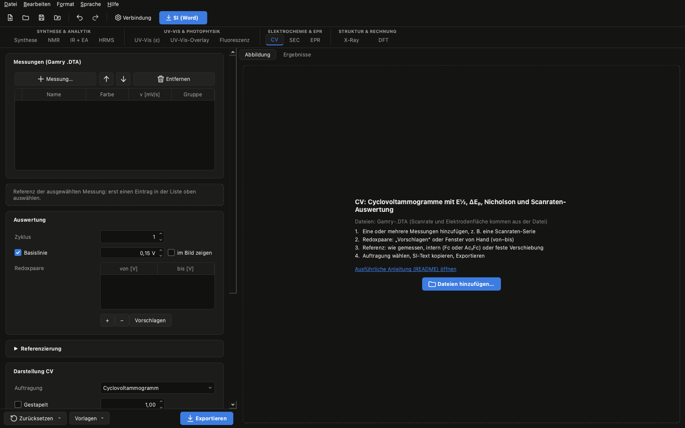

[English](elektrochemie.en.md) | **Deutsch** · [zurück zur Übersicht](../../README.de.md#anleitungen)

# Elektrochemie: CV und SEC

**Was herauskommt:** Cyclovoltammogramme mit E½, ΔEₚ und Peakstromverhältnis (Nicholson), Auswertung über die
Scanrate (Randles-Ševčík mit Konfidenzintervall), die Referenzierung gegen Fc⁺/Fc und daraus die Abbildungen mit
SI-Unterschrift und ein Methodenabsatz. Im SEC-Tab die Spektrenserie während des Potentialscans.

**Was du brauchst:** Gamry-.DTA-Dateien (z. B. eine Scanraten-Serie), am besten eine Messung mit internem Standard
(Fc oder Ac₂Fc). Für SEC die Spektrenserie aus B&W-Tek BWSpec (Textexport) und die .DTA des Potentialscans.

## 1. Messungen laden (CV)

Im Tab **CV** über **Messung…** eine oder mehrere .DTA-Dateien hinzufügen. Scanrate und Elektrodenfläche kommen aus
der Datei. Die **Gruppe** je Messung (z. B. das Lösungsmittel) trennt die Datenreihen in den Auftragungen gegen die
Scanrate.

## 2. Redoxpaare

**Vorschlagen** sucht die Paare; du kannst die Fenster (von–bis, in der Skala der x-Achse) anpassen. Rot markierte
Werte in den Ergebnissen bedeuten: Peak am Fensterrand – Fenster vergrößern. Die **Basislinie** (Standard an) zieht den
Ladestrom vor dem Peak ab; die Peakpotentiale bleiben unverändert.

## 3. Referenzierung

Unter **Referenzierung** wählst du: wie gemessen, intern (Fc- oder Ac₂Fc-Paar in einer der Messungen; Vorgabe
Ac₂Fc +0,49 V vs. Fc⁺/Fc, bitte mit eurer Literatur abgleichen) oder eine feste Verschiebung. Beim Vergleich mehrerer
Lösungsmittel bekommt jede Messung ihren eigenen Standard (Messung anklicken → Referenz der ausgewählten Messung).

## 4. Ergebnisse und Auftragungen

Der Reiter **Ergebnisse** neben der Abbildung zeigt E_pa, E_pc, E½, ΔEₚ, i_pa, i_pc und i_r/i_f je Messung und
Paar. Unter **Auftragung** wählst du außer dem CV auch ΔEₚ gegen v, Randles-Ševčík, log i gegen log v, chemische
Reversibilität oder den Trumpet-Plot. Hinweis: ΔEₚ enthält auch den iR-Abfall (v. a. in THF).

## 5. Spektroelektrochemie (SEC)

Im Tab **SEC** die Spektrenserie und die Potentialdatei wählen. Jedes Spektrum bekommt sein Potential über die
Uhrzeit (ggf. **Zeitversatz** einstellen). **Ansicht:** Spektrenserie, Differenzspektren oder A bei λ gegen E mit
scheinbarem Nernst-Fit – bei kontinuierlichem Scan hinkt die Dünnschichtzelle nach, die CV-Werte haben Vorrang.
Zwischenspezies hebst du über ihr Potential hervor.

## 6. Export und SI

**Exportieren** schreibt Abbildung, Ergebnisse (CSV) und den Methodenabsatz. Die Felder der **Bildunterschrift**
(Konzentration, Lösungsmittel, Leitsalz) ausfüllen – dann entsteht die Unterschrift wie in der SI der Gruppe.
**SI-Text kopieren** liefert den englischen Absatz zur Auswertung.
