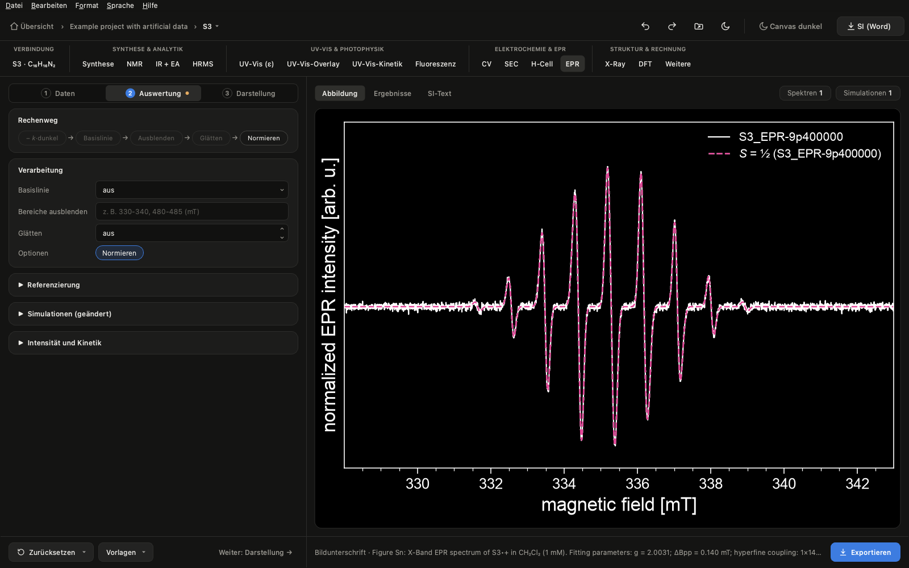

[English](epr.en.md) | **Deutsch** · [zurück zur Übersicht](../../README.de.md#abläufe)

# EPR: Spektren, Simulation und Fit

**Was herauskommt:** CW-EPR-Abbildungen (überlagert oder gestapelt) mit Simulationen, g-Werte und Kopplungen aus einem
eigenen S = ½-Fit, Anteile mehrerer Spezies und – wenn nötig – Intensität gegen Zeit oder Temperatur.

**Was du brauchst:** Bruker-BES3T-Dateien (.dsc + .DTA) oder zweispaltigen Text (z. B. MS400); optional ein
Dunkelspektrum (vor dem Bestrahlen) und Simulationen aus EasySpin als Text.

## 1. Messungen laden

Im Tab **EPR** über **Messung…** die Dateien hinzufügen. Frequenz, Temperatur, Modulation und Leistung stehen je
Spektrum dabei.

## 2. Verarbeiten

Messung anklicken: Feld **Dunkelspektrum** (hell − k·dunkel). Unter **Verarbeitung**: Basislinie wählen, Bereiche
ausblenden, glätten. Die Reihenfolge ist fest: Dunkelspektrum → Basislinie → Ausblenden → Glätten → Normieren.

Welche Basislinie?
- **Polynom** (aus den Rändern oder aus signalfreien Bereichen): der Normalfall bei schmalen Sweeps.
- **Glatt:** bei weiten Sweeps mit breitem Untergrund des Resonators, z. B. Triplett-Spektren. Die **Breite** größer
  wählen als die breiteste echte Linie; ein Dunkelspektrum ist dann nicht nötig.
- **Spline:** wenn du die Stützstellen selbst setzen willst (mindestens zwei kurze signalfreie Bereiche).
- **Dunkelspektrum** statt Basislinie, wenn der Untergrund ähnlich schmal ist wie das Signal. „Dunkelspektrum für alle
  Messungen übernehmen“ setzt es für die ganze Serie und blendet es selbst im Bild aus.

## 3. Simulation

- **Simulation…** lädt eine fertige Simulation aus EasySpin (zweispaltig, B in mT). Sie wird an die gewählte Messung
  angepasst; mehrere Simulationen je Messung werden gemeinsam skaliert (Anteile der Spezies).
- **S = ½-Simulation** legt eine eigene isotrope Simulation an: g, Kerne (z. B. `2 14N 0.65; 4 1H 0.32`, a in mT),
  Linienbreite. **An Messung fitten (g, a, ΔB_pp)** verfeinert die Werte.

## 4. Feldkalibrierung (optional)

Mit einer Referenz wie TEMPO: Referenz mit einer S = ½-Simulation fitten und unter **Feldkalibrierung** mit ihrem
Literatur-g wählen. Die Verschiebung wird von allen anderen Messungen abgezogen, deren Fits dann kalibrierte g-Werte
liefern.

## 5. Intensität und Kinetik (optional)

**Intensität und Kinetik** (Schritt **Auswertung**) wertet Doppelintegral oder Peak-zu-Peak je Spektrum aus – gegen Zeit oder
Temperatur, optional × T (Curie) und mit Zerfallsfit.

## 6. Export und SI

**Exportieren** schreibt die Abbildung und jede Messung als Text für EasySpin. Die Unterschrift nimmt g, ΔB_pp und
Kopplungen aus deinen S = ½-Fits; Spezies, Lösungsmittel und Konzentration trägst du unter **Bildunterschrift** ein.
