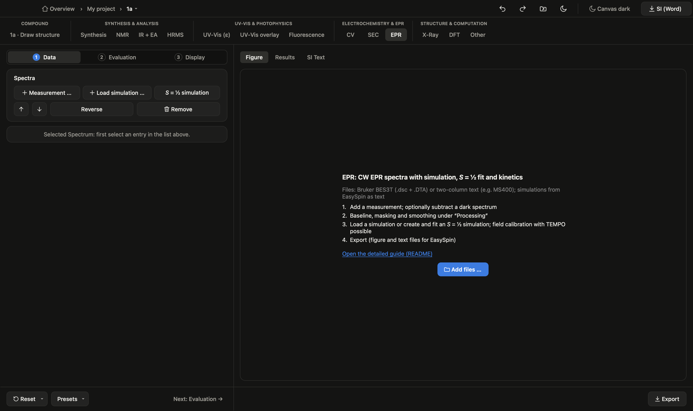

**English** | [Deutsch](epr.de.md) · [back to the overview](../../README.md#workflows)

# EPR: spectra, simulation and fit

**What you get:** CW EPR figures (overlaid or stacked) with simulations, g values and couplings from an own S = ½ fit,
shares of several species and – if needed – intensity versus time or temperature.

**What you need:** Bruker BES3T files (.dsc + .DTA) or two-column text (e.g. MS400); optionally a dark spectrum (before
irradiation) and simulations from EasySpin as text.

## 1. Load the measurements

In the **EPR** tab add the files with **Measurement…**. Frequency, temperature, modulation and power are shown per
spectrum.

## 2. Process

Click a measurement: field **Dark spectrum** (light − k·dark). Under **Processing**: choose a baseline, mask ranges,
smooth. The order is fixed: dark spectrum → baseline → masking → smoothing → normalisation.

Which baseline?
- **Polynomial** (from the edges or from signal-free ranges): the normal case for narrow sweeps.
- **Smooth:** for wide sweeps with a broad resonator background, e.g. triplet spectra. Choose the **width** larger
  than the broadest real line; a dark spectrum is then not needed.
- **Spline:** if you want to set the anchors yourself (at least two short signal-free ranges).
- **Dark spectrum** instead of a baseline when the background is about as narrow as the signal. "Use this dark
  spectrum for all measurements" sets it for the whole series and hides it in the figure.

## 3. Simulation

- **Simulation…** loads a finished simulation from EasySpin (two columns, B in mT). It is scaled to the chosen
  measurement; several simulations per measurement are scaled together (shares of the species).
- **S = ½ simulation** creates an own isotropic simulation: g, nuclei (e.g. `2 14N 0.65; 4 1H 0.32`, a in mT),
  linewidth. **Fit to measurement (g, a, ΔB_pp)** refines the values. For two overlapping species: create one
  simulation each, set them roughly, then **Fit together**.

## 4. Field calibration (optional)

With a reference such as TEMPO: fit the reference with an S = ½ simulation and choose it under **Field calibration**
with its literature g. The shift is subtracted from all other measurements, whose fits then give calibrated g values.

## 5. Intensity and kinetics (optional)

**Intensity and kinetics** (step **Evaluation**) evaluates the double integral or peak-to-peak per spectrum – versus time or
temperature, optionally × T (Curie) and with a decay fit.

Everything is in this one card; the field **View** chooses what the figure shows.

- **Ramp** (temperature rises): view "Intensity against temperature" and **Fit decay** → E_a and A from one series.
- **Isothermal** (several series at fixed temperatures): load all spectra, view "Intensity against time" and **Fit
  decay** → k per temperature. Then the view "Arrhenius" → E_a and ln A. The temperature is read from the
  measurement file.

## 6. Export and SI

**Export** writes the figure and every measurement as text for EasySpin. The caption takes g, ΔB_pp and couplings from
your S = ½ fits; enter species, solvent and concentration under **Figure caption**.
