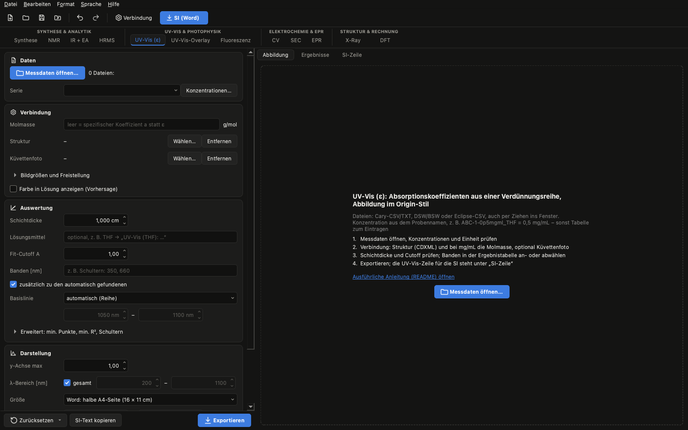

[English](uvvis-epsilon.en.md) | **Deutsch** · [zurück zur Übersicht](../../README.de.md#anleitungen)

# UV-Vis: ε aus einer Verdünnungsreihe

**Was herauskommt:** eine Abbildung im Origin-Stil (Spektren, λ/ε an den Banden, Inset mit den Regressionen, Struktur
und Küvettenfoto), ε je Bande mit Standardfehler und 95-%-Konfidenzintervall, die UV-Vis-Zeile für die SI
(„UV-Vis: λmax: 331 nm (ε = 8440 cm-1 M-1), …“) und ein Excel-Report zum Nachrechnen.

**Was du brauchst:**

- eine Verdünnungsreihe, am besten 4–6 Konzentrationen, alle in derselben Küvette gemessen
- die Messdaten als Cary-CSV/TXT oder als DSW/BSW-Dateien direkt vom Gerät (auch eine Datei je Konzentration)
- die Struktur als CDXML (für Bild und Molmasse), optional ein Foto der Küvette (auch HEIC vom iPhone)

## 1. Verbindung anlegen

**Datei → Neue Verbindung…**, dann **Verbindung …** in der Werkzeugleiste mit Name und CDXML. Die Molmasse kommt aus
der CDXML. Sie wird nur gebraucht, wenn die Konzentrationen in mg/mL angegeben sind.

## 2. Messdaten laden

Die Dateien ins Fenster ziehen oder **Messdaten öffnen…** im Tab **UV-Vis (ε)**. Mehrere Dateien auf einmal werden zu
einem Datensatz zusammengeführt.

**Konzentrationen:** Elucida liest sie aus den Probennamen, z. B. `ABC-1-0p5mgml_THF` → Serie `ABC-1`, 0,5 mg/mL
(`p` steht für das Komma; erkannt werden mg/mL, mM, µM). Stehen keine Konzentrationen im Namen, öffnet sich eine
Tabelle. Die **Einheit musst du dort ausdrücklich wählen**, damit kein falsches ε entsteht. „Verdünnungsreihe
ausfüllen“ setzt Start, Start/Faktor, … in die markierten Zeilen.

## 3. Verbindung im Tab prüfen

Unter **Verbindung** stehen Struktur und Molmasse aus dem Dialog Verbindung. Willst du die Struktur genau wie in ChemDraw,
speichere sie dort zusätzlich als SVG oder PDF mit gleichem Namen neben die CDXML. Ein Foto der Küvette wird
automatisch freigestellt.

## 4. Auswertung einstellen

- **Schichtdicke** der Küvette (z. B. 1 cm oder 0,1 cm).
- **Fit-Cutoff A** (Standard 1): Messpunkte mit höherer Absorbanz gehen nicht in den Fit ein, weil der Detektor dort
  nicht mehr linear ist.
- **Banden:** werden automatisch gefunden; Schultern trägst du als Liste ein (z. B. `350, 660`) oder lässt sie suchen.
- **Basislinie:** Standard „automatisch (Reihe)“ – zieht nur den konzentrationsunabhängigen Versatz ab.

## 5. Ergebnisse prüfen

Der Reiter **Ergebnisse** neben der Abbildung zeigt je Bande ε mit Fehler, Achsenabschnitt, R² und Hinweise. Darauf achten:

- **Mindestens 3 Punkte** unter dem Cutoff, sonst gibt es keinen Fit (Hinweis in der Tabelle).
- **R² unter 0,98:** Die Bande steht in Tabelle und Export, aber nicht im Bild. Bei nur 4 Punkten sagt R² wenig;
  aussagekräftiger ist das Konfidenzintervall.
- Ein signifikanter **Achsenabschnitt** deutet auf Basislinien- oder Linearitätsprobleme hin.
- Das Häkchen bei λ entscheidet, ob eine Bande im Bild erscheint; ein Doppelklick auf „Cutoff A“ setzt einen eigenen
  Cutoff für diese Bande.

## 6. Abbildung gestalten

Inset, Struktur, Küvette und jedes λ/ε-Label mit der Maus verschieben, mit dem Mausrad über Inset oder Bild die Größe
ändern. Optional: Indizes λ₁/ε₁ …, „(sh)“ an Schultern, R² im Bild. **Zurücksetzen ▾** stellt die automatische
Anordnung wieder her.

## 7. Exportieren und in die SI

**Exportieren** schreibt für alle Serien die Abbildung (PDF/SVG/PNG) nach `figures/`, `<Serie>_UV-Vis_results.csv` und
den Excel-Report nach `tables/`. Die UV-Vis-Zeile steht unter **SI-Zeile** und kommt mit **SI (Word)** automatisch in den
Charakterisierungsabsatz, die Abbildung mit Unterschrift („UV-Vis spectra of **X** in THF, measured in 0.1 cm quartz
cuvettes.“) in den Abbildungsteil. Das Lösungsmittel dafür trägst du unter **Auswertung** ein.

**SI-Text kopieren** liefert einen englischen Absatz, der genau die benutzten Auswerteschritte beschreibt (Basislinie,
Modell, Cutoff, Fehler) – zum Anhängen an den Methodenteil.
