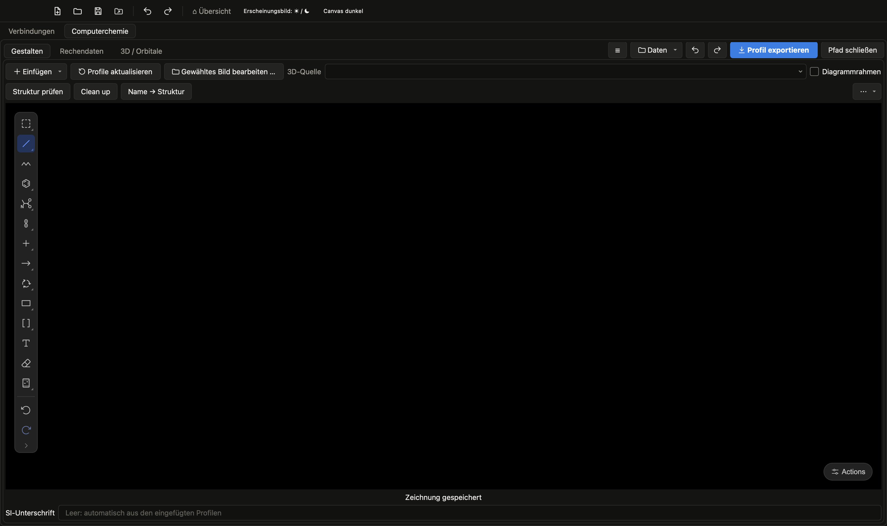
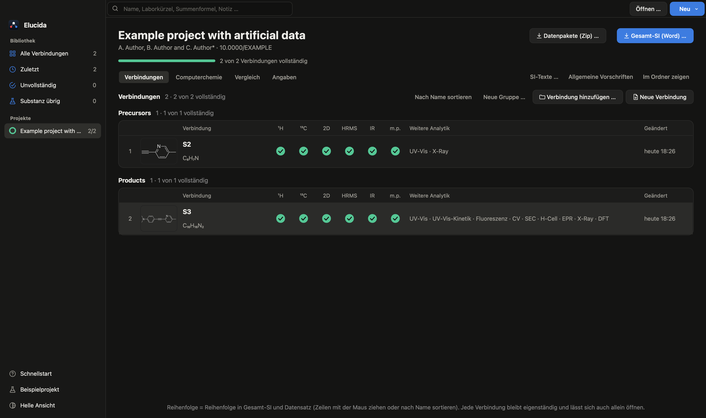
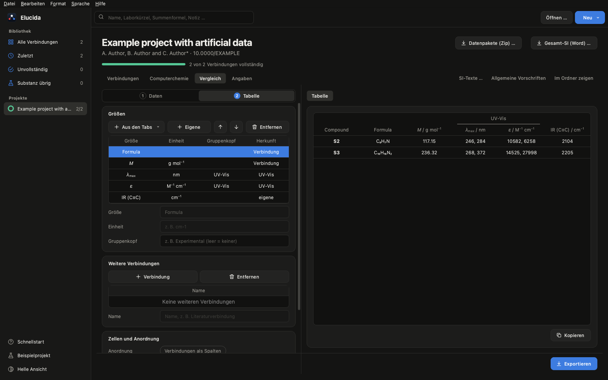

[English](manual.en.md) | **Deutsch** · [Übersicht](../README.de.md)

# Elucida-Handbuch

## Herunterladen und starten

Lade unter **Releases** (rechts auf der Repository-Seite) die Datei für dein System herunter und entpacke sie.

| System | Datei | Starten |
|---|---|---|
| Windows | `Elucida-windows-x64.zip` | `Elucida\Elucida.exe` |
| macOS (Apple Silicon) | `Elucida-macos-arm64.zip` | `Elucida.app` |
| macOS (Intel, ab macOS 14) | `Elucida-macos-x64.zip` | `Elucida.app` |
| Linux (AppImage) | `Elucida-linux-x64.AppImage` | ausführbar machen, dann doppelklicken |
| Linux (Ordner) | `Elucida-linux-x64.tar.gz` | `Elucida/Elucida` |

Die App ist nicht signiert, deshalb warnt das Betriebssystem beim ersten Start:

- **Windows (SmartScreen):** „Weitere Informationen“ → „Trotzdem ausführen“.
- **macOS (Gatekeeper):** `Elucida.app` in „Programme“ ziehen und einmal doppelklicken (wird blockiert).
  Dann Systemeinstellungen → Datenschutz & Sicherheit → ganz unten „Dennoch öffnen“ → mit Passwort/Touch ID
  bestätigen. Ab macOS 15 funktioniert der frühere Weg „Rechtsklick → Öffnen“ nicht mehr. Alternativ im
  Terminal: `xattr -dr com.apple.quarantine /Applications/Elucida.app`. Welcher Mac? Apple-Menü → Über diesen Mac: „Chip Apple M…“ = Apple Silicon,
  „Prozessor Intel…“ = Intel. Die Intel-Version braucht macOS 14 (Sonoma) oder neuer.

**Updates:** Beim Start prüft das Programm einmal am Tag, ob es auf GitHub eine neuere Version gibt,
und bietet an, die Release-Seite zu öffnen (Hilfe → „Nach Updates suchen…“; im Hilfe-Menü abschaltbar).
Zum Aktualisieren die neue Datei herunterladen und die alte App ersetzen; Verbindungen, Projekte und Einstellungen
bleiben erhalten.

**Linux-AppImage:** `chmod +x Elucida-linux-x64.AppImage` (oder Dateieigenschaften → „Als Programm
ausführen“), dann starten. Es braucht `fusermount` (Paket `fuse3`, bei den meisten aktuellen
Distributionen vorinstalliert); ohne startet man mit `./Elucida-linux-x64.AppImage --appimage-extract-and-run`.
Wie beim tar.gz ist eine Distribution mindestens so neu wie Ubuntu 22.04 (glibc 2.35) nötig.

Unter Windows immer den ganzen Ordner `Elucida` zusammenlassen. Die `.exe` funktioniert nicht ohne den Ordner `_internal` daneben.

*Elucida hieß früher **Spectravolt** (davor **UVVisTool**, als es nur UV-Vis-Verdünnungsreihen auswertete).
Verbindungen, Einstellungen und heruntergeladene Daten werden automatisch übernommen. Versionen vor 1.0 (gezählt bis
2.7.1) bieten 1.0 nicht als Update an: einmal von Hand herunterladen.*

## Schnellstart: von der leeren Verbindung zur SI

Elucida kennt zwei Ebenen: Eine **Verbindung** ist ein Ordner mit allen Daten einer Verbindung, ein **Projekt** fasst
die Verbindungen einer Veröffentlichung zusammen (Gesamt-SI, Datensatz; siehe den nächsten Schnellstart). Jede
Verbindung gehört zu einem Projekt: Sie liegt in dessen Ordner.

1. **Verbindung anlegen:** **Neu → Neue Verbindung** auf dem Startbildschirm (oder **Datei → Neue Verbindung…**) fragt erst
   nach dem Projekt (zuletzt geöffnetes, anderes oder neues), dann nach dem Namen; in einem Projekt **Neue Verbindung**
   auf dessen Seite. Alle Dateien, die du lädst, werden hineinkopiert, gespeichert wird automatisch.
2. **Verbindung festlegen:** der Tab **Verbindung** ganz links (eine neue Verbindung öffnet dort): die Nummer, die sie
   in der SI trägt (z. B. 3a), und die Struktur – rechts zeichnen oder mit **Wählen…** eine ChemDraw-Datei (CDXML)
   laden. Summenformel und Molmasse kommen daraus, alles gilt sofort (kein OK). Alle Tabs und die SI folgen dieser
   Verbindung; Nummer und Summenformel stehen am Tab. Lieber in ChemDraw zeichnen? Menü **…** über der Zeichnung →
   **In ChemDraw bearbeiten** öffnet die leere Datei, die jede Verbindung schon hat – speichern, und Elucida übernimmt
   Struktur, Summenformel und Molmasse von selbst (genauso das Reaktionsschema im Synthese-Tab).
3. **Daten laden:** Dateien einfach ins Fenster ziehen – Elucida legt sie in den passenden Tab:
   CIF → **X-Ray**, SVG aus MestReNova → **NMR**, xyz/ORCA/Gaussian/Molden/Cube → **DFT**, MS-Bericht (.docx) oder Bruker-.d →
   **HRMS**, OPUS-Datei → **IR + EA**, UV-Vis-Messdaten (CSV, DSW/BSW) → **UV-Vis (ε)**. CV, SEC, EPR, Overlay und
   Fluoreszenz lädst du im Tab über **Dateien hinzufügen…**. Ein leerer Tab zeigt, was er braucht und woher es kommt.
4. **Auswerten:** Links stehen die Einstellungen in Schritten (meist **Daten · Auswertung · Darstellung**; ein Punkt
   am Schritt zeigt, wo etwas vom Standard abweicht), rechts die Abbildung mit den Reitern **Ergebnisse** und
   **SI-Text**. Labels, Strukturen und Insets lassen sich mit der Maus verschieben.
   **Strg+Z** / **⌘Z** macht alles rückgängig.
5. **Exportieren:** **Exportieren** unten im Tab schreibt die Abbildung (PDF/SVG/PNG, 16 × 11 cm für eine halbe
   A4-Seite) und die Daten in den Ordner der Verbindung (`figures/`, `tables/`, `SI/`).
6. **SI erstellen:** **SI (Word)** in der Werkzeugleiste sammelt alles Fertige in einer Word-Datei: Synthese,
   Charakterisierungsabsatz (m.p., NMR, IR, HR-MS, UV-Vis, Elementaranalyse), Abbildungen zu zweit je Seite,
   Kristalldaten und DFT-Koordinaten. Was noch fehlt, zählt das Programm danach auf.

## Schnellstart: Projekt mit mehreren Verbindungen

1. **Projekt anlegen:** **Neu → Neues Projekt** auf dem Startbildschirm (oder **Datei → Neues Projekt…**) und einen
   Ordner wählen – leer oder einer, in dem schon Verbindungen liegen (die werden automatisch aufgenommen).
2. **Angaben ausfüllen:** Seite **Angaben** (neben Verbindungen und Computerchemie; jedes Feld gilt beim Verlassen) – Titel des Artikels (Titelblatt der SI; kursiv mit `<i>…</i>`), Autoren,
   Adresse, DOI des Datensatzes, zugehörige Publikation, Beschreibungen, Lizenz. Sie landen in `README.txt` des
   Datensatzes und auf dem Titelblatt.
3. **Verbindungen anlegen:** **Neue Verbindung** legt einen Unterordner an (Name = Verbindung, z. B.
   `3b`); ein Klick auf eine Verbindung öffnet sie, gearbeitet wird wie im Schnellstart oben. Der Pfad oben in der
   Werkzeugleiste, **Übersicht › <Projekt> › <Verbindung> ▾**, führt zurück zum Projekt oder zur Übersicht und wechselt
   direkt zu einer anderen Verbindung des Projekts (auch Datei → Zum Projekt, Strg+Umschalt+P; Datei → Zur Übersicht,
   Strg+Umschalt+H). **Neue Gruppe …** gliedert die Verbindungen (z. B.
   Precursor, Salze, NHOs; Rechtsklick auf eine Verbindung → Gruppe, oder in eine Gruppe ziehen); in der Gesamt-SI werden
   die Gruppen zu Unterkapiteln von Synthese und NMR (2.1, 2.2 …). Zeilen ziehen oder **Nach Name sortieren** ändert die
   Reihenfolge – sie gilt für SI und Datensatz. Das Suchfeld oben
   auf dem Startbildschirm findet Verbindungen in allen deinen Projekten (Name/Nummer, Laborkürzel wie AB-1-234,
   Summenformel, Notiz); Strg+F springt dorthin. Jede Verbindung zeigt eine **Checkliste**: Pflicht sind ¹H,
   ¹³C, 2D-NMR, HRMS, IR und m.p.; für im Tab Verbindung als **literaturbekannt** markierte Verbindungen (mit Literatur)
   nur ¹H und ¹³C. **Öl** neben dem Schmelzpunkt ergibt „m.p. <25 °C“.
4. **SI-Texte:** **SI-Texte …** – „Materials and Methods“ (oder die in den Tabs hinterlegten Aufbau-Texte übernehmen) und
   je Kapitel eine optionale Einleitung.
5. **Gesamt-SI:** **Gesamt-SI (Word) …** – Kapitel, Verbindungen und Vorlage (Gruppe, Wiley, ACS, RSC, Nature) wählen;
   die Word-Datei liegt danach in `SI/` des Projekts.
6. **Datensatz:** **Datenpakete (Zip) …** – je Verbindung ein Zip, `CompChem.zip`, `README.txt` und Lizenztext in
   `datapack/`, fertig zum Hochladen (z. B. TUDOdata).

Zum Ausprobieren: **Hilfe → Beispielprojekt ansehen** legt ein Projekt mit zwei erfundenen Verbindungen an: eine Vorstufe mit der üblichen Charakterisierung und ihr Produkt mit Daten für alle Tabs, die zueinander passen.

## Anleitungen

Schritt für Schritt durch einen Arbeitsablauf, mit Bildern:

- [Synthese und Charakterisierung bis zur SI](anleitungen/synthese-bis-si.de.md) – Schema, Vorschrift, NMR, IR,
  HRMS, Elementaranalyse, SI-Abschnitt
- [UV-Vis: ε aus einer Verdünnungsreihe](anleitungen/uvvis-epsilon.de.md)
- [Elektrochemie: CV, SEC und H-Zelle](anleitungen/elektrochemie.de.md)
- [EPR: Spektren, Simulation und Fit](anleitungen/epr.de.md)
- [Kristallstruktur und DFT](anleitungen/struktur-dft.de.md)

Zum Ausprobieren ohne eigene Daten: **Hilfe → Beispielverbindung ansehen** legt eine Verbindung mit künstlichen Daten für
alle Tabs an. **Hilfe → Anleitung zu diesem Tab** (F1) öffnet den passenden Abschnitt unten.

Alle Einstellungen der einzelnen Tabs stehen weiter unten zum Nachschlagen.

## Verbindungen, Projekte, Export

Alles passiert im **Ordner der Verbindung** (der Ordner-Knopf in der Werkzeugleiste öffnet ihn im Finder, Explorer bzw.
im Dateimanager des Linux-Desktops):

1. **Datei → Neue Verbindung…** – Projekt wählen, dann den Namen; die Verbindung wird ein Unterordner des Projekts.
   Für eine einzelne Auswertung ohne Projekt: **Neu → Schnellauswertung** auf dem Startbildschirm (internes Projekt
   „Einzelauswertungen“, Exporte fragen nach dem Zielordner; später verschieben).
2. Messdaten, Strukturen, Fotos und TD-DFT-Dateien von beliebigen Orten laden – sie werden **in die
   Verbindung kopiert** (`data/<Analytik>/`, `structures/`; ChemDraw-Exporte mit gleichem Namen wie eine CDXML kommen
   mit). Dateien, die schon in der Verbindung liegen, werden nicht erneut kopiert.
3. Normal arbeiten – die Verbindung wird **automatisch gespeichert**. Beim Öffnen wird jeweils eine Sicherung angelegt
   (`.elucida/project.elucida.bak`). Ordner älterer Versionen (`project.uvvis`) öffnen wie bisher und werden ab dann als
   `project.elucida` gespeichert (der Dateiname bleibt aus Gründen der Verträglichkeit „project“).
4. **Exportieren** schreibt direkt in die Verbindung (vorhandene Dateien werden überschrieben):

```
S2/
  project.elucida        Einstellungen (Pfade relativ zum Ordner)
  SI/                    Word-Dateien und SI-Texte: S2_SI.docx, S2_NMR.docx, S2_UV-Vis_methods.txt …
  figures/               Abbildungen (PDF/SVG/PNG): S2_CV.pdf, S2_X-ray.svg, <Serie>_UV-Vis.png …
  tables/                Tabellen und Datendateien: S2_CV_results.csv, <Serie>_UV-Vis_report.xlsx, xyz …
  data/nmr/ data/cv/ …   Kopien der Messdaten, ein Ordner je Analytik
  structures/            ChemDraw-Strukturen (mit ihren Exporten), Schemata, Fotos
  .elucida/              Zwischenbilder für Word, Cache, Sicherung (versteckt)
```

Dateinamen beginnen mit dem Namen der Verbindung (Tab **Verbindung**; ohne sie der Ordnername). Ordner entstehen erst,
wenn etwas hineinkommt. Ordner aus Versionen vor 2.1 (`data/`, `images/`, `exports/`) öffnen wie bisher; ihre
Dateien bleiben liegen, neue Dateien und Exporte kommen in den neuen Aufbau.

Das Programm startet mit dem Startbildschirm. Verbindungen und Projekte öffnen über **Datei → Öffnen**, **Zuletzt
geöffnet** oder indem man den Ordner ins Fenster zieht. **Datei → Verbindung als Kopie speichern** legt
eine vollständige Kopie an (z. B. als Zwischenstand). **Bearbeiten → Rückgängig / Wiederholen**
(⌘Z / ⌘⇧Z, Strg+Z / Strg+Y) gilt für alle Tabs.

**Startbildschirm:** Links stehen die Filter (Alle Verbindungen, Zuletzt, Unvollständig, Substanz übrig) und deine Projekte mit
Fortschritt, rechts die Verbindungen als **Galerie** oder **Liste**. Die Galerie zeigt, welche Pflichtteile noch fehlen; Liste und
Projektseite zeigen sie als Tabelle. Tabs mit Daten sind hell, leere gedimmt.

**Datei → Datenpaket (Zip) exportieren** schreibt die Rohdaten der Verbindung für ein Datenrepositorium (z. B.
TUDOdata), aufgebaut wie veröffentlichte Datensätze: `3b.zip` mit `3b/NMR/1H/10/` (TopSpin-Experimente vollständig),
`NMR/HSQC + HMBC/12/`, `IR/`, `MS/` (Bericht, Bruker-.d), `UV-Vis/`, `Fluorescence/`, `CV/<Lösungsmittel>/`, `SEC/`,
`EPR/`; DFT und die eigenen Abbildungen/SI wahlweise. X-Ray (CCDC) und Synthese gehören nicht hinein. Jede Datei ist
abwählbar, die Auswahl wird je Verbindung gemerkt. **Laborkürzel** wie `AB-1-234` werden automatisch gefunden und ersetzt –
in Datei- und Ordnernamen durch die Verbindung (`3b`), im Inhalt durch „Compound 3b“ (beides änderbar) –, und **Datum
und Uhrzeit werden gelöscht**: in allen Textdateien (CSV, Gamry-DTA, EPR, TopSpin-Parameter, -Titel und -Prüfprotokoll),
im MS-Bericht (Text, Ersteller und Datum der Datei, Beschriftungen der Spektren) und in OPUS-Dateien (auf gleicher
Länge). Die Messwerte (FID, ser, Spektren) bleiben bytegleich. PDF, Mnova und Bruker-.d lassen sich nicht bearbeiten;
steckt dort noch ein Kürzel, nennt das Protokoll die Datei.

Jeder Export aus den Tabs Overlay, UV-Vis-Kinetik, Fluoreszenz, CV, SEC und EPR schreibt zusätzlich `…_data.csv` mit genau den
gezeichneten Kurven (ein x/y-Spaltenpaar pro Kurve, Werte ohne Stapelversatz) – für Origin, Excel oder MATLAB.

### Projekte

<p align="center"></p>

**Computerchemie (Reaktionspfade):** Ein Reiter des Projekts für Energieprofile und IRCs über mehrere Verbindungen, ohne
diese zu verändern (Rechnungen werden hineinkopiert). **Gestalten** ist eine freie Zeichenfläche (Octet) für Profile,
Moleküle, Text und 3D-/Orbitalansichten, **Rechendaten** ist das Energiediagramm mit seiner Spalte in drei Schritten
(siehe unten), **3D / Orbitale** die Ansichten. Pfade
erscheinen als Karten (Rechtsklick: umbenennen, entfernen). Alles bleibt im Hauptfenster, ☰ blendet bei offenem Pfad die Pfadliste ein und aus. Profile sind standardmäßig maßstäblich; eine schematische
Darstellung muss man ausdrücklich wählen, sie steht dann in Abbildung und SI. Energien werden nie bearbeitet, ein
veraltetes Diagramm stoppt den Export bis **Diagramme aktualisieren**. Die Gesamt-SI übernimmt die ganze Komposition.

**Energiediagramm** (Reiter Rechendaten; links Schritte, rechts das Diagramm, das jeder Änderung sofort folgt):
- **Daten:** die Rechnungen als Stufen (Label, Schritt, Pfad), Einzelpunkte, IRC-Kurven. Die Felder unter der Tabelle
  ändern das gewählte Plateau: **Position** (waagerecht in Schritten, z. B. damit Beschriftungen oder senkrechte
  Übergänge nicht kollidieren), **Breite** und **Farbe**; im schematischen Bild auch **Höhe** und „Verbinder
  unterbrechen“. **Plateau automatisch** stellt Lage am Schritt, Standardbreite und Pfadfarbe wieder her. Die Energie
  bleibt dabei unverändert.
- **Pfad:** Die Stufen sind Knoten. Im Bild am Ende eines Plateaus ziehen und auf einem anderen loslassen verknüpft sie;
  damit gehen Verzweigungen und Zusammenführungen. Ohne eigene Verbinder gilt wie bisher: je Pfadbuchstabe in der
  Reihenfolge der Schritte (**Aus Schritt und Pfad** stellt das wieder her). Die Tabelle listet die Verbinder; die Felder
  darunter ändern den gewählten: Linie (gestrichelt, durchgezogen, gepunktet, geschwungen, Wellenlinie, keine),
  Pfeilspitze und ein Text, z. B. „ISC“, „IC“ oder „hν“ wie im Jablonski-Diagramm; die Farbe steht in der Tabelle. Liegen
  zwei Stufen übereinander, läuft der Übergang senkrecht in der Spalte und setzt seitlich an den Linien an, neben den
  Beschriftungen, mehrere nebeneinander; die Linie einer Stufe dazwischen ist am Übergang unterbrochen. Der Text eines
  Verbinders steht neben der Linie, nie auf einem Strich oder einer anderen Beschriftung.
- **Darstellung:** vier Vorlagen (Klassisch, Kurven, Farbig, Minimal) setzen den Stil in einem Zug; darunter Linienart,
  Strichstärken, Schriftgröße, Rahmen, maßstäblich und Farbe je Pfad. Der Stil gehört zum Diagramm des Pfads.
- Energien, Namen und Verbinder-Texte lassen sich im Bild mit der Maus verschieben (wenn zwei Stufen eng liegen);
  **Beschriftungen zurücksetzen** stellt sie zurück. Die Energien selbst ändern sich nie.

<p align="center"></p>

**Datei → Neues Projekt** macht einen Ordner zum Projekt: dem übergeordneten Ordner für alle Verbindungen einer
Veröffentlichung. Die Verbindungen bleiben normale Verbindungsordner in seinen Unterordnern (jede lässt sich weiter allein
öffnen); `publication.elucida` hält ihre Reihenfolge, die Angaben für den Datensatz und die SI-Texte. Die Seite des
Projekts listet die Verbindungen mit Checkliste (Zeilen ziehen zum Umsortieren, **Nach Name sortieren**, Rechtsklick: verschieben, kopieren, herausnehmen), **Neue Verbindung** legt
einen Unterordner an, **Verbindung hinzufügen** verschiebt oder kopiert eine von woanders in das Projekt.

- **Verschieben oder duplizieren:** Rechtsklick auf eine Verbindung (Projektseite oder Übersicht) oder das Menü der
  Verbindung im Pfad oben → **In anderes Projekt verschieben …** verschiebt den Ordner; **In anderes Projekt kopieren …**
  legt eine unabhängige Kopie an, z. B. wenn dieselbe Verbindung in zwei Papern vorkommt. Verbindungen aus älteren
  Versionen ohne Projekt bietet das Programm beim Öffnen zum Zuordnen an (Pfad: „⚠ ohne Projekt“).
- **Suchen:** Das Feld oben auf dem Startbildschirm durchsucht alle Verbindungen aller bekannten Projekte nach
  Name/Nummer, Laborkürzel (z. B. AB-1-234, auch aus Dateinamen und Vorschriften), Summenformel, Notiz, Literatur oder
  Projekt; auf der Projektseite filtert dasselbe Feld die Verbindungen; Strg+F springt dorthin.
- **In den Papierkorb verschieben …** (Rechtsklick in der Übersicht) entfernt eine Verbindung oder ein ganzes Projekt
  nach einer Nachfrage mit Anzahl der Dateien und Größe; aus dem Papierkorb lässt sich alles wiederherstellen.

- **Datenpakete (Zip):** der ganze Datensatz wie auf TUDOdata – je Verbindung ein Zip (wie oben), die DFT-Rechnungen
  aller Verbindungen in `CompChem.zip`, `README.txt` (Titel, Autoren, DOI, Zitat, zugehörige Publikation,
  Beschreibungen, Lizenz; aus den **Angaben**) und der Lizenztext (CC BY 4.0 oder CC0). Laborkürzel gehören zu der
  Verbindung, in deren Dateinamen sie stehen.
- **Gesamt-SI (Word):** eine Datei mit Titelseite und Inhaltsverzeichnis, Kapitel wie die SI der Gruppe – 1. Materials
  and Methods, 2. Synthetic Procedures and Characterization Data, 3. NMR Spectra, 4. UV-Vis Spectroscopy, 5. EPR
  Spectroscopy, 6. Cyclic Voltammetry, 7. Spectroelectrochemistry, 8. X-Ray Characterization Data, 9. Computational
  Section (leere Kapitel fallen weg). In jedem Kapitel die Verbindungen in der Reihenfolge des Projekts; Abbildungen
  zwei je Seite und fortlaufend nummeriert, Kristalldaten aller Strukturen in gemeinsamen Tabellen. **SI-Texte** enthält
  „Materials and Methods“ und je Kapitel eine optionale Einleitung.
- **Vorlagen** der Gesamt-SI: Gruppe (wie die Angewandte-SI der Gruppe: „Supplementary Materials for“, Figure S1:),
  Wiley („Supporting Information for“, Figure S1.; Angewandte verlangt ein Inhaltsverzeichnis am Anfang), ACS
  („Supporting Information for“, Figure S1., Seiten S1, S2 …; JOC verlangt ein Inhaltsverzeichnis mit Seitenzahlen), RSC
  („Supplementary Information for“, Fig. S1 wie in RSC-Artikeln), Nature („Supplementary Information for“,
  Supplementary Figure 1 |, eigene Zählung). Für die SI schreiben die Verlage kaum etwas vor; es ändern sich nur
  Titelblatt, Bezeichnungen und Seitenzahlen, Kapitel, Schrift und Seitenaufteilung bleiben wie die SI der Gruppe. Die
  Gesamt-SI hat Seitenzahlen und ein schon ausgefülltes Inhaltsverzeichnis (Seitenzahlen geschätzt; Word aktualisiert
  beim Öffnen, ONLYOFFICE über „Inhaltsverzeichnis aktualisieren“). Die SI einer einzelnen Verbindung bleibt im Stil
  der Gruppe.

## Vergleich (Projekt)

<p align="center"></p>

Der Reiter **Vergleich** der Projektseite stellt Verbindungen des Projekts nebeneinander, beliebig viele benannte
Vergleiche (**+ CV-Stapel**, **+ Spektren**, **+ Tabelle**; Name, **Entfernen** nimmt nur den Eintrag aus dem Projekt,
exportierte Dateien bleiben). Links die Schritte wie in den Tabs, rechts Abbildung bzw. Tabelle, **Exportieren** unten
rechts. Gespeichert wird in `publication.elucida`.

**Nichts wird neu ausgewertet.** Jede Verbindung legt beim Speichern einen kleinen Stand ihrer Auswertungen in
`.elucida/compare.json` ab (Kurven ausgedünnt, Werte als Text genau wie im Tab: λ und ε ganzzahlig wie in der Tabelle des
ε-Tabs, E½ und ΔE_p wie in den CV-Ergebnissen, g mit vier Stellen). Der Vergleich liest nur diese Stände, öffnet also keine
Verbindung. Hat sich eine Verbindung seit ihrem Stand geändert oder fehlt er (z. B. ein Tab, der in der Sitzung nicht
geöffnet war, oder eine Verbindung aus einer älteren Version), steht sie in der Liste als **veraltet** bzw. **fehlt** und
ihre Werte bleiben leer. **Aktualisieren** öffnet diese Verbindungen kurz nacheinander, schreibt den Stand neu und kehrt
zur Seite zurück.

- **CV-Stapel:** je Verbindung ein Cyclovoltammogramm, versetzt übereinander (oben in der Liste = oberste Kurve, Ziehen
  oder Pfeile ordnen um, **Abstand** in Vielfachen der größten Kurvenhöhe). Unter „Gewählte Verbindung“: Messung (Standard:
  die erste sichtbare, im Zyklus des CV-Tabs), Redoxpaar und Beschriftung am Peak (Hinpeak, E_pa, E_pc, E½ oder keine; die
  Zahl aus den Ergebnissen des CV-Tabs). Die Struktur der Verbindung steht neben ihrer Kurve (ziehbar, wahlweise in
  Kurvenfarbe), ein Pfeil zeigt je Kurve die Messrichtung, die y-Achse hat keine Zahlen. **Normiert** teilt jede Kurve
  durch ihren größten Betrag; die Bildunterschrift sagt das. Verbindungen auf einer anderen Referenzskala als die erste
  werden nicht gezeigt (Hinweis unter dem Bild), nie umgerechnet. Die Bildunterschrift entsteht aus den Angaben der
  Verbindungen (Lösungsmittel, Leitsalz, Konzentration, Vorschub): gleiche einmal, verschiedene je Verbindung.
- **Spektren:** UV-Vis als ε (dieselbe Messung und Basislinie wie im Overlay, ohne Konzentration oder Molmasse keine
  Kurve) oder auf das Maximum normiert, Emission normiert wie im Fluoreszenz-Tab, beides zusammen (Emission
  gestrichelt); übereinander oder gestapelt, ein Legendeneintrag je Verbindung. Bei mehreren ε-Serien wählt man die Serie
  je Verbindung.
- **Tabelle:** Zeilen = Verbindungen in der Reihenfolge des Projekts (im Schritt „Daten“ abwählbar). Im Schritt
  „Tabelle“ stehen links drei Karten:
  - **Größen:** was verglichen wird, als Liste mit Größe, Einheit, Gruppenkopf und Herkunft. **Aus den Tabs** fügt
    einen Wert hinzu, den die Verbindungen selbst liefern (Summenformel, Molmasse, Schmelzpunkt, UV-Vis λ_max/ε/
    Lösungsmittel, Fluoreszenz λ_abs/λ_em/Stokes, CV E½/E_pa/E_pc/ΔE_p je Redoxpaar und Referenz, EPR g, Kopplungen, D
    und |E/D|); Name und Einheit stehen dann fest. **Eigene** fügt eine Größe zum Eintippen hinzu (z. B. „IR (CN2)“ und
    „cm-1“, Rechnung, Literatur); der Kopf wird in Normschreibweise „Größe / Einheit“ gesetzt. **Gruppenkopf** setzt
    einen zweiten Kopf über benachbarte Größen (z. B. „Experimental“ / „Computational“).
  - **Weitere Verbindungen:** Zeilen für Verbindungen, die nicht im Projekt liegen (z. B. aus der Literatur); ihre
    Werte tippt man in der Tabelle ein.
  - **Zellen und Anordnung:** **Verbindungen als Spalten** dreht die Tabelle. Zellen bearbeitet man direkt in der
    Tabelle rechts (Doppelklick); ein überschriebener Wert aus einem Tab steht orange, **Wert des Tabs** stellt ihn
    zurück.

  Export als Word (Dreilinien-Tabelle wie in der SI, Namen fett), Excel und CSV; **Kopieren** legt sie als
  formatierten Text in die Zwischenablage.

Abbildungen landen als PDF/SVG/PNG in `comparisons/figures/`, Tabellen als Excel/CSV in `comparisons/tables/` und als
Word in `comparisons/SI/` des Projektordners, Dateiname = Name des Vergleichs. In die Gesamt-SI kommen Vergleiche
(noch) nicht.

## Verbindung

Ein Verbindungsordner steht meist für **eine Verbindung** (oder einen Vergleich). Der Tab **Verbindung** ist der erste in der
Tab-Reihe und trägt ihre Nummer (die der SI, sonst die Laborbuch-Nr.) und ihre Summenformel. Links stehen Bezeichnung,
Summenformel, Molmasse und die Angaben für die SI, rechts die Zeichnung. Es gibt kein OK und kein Abbrechen: Ein Feld gilt,
sobald du es verlässt, die Zeichnung speichert sich selbst, Rückgängig nimmt jede Änderung zurück. Summenformel und Molmasse
folgen der Zeichnung (Isotope wie D inklusive), solange du sie nicht von Hand geändert hast; ein geleertes Feld nimmt wieder
den Wert der Zeichnung. **Wählen…** lädt stattdessen eine vorhandene ChemDraw- oder Bilddatei. Die Summenformel steht
schon im Feld mit tiefgestellten Ziffern. Enthält die Zeichnung mehr als ein Molekül und ist kein Salz, steht darunter ein
Hinweis: Summenformel und Molmasse gelten dann für alle zusammen. Die Probennummer lässt sich immer eintragen, auch ohne
„Substanz übrig“.
Der ε-Tab (Struktur, Molmasse), der Fluoreszenz-Tab, IR + EA und HRMS folgen der Verbindung immer: Wird sie geändert, ersetzt
das auch dort eingetragene Werte; eine ersetzte Molmasse wird eingeblendet, Rückgängig stellt sie wieder her. Im UV-Vis-Tab
gibst du dazu nichts mehr ein: Die Karte **Verbindung** zeigt Summenformel und Molmasse, **Ändern …** öffnet die Verbindung,
**Struktur im Bild** blendet die Struktur für eine Serie aus. Der Name steht im Fenstertitel. Der dort eingetragene Schmelzpunkt beginnt den
Charakterisierungsabsatz im SI-Abschnitt. Die Molmasse wird überall mit zwei Nachkommastellen geführt. Die
**Laborbuch-Nr.** steht neben der Nummer für die SI: Sie erscheint in der Übersicht und wird von der Suche gefunden,
aber nie in SI, Word oder Datenpaket.

**In ChemDraw bearbeiten:** Jeder Verbindungsordner enthält von Anfang an leere ChemDraw-Dateien für Struktur und
Reaktionsschema (`structures/<Name>.cdxml`, `…_scheme.cdxml`, Dokumenteinstellungen ACS 1996). **In ChemDraw
bearbeiten** (Menü **…** über der Zeichnung im Tab Verbindung und im Synthese-Tab) öffnet die Datei in ChemDraw; sobald du dort speicherst, übernimmt Elucida
die Struktur (Formel, Molmasse, Bilder) bzw. das Schema von selbst.

## SI-Abschnitt (Word)

**SI (Word)** in der Werkzeugleiste (oder **Datei → SI-Abschnitt exportieren (Word) …**) exportiert sofort mit der Auswahl
der Karte **SI-Export (Word)** im Tab **Verbindung**: Teile als Chips (Charakterisierung, NMR-Spektren, Abbildungen,
Methodik, Kristallstruktur, DFT), darunter die Abbildungen je Tab mit Daten und die Schriftart; die Auswahl wird gemerkt
und gilt für alle Verbindungen. Gewählte Teile ohne Daten fallen weg (Hinweis unten rechts). Der Export sammelt alles Fertige zur Verbindung in
`SI/<Verbindung>_SI.docx`, im Stil der SI: ein Charakterisierungsabsatz **m.p. …; IR …; HR-MS …; UV-Vis …;
Elemental analysis …** (Schmelzpunkt aus dem Tab **Verbindung**, UV-Vis-Zeile von der Seite **SI-Zeile** im Tab UV-Vis (ε):
*λ*_max: 350 nm (*ε* = 12000 cm⁻¹ M⁻¹), … mit den Banden wie im Bild, aufsteigend, ε ganzzahlig), danach Kristalldaten-Tabelle, ausgewählte Parameter und Bildunterschriften aus dem
X-Ray-Tab und die DFT-Rechnungen (zweispaltig). Was noch fehlt, wird nach dem Export aufgezählt. Zahl und Einheit sind
durch geschützte Leerzeichen verbunden, Word trennt also nie „298 nm“ oder „ε = 8440“.

**Abbildungen:** Die Abbildungen aller Tabs mit Daten (UV-Vis (ε) je Serie, IR, HR-MS, Overlay, UV-Vis-Kinetik, Fluoreszenz, CV, SEC,
EPR) und die NMR-Spektren stehen immer **zu zweit auf einer Seite**; passen Bild und Unterschrift nicht, werden beide
Abbildungen der Seite verkleinert (Seitenverhältnis bleibt). Unter einem längeren Text folgt noch eine
Abbildung auf derselben Seite, solange sie mindestens 7 cm hoch bleibt. Unterschriften wie in der SI: UV-Vis „UV-Vis spectra of
**X** in THF, measured in 0.1 cm quartz cuvettes.“ (Lösungsmittel unter „Auswertung“ im ε-Tab); CV, SEC und EPR nehmen
Vorschub, iR-Kompensation, Referenz, Potentialbereich, Band, g und Kopplungen aus den Daten und Konzentration,
Lösungsmittel, Leitsalz bzw. Spezies aus den Feldern im Reiter **SI-Text** des Tabs (Formeln stehen dort schon im Feld mit
tiefgestellten Ziffern; die Texte stehen im Blocksatz, gesetzt wie im Druck). **Kopieren** steht in jeder Karte oben rechts
auf der Titelzeile, auch bei der NMR-, IR-, EA- und HRMS-Zeile. **Aufbau-Text (SI) …** neben „Kopieren“ des Methodentexts speichert den allgemeinen Absatz zu Gerät und Aufbau nur auf diesem Rechner (nicht in der Verbindung,
nicht im Repository); er steht vor den Abbildungen dieses Tabs. Word öffnet die Dateien im normalen Modus (Word 2013+).

**SI-Text zu den Fits:** Jeder Tab, der etwas fittet (UV-Vis (ε), CV, SEC, EPR), hat den Knopf **Kopieren** in der Karte „Methodentext“ (Reiter SI-Text):
ein englischer Methodenabsatz, der genau die benutzten Auswerteschritte mit ihren Einstellungen beschreibt (z. B. ε:
Basislinienfenster, OLS-Modell, Cutoff, SE/95-%-KI; EPR: Basislinienpolynom, Feldkalibrierung, S = ½-Fit, Kinetik), zum
Anhängen an den Aufbau-Absatz des passenden SI-Abschnitts, danach die Ergebnisse. Derselbe Text wird beim Export als
`…_methods.txt` geschrieben, und **SI (Word)** kann alle Texte als Abschnitt „Data processing and fitting“ (ein Absatz je
Technik) hinter die Abbildungen setzen – so ist dokumentiert, wie die Rohdaten verarbeitet wurden.

**Schriftart der Word-Exporte:** in der Karte **SI-Export (Word)** im Tab Verbindung wählbar (Standard Arial wie die SI der Gruppe), gilt für alle
Word-Exporte. Die Größe bleibt 11 pt, weil „zwei Abbildungen je Seite“ mit dieser Zeilenhöhe rechnet.

## Synthese-Tab

„Synthesis of **Name**“ (der Name der Verbindung aus dem Tab „Verbindung“, sonst der Ordner; Namen werden nur dort vergeben), Reaktionsschema und Vorschrift,
als eigene Word-Datei oder im SI-Abschnitt.

- **Eingebauter Zeicheneditor (Octet Draw):** Das Schema entsteht direkt im Tab; Änderungen werden nach einer Sekunde
  gespeichert, frühere Stände bleiben in `structures/.editor-backups/`. Strukturprüfung, Clean-up und Name-zu-Struktur
  arbeiten offline; ChemDraw-Kürzel und Kopieren/Einfügen bleiben, Dateiaktionen stehen im ⋯-Menü. Beschriftungen wie
  `NaBH4 (1,5 Äq.)` oder `Pd(PPh3)4 (5 mol%)` zählen als Äquivalente, ausdrückliche Mengen haben Vorrang. **Aus
  Octet-Tabelle übernehmen** kopiert die Stöchiometrietabelle des Editors auf Klick in die Reagenzientabelle (keine
  Live-Kopplung; gleiche Formeln werden nur nach Spalte zugeordnet, also prüfen). In die SI kommt nur die **oberste
  Reaktion mit ihren Bedingungen**, im Vorschaubild wie in der eingebetteten CDX; die ganze Zeichnung bleibt im Projekt.
  Word-Exporte schreiben zusätzlich `<Name>_structures/` mit CDX/CDXML-Momentaufnahmen zum Öffnen in ChemDraw auf jedem
  System (Bearbeiten per Doppelklick in Word bietet ChemDraw nur unter Windows). Der Tab Verbindung hat denselben
  Editor: Die Zeichnung speichert sich selbst, Formel und Masse folgen ihr, solange du sie nicht von Hand korrigiert hast.
- **Schema:** **In ChemDraw bearbeiten** öffnet die leere Schemadatei der Verbindung (Speichern wird automatisch
  übernommen), oder eine vorhandene CDXML wählen. Daneben (gleicher Name, gleicher Ordner) kann man aus ChemDraw speichern: **SVG/PDF**
  (Bild unverändert übernommen), **.cdx** (das Schema wird in Word ein bearbeitbares ChemDraw-Objekt – Doppelklick
  öffnet ChemDraw; mit einer CDXML kann Word das nicht) und **.emf** (scharfe Vektorvorschau dieses Objekts). Ohne
  SVG/PDF wird das Schema aus den CDXML-Koordinaten gezeichnet, mit Pfeil und Bedingungen.
- **Vorschrift** mit fett, kursiv, tief- und hochgestellt. **GP ▾** wählt eine allgemeine Vorschrift des Projekts
  („according to **GP A**“); in der Gesamt-SI steht sie einmal vor der ersten Verbindung, die sie benutzt.
- Mengen dürfen eine Einheit in der Zelle tragen („1.03 g“, „150 µL“, „800 mM“), n ist eintragbar; mit einer
  ChemDraw-Reagenzientabelle im Schema übernimmt **Aus Schema** deren Werte.
- **Mengenprüfung:** Angaben wie „(1.03 g, 5.00 mmol, 1.0 eq.)“, „(99%)“ werden mit der Reagenzientabelle verglichen
  (M oder Summenformel, Masse, Volumen, Konzentration, Dichte); Abweichungen jenseits der Rundung der angegebenen Stellen
  werden markiert. **Aus Schema** füllt die Tabelle mit den Edukten (erstes = Bezug 1.0 eq.), den Reagenzien über/unter
  dem Pfeil (z. B. K2CO3), Lösungsmitteln und dem Produkt; **Klammer einfügen** setzt die berechnete Klammer der gewählten
  Zeile an der Schreibmarke ein.

## NMR-Tab

- **Spektren:** SVG-Exporte aus MestReNova (Drag & Drop). Der Kern kommt aus der Achsenbeschriftung („δ ¹H (ppm)“);
  fehlt sie, von Hand eintragen. Reihenfolge: ¹H, ¹³C, übrige Kerne nach Massenzahl, dann 2D (COSY, HSQC, HMBC,
  NOESY …).
- **Struktur** in jedem Spektrum als Vektorgrafik: automatisch an einer freien Stelle (nichts verdeckt), oder oben
  links/mittig/rechts, oder in der Vorschau gezogen; das Mausrad über der Struktur ändert die Größe, für alle Spektren
  gleich.
- **NMR-Zeile:** den Mnova-Multiplettbericht einfügen („Multiplets → Copy“, Journal-Format) – alle Kerne in das eine
  Feld, je Kern eine Zeile. **Zeile aus Peaklabels** baut die ¹³C-Zeile (oder andere) aus den beschrifteten Peaks des
  gewählten Spektrums; ein mit Namen beschriftetes Lösungsmittelsignal („77.16 CDCl3“) fällt weg. Zuordnungen je Signal
  in der Tabelle (*kursiv*, _{tief}, ^{hoch}).
- **Temperatur** standardmäßig 298 K, oder aus dem Bruker-Experimentordner (acqus, mit Übersicht der Parameter wie
  Frequenz, O1P, Pulsprogramm, Scans).
- **Rohdaten** (Reiter neben der Abbildung): **TopSpin-Daten …** nimmt ein Experiment, einen Datensatz (10, 11, …) oder
  einen Ordner mit mehreren Datensätzen – auch per Ziehen ins Fenster – und übernimmt jedes Experiment vollständig in
  die Verbindung, nach Art sortiert (`data/nmr/1H`, `13C`, `DEPT135`, `HSQC` …). Passt genau ein Experiment zu einem Spektrum,
  wird es automatisch zugeordnet (Parameter, Temperatur).
- **Mnova-Dokumente** (`.mnova`): Karte oben in der linken Spalte – ablegen (liegen in `data/nmr/mnova`) und in Mnova
  öffnen.
- Spektren können auch **EMF** aus Mnova sein: Sie gehen unverändert nach Word (Vektor, ohne eingesetzte Struktur); für
  Vorschau und Struktur SVG verwenden.
- **Word:** zwei Spektren je Seite, „Figure Sn: ¹H NMR (500 MHz, CDCl₃, 298 K) of **Name**.“

## IR + EA-Tab

- **IR:** Bruker-**OPUS**-Datei (`*.0`, Spektrum) und/oder den **OPUS-PDF**-Ausdruck (Peakbeschriftung) laden. Mit dem
  PDF sind die Werte genau die OPUS-Peakliste; mit der Datei allein sucht Elucida die Banden selbst
  (Empfindlichkeit einstellbar). Bereich frei wählbar (Standard: der ganze gemessene Bereich); Banden, die nicht in die
  Liste sollen, abhaken; Intensitäten w/m/s/br optional (relativ zur stärksten Bande: s ab 60 %, m ab 30 %, sonst w; br ab einer
  Halbwertsbreite von 120 cm⁻¹). Ausgabe: **IR** [cm⁻¹]: ṽ = 2961, 2866, … (ganze Zahlen,
  absteigend).
  **Basislinie korrigieren (wie OPUS)** zieht die Basislinie wie OPUS ab (nur Bild und Peaksuche); **Schwelle setzen**:
  Punkte ins Bild klicken, Peaks jenseits der Linie. Liegt nur das OPUS-PDF vor, wird das Spektrum aus dem PDF gelesen.
- **HRMS:** den **Word-Bericht** der Massenabteilung laden; Formel, Ionisierung, Polarität und die gemessenen m/z (aus
  den eingebetteten Spektren) werden ausgelesen. Die Formel kommt aus der Verbindung (Warnung, wenn der
  Bericht etwas anderes sagt), das Ion ist wählbar ([M+H]⁺, [M+Na]⁺, [M]⁺, [M−H]⁻ …), vorgewählt ist das nächste
  gemessene m/z. calc. mit Elektronenmasse, vier Nachkommastellen: **HR-MS-ESI(+)** calc. C₁₈H₁₉N₂O⁺ [M+H]⁺ 279.1492;
  found 279.1496. Die Abweichung in ppm steht zur Kontrolle daneben (found − calc). Die Formel wird gegen das im
  Bericht **eingebettete ChemDraw-Objekt** geprüft; ohne festgelegte Verbindung setzt **Verbindung aus dem MS-Bericht
  übernehmen** Name, Formel und Molmasse daraus (die Zeichnung ist dann eine RDKit-Ersatzzeichnung – für Abbildungen
  die eigene CDXML nehmen).
- **HRMS aus Rohdaten:** alternativ (oder zusätzlich) den Bruker-**Messordner** (`.d`, z. B. timsTOF; Knopf oder
  Drag & Drop) laden. Elucida liest die Linienspektren des Geräts selbst (ohne Bruker-Software, auch unter macOS)
  und mittelt das Ion über den **LC-Peak** (automatisch: zusammenhängende Scans mit ≥ 50 % des Maximums, oder ein
  gewählter RT-Bereich). found = intensitätsgewichtetes Mittel; Anzahl der Scans, Bereich der Einzelscans und ihre
  Streuung (± mDa/ppm) stehen dabei, weil Einzelscans in der 4. Nachkommastelle abweichen können. Mit Bericht bleibt
  dessen Wert vorgewählt, das Mittel aus den Rohdaten ist wählbar. In die Verbindung kommen nur `analysis.baf` und
  `analysis.sqlite`.
- **Elementaranalyse:** Formel aus der Verbindung, optional plus Solvat (`0.5 CH2Cl2`, mehrere mit
  Komma); berechnet mit den konventionellen mittleren Atommassen, gefundene C/H/N/S-Werte eintragen. Abweichungen über
  0.4 % werden markiert (übliche Grenze der Journals). Ausgabe, aufgebaut wie die HR-MS-Zeile: **Elemental analysis** (%) calc.
  C₁₈H₁₈N₂O: C 77.67, H 6.52, N 10.06; found C 77.41, H 6.59, N 9.87. Die Elementaranalyse ist immer optional (wird
  nicht als fehlend gemeldet).
- **In Zwischenablage** behält Fettdruck, Hoch- und Tiefstellung beim Einfügen in Word. Der Export schreibt die
  Spektrenabbildung und `…_SI.txt` mit allen Zeilen.

## HRMS-Tab

- Den **Word-Bericht** der Massenabteilung und/oder den Bruker-**Messordner** (`.d`) laden; was jeweils gelesen wird, steht
  in den Punkten unten. Mit Rohdaten zeigt der Tab:
  - ein **Chromatogramm** (Gesamt-Ionenstrom grau, Ionenstrom des gesuchten Ions rot, ± 10 ppm); das blaue Band ist der
    LC-Bereich für das Spektrum – mit der **Maus ziehen**, um einen anderen Bereich zu wählen;
  - das **gemittelte Spektrum** über diesen Bereich (Mittel der Linienspektren des Geräts) mit m/z an den größten Peaks
    und dem **berechneten Isotopenmuster** des Ions gespiegelt darunter (rot; Feinstruktur, die das TOF nicht trennt,
    z. B. ¹³C/¹⁵N, zusammengefasst); die gemessenen/berechneten Isotopenverhältnisse (M+1, M+2 …) stehen dabei;
  - **Peak anklicken**, um ihn als *found* zu übernehmen (neben dem Wert aus dem Bericht und dem Mittel über den LC-Peak).
- Export: Spektrum als Abbildung (PDF/SVG/PNG), `…_sticks.csv` (gemessen und berechnet) und `…_SI.txt`.
- Ältere Verbindungen: Die MS-Daten aus dem früheren Tab IR + MS werden automatisch übernommen.

## UV-Vis-(ε)-Tab

Molare Absorptionskoeffizienten (ε) aus UV-Vis-Verdünnungsreihen (Lambert-Beer: A/d gegen c) mit Standardfehler und
95-%-Konfidenzintervall, dazu eine Abbildung im Origin-Stil: Spektren, λ/ε-Labels an den Banden, ein Inset mit den
linearen Regressionen und R², die Struktur und ein freigestelltes Foto der Küvette.

1. **Daten öffnen:** Datei → Messdaten öffnen, oder Dateien ins Fenster ziehen. Unterstützt werden
   Cary-CSV/TXT-Exporte und die gerätenahen **.DSW/.BSW**-Dateien. **Mehrere Dateien auf einmal**
   (z. B. jede Konzentration einzeln gemessen) werden zu einem Datensatz zusammengeführt.
2. **Konzentrationen:** Die Konzentrationen werden aus den Probennamen gelesen, z. B.
   `ABC-1-0p5mgml_THF` → Serie `ABC-1`, 0,5 mg/mL. Erkannt werden
   `mgml`/`mg_ml`/`mg/ml`, `mM`, `uM`/`µM`; `p` steht für das Dezimalkomma.
   - Stehen keine Konzentrationen im Namen (z. B. `c0` … `c4`) oder ist die Zahl unklar (führende Null wie `05mgml`), klappt in der Karte **Daten** der Bereich **Konzentrationen eingeben** auf (kein eigenes Fenster).
     Die **Einheit** (mM, µM, mg mL⁻¹, M) muss ausdrücklich gewählt werden, es ist nichts vorbelegt; die Werte gelten, sobald sie gewählt ist.
   - Unter **Messungen** lässt sich jede Konzentration einzeln abwählen: Sie fehlt dann in Bild, Fit, Tabellen und SI, die Datei bleibt unverändert.
     Das Farbfeld daneben gibt der Kurve eine eigene Farbe (**Farben zurücksetzen** nimmt alle zurück). **Konzentrationen farbig** (Schritt Darstellung)
     färbt die übrigen nach Konzentration; die **Legende** dazu ist ein eigener Schalter und steht nur auf Wunsch im Bild.
   - „Verdünnungsreihe ausfüllen“ setzt in die markierten Zeilen (oder alle) von oben nach unten Start, Start/Faktor, … ein.
     Der Startwert gehört immer zur **obersten** markierten Zeile (meist die Stammlösung).
   - Proben ohne Wert, z. B. eine Blindprobe, werden ignoriert.
   - Über die Spalte „Serie“ lassen sich mehrere Verbindungen in einer Datei trennen.
   - Später ändern: denselben Bereich aufklappen.
3. **Verbindung (je Serie):**
   - **Struktur:** CDXML, SVG, PDF oder eine Bilddatei. Bei CDXML wird die **Molmasse automatisch
     berechnet** (Isotope wie D eingeschlossen), die Summenformel wird zur Kontrolle angezeigt.
     Damit die Zeichnung **exakt wie in ChemDraw** aussieht, die Struktur in ChemDraw zusätzlich
     als SVG, PDF oder PNG mit gleichem Namen neben die CDXML speichern (z. B. `6g.cdxml` +
     `6g.svg`). Die Zeichnung kommt dann unverändert aus dieser Datei, die Molmasse aus der CDXML.
     Ohne eine solche Datei wird die Struktur neu gezeichnet (ACS-1996-Stil) und kann von ChemDraw
     abweichen.
   - **Küvettenfoto:** HEIC (iPhone), JPG, PNG und weitere. Der Hintergrund wird automatisch entfernt.
   - **Farbe in Lösung (Vorhersage, optional):** aus dem Spektrum berechnet – Transmission 10^(−A) unter
     Tageslicht, CIE-1931-Farbmetrik, als Farbfeld unter dem Foto. Konzentration und Schichtdicke sind
     wählbar (Lambert-Beer; Standard: höchste gemessene Konzentration in 1 cm). Fluoreszenz und Streuung
     bleiben unberücksichtigt, Bildschirme sind nicht kalibriert; nur Anzeige, nicht in der Abbildung.
     Beim ersten Mal bietet die App einen einmaligen Download des KI-Modells an (~180 MB).
   - **Molmasse:** nur bei Konzentrationen in mg/mL nötig. Wird aus der CDXML übernommen, sonst von
     Hand eintragen. Ohne Molmasse gibt das Tool den spezifischen Absorptionskoeffizienten *a* in
     L g⁻¹ cm⁻¹ statt ε aus, und das Feld wird rot markiert. Bei mM/µM wird die Molmasse nicht verwendet.
4. **Auswertung:** Schichtdicke und Fit-Cutoff eintragen. Banden werden automatisch gefunden;
   zusätzliche Banden (z. B. Schultern) lassen sich als Liste eintragen („zusätzlich zu den
   automatisch gefundenen“ behält beide), optional mit Indizes **λ₁/ε₁ …** an den Labels, und **„Schultern automatisch suchen“** ergänzt Schultern
   (in der Abbildung optional mit „(sh)“ markiert). In der Ergebnistabelle entscheidet das Häkchen vor λ, ob eine Bande im Bild
   erscheint, und ein Doppelklick auf **„Cutoff A“** setzt einen eigenen Cutoff für diese Bande
   (z. B. um einen Punkt knapp über A = 1 mitzunehmen). Banden mit eigenem Cutoff sind farbig
   hinterlegt; optional zeigt das Inset ausgeschlossene Punkte als offene Symbole.
5. **Layout:**
   - **Mit der Maus ziehen:** Inset, Struktur, Küvette und jedes λ/ε-Label lassen sich verschieben.
   - **Mausrad bzw. Trackpad** über Inset oder Bild ändert die Größe. Alternativ die Felder „Größe [% Plotbreite]“ nutzen.
   - **Maus über den Spektren:** Eine Einblendung unten rechts zeigt λ und A des nächsten Messpunkts (und seine
     Konzentration), in der Vorschau mit rotem Kreis markiert (nicht im Export) – praktisch zum Prüfen der
     Daten. **Doppelklick** auf einen Punkt fügt seine Wellenlänge als Bande hinzu, erneuter Doppelklick
     entfernt sie. Overlay- und Fluoreszenz-Tab zeigen λ und den gezeichneten Wert genauso an.
   - **Zurücksetzen ▾** → „Layout zurücksetzen“ stellt die automatische Anordnung wieder her; „Alles auf Standard“ setzt
     alle Einstellungen des Tabs (Darstellung und Auswertung) auf Standard – Daten und Angaben zur Messung (Dateien,
     Referenz/Kalibrierung, Schichtdicke, eingegebene Werte, Bildunterschrift, Exportgröße) bleiben, Rückgängig holt alles
     zurück. X-Ray und DFT haben zusätzlich „Standardwerte“ neben „Startansicht“ (Stil, Ellipsoide,
     Bindungsdicke, Labels, ausgeblendete Atome …).
6. **Exportieren:** Datei → Exportieren (oder der Knopf). Das schreibt die gewählten Formate (PDF/SVG/PNG),
   `<Serie>_results.csv` und den Excel-Report für **alle** Serien in die Verbindung (siehe unten).

### Was bei der Auswertung automatisch passiert

- **Basislinie** („automatisch (Reihe)“, Standard): Das Fenster liegt dort, wo die konzentrierteste
  Probe am wenigsten absorbiert. Abgezogen wird nur der Teil des Fensterwerts, der *nicht* mit der
  Konzentration skaliert (Geräte- bzw. Küvettenoffset). Ein zu c proportionaler Rest gilt als echte
  Absorption und bleibt erhalten. „automatisch (einfach)“ zieht den kompletten Fensterwert ab.
  Die Basislinie nutzt immer den vollen Datenbereich, unabhängig vom dargestellten λ-Bereich.
- **Fit-Cutoff:** Punkte oberhalb des Cutoffs (Standard A = 1,0) gehen nicht in den Fit ein.
- **Banden:** automatisch im dargestellten λ-Bereich gesucht oder als Liste vorgegeben.
- **Rundung:** ε (M⁻¹ cm⁻¹) und seine Fehler erscheinen ganzzahlig (z. B. 7264 ± 318), gleich in Tabelle, Bild,
  SI-Zeile, Methodentext und Excel-Bericht; der spezifische Koeffizient a wird auf die Genauigkeit seines
  Standardfehlers gerundet. Die Ergebnis-CSV enthält die vollen Werte.
- **Konventionen:** Gerundet wird kaufmännisch (7264,5 → 7265). R² ist auch beim Fit durch den Ursprung auf den
  Mittelwert bezogen (1 − RSS/SST); Excel-LINEST ohne Konstante nennt dort einen anderen, größeren Wert.
- **Warnungen** (Ergebnistabelle und Protokoll): weniger als 4 Fitpunkte, signifikanter
  Achsenabschnitt (> t(0,975; n−2)·SE), R² unter der Schwelle (Standard 0,98, einstellbar unter Auswertung →
  „min. R² fürs Bild“; 0 = alle zeigen; die Bande bleibt in Tabelle – R²-Zelle rot markiert –, CSV und
  Excel-Report, erscheint aber nicht im Bild), weniger als 3 Punkte (dann gar kein ε). Bei 4 Punkten
  sagt R² allein wenig: vor dem Absenken der Schwelle das 95-%-Konfidenzintervall im Excel-Report prüfen.
  R² steht überall mit zwei Nachkommastellen; die Stellenzahl lässt sich unter Auswertung → Erweitert → „R²-Stellen“
  wählen (gilt für alle Tabs der Verbindung; CSV und Excel-Report behalten den vollen Wert).

### Excel-Report

Für jede Serie entsteht `<Serie>_report.xlsx` mit drei Blättern:

- **Ergebnisse:** eine Tabelle wie in der App (λ, ε ± SE, 95-%-Konfidenzintervall, R², n, Hinweise). Daneben steht
  ε noch einmal, unabhängig mit Excel-Formeln nachgerechnet. Darunter zwei Diagramme im Stil der Abbildung (Spektren
  mit denselben Farben, Achsen und Bereichen; A/d gegen c mit Regressionsgeraden) und die Angaben zur Messung
  (Einheit, Schichtdicke, Molmasse, Modell, Cutoff, Basislinienfenster, Messdateien).
- **Rechnung:** alle Banden nebeneinander. Oben die Messpunkte (A, A/d, „im Fit“), darunter die Regression als
  **Excel-Formeln**: zuerst das Ergebnis (n, m, b, R², ε, SE, Konfidenzintervall), grau darunter die Zwischenwerte
  (x̄, ȳ, Sxx, Sxy, RSS, s, SE(m), SE(b), t). Die gelben Zellen „im Fit“ (1 oder 0) lassen sich ändern, Excel rechnet
  die Bande und das Diagramm neu.
- **Spektren:** A(λ) aller Proben, basislinienkorrigiert und roh, mit dem je Probe abgezogenen Offset.

Die Zellen enthalten den vollen Wert; nur das Zahlenformat rundet wie in der App.

## UV-Vis-Overlay-Tab

Mehrere Spektren in einer Abbildung vergleichen, gemessen und berechnet:

- **Messung…** fügt Spektren aus CSV/TXT/DSW/BSW-Dateien hinzu (ein Eintrag pro Probe);
  **TD-DFT…** fügt Ausgabedateien von ORCA (4–6) oder Gaussian hinzu; **ESD…** fügt ORCA-ESD(ABS)-Spektren hinzu
  (`.spectrum`, nur normiert; x-Einheit aus `%ESD UNIT` der Eingabe daneben oder aus dem Wertebereich, änderbar).
- **Aus Tabs ▾** übernimmt ε-Serien des ε-Tabs (verknüpft, Messung wählbar) und TD-DFT-Rechnungen des DFT-Tabs.
- **SEC…** übernimmt Spektren aus dem SEC-Tab, z. B. um eine Reduktion oder Oxidation mit dem isolierten UV-Vis-Spektrum
  und TD-DFT zu vergleichen. Als **Serie** (alle Spektren oder nur Anfang und Ende, Bereich nach Potential) wird alles
  mit **einem gemeinsamen Faktor** auf das Startspektrum normiert, Intensitätsverhältnisse und isosbestische Punkte
  bleiben also erhalten; Zwischenspektren grau, Anfang blau, Ende rot, Legende mit den Potentialen. **Einzelne
  Spektren** werden jedes für sich normiert (Formvergleich). SEC wird nie als ε gezeigt: Schichtdicke und umgesetzte
  Konzentration der Dünnschichtzelle sind nicht genau bekannt.
- TD-DFT-Übergänge werden mit Gaußfunktionen in der Energie verbreitert (Breite FWHM und eine
  empirische Energieverschiebung pro Rechnung einstellbar, Standard 0,3 eV); ε folgt aus den
  Oszillatorstärken (ε(ν̃) = 1,306·10⁸ · Σ f/σ · exp(−((ν̃−ν̃ᵢ)/σ)²), wie in GaussView). Übergänge
  lassen sich als Striche anzeigen.
- **y-Größe**: *normiert* – jedes Spektrum wird auf sein Maximum im Normierungsbereich skaliert (global oder pro
  Spektrum mit eigenem Bereich, z. B. wenn die berechnete Bande verschoben ist), **ε [10³ M⁻¹ cm⁻¹]** – gemessene
  Spektren brauchen dann Konzentration (bei mg/mL auch Molmasse) und Schichtdicke, oder **Absorbanz** wie gemessen
  (Messungen und SEC, ohne TD-DFT). Der automatische y-Bereich enthält immer alle Kurven.
- Pro Spektrum: Farbe, Name, **Linienart und -stärke**, **Skalierungsfaktor und vertikaler Versatz**
  (z. B. für gestapelte Spektren); **Reihenfolge** mit ↑/↓ (auch die der Legende).
- ORCA-Rechnungen mit **Spin-Bahn-Kopplung**: pro Rechnung „mit SOC“ oder „ohne SOC“ wählbar.
- **Farbe in Lösung** je TD-DFT-Rechnung (Details des Eintrags): A = ε·c·d mit der eingestellten Verbreiterung,
  Standard 1 mM in 1 cm – nur qualitativ, TD-DFT-Energien liegen oft 0,2–0,3 eV daneben.
- **Triplett-Zustände** (ohne SOC, f = 0) lassen sich als gestrichelte Marken fester Höhe anzeigen; sie
  tragen nicht zur Kurve bei (ORCA 4–6, Gaussian).
- Rechnungen **kombinieren**: zwei oder mehr TD-DFT-Einträge markieren (Strg/Shift-Klick) → „Kombinieren“.
  Die Übergänge werden zusammengeführt und dann gemeinsam verbreitert; ein Gewicht pro Rechnung (Standard
  1 = Summe, z. B. 0,7/0,3 für Konformere). Die Rechnungen sollten auf demselben Theorieniveau sein; gleiche
  Zustände in beiden Rechnungen lösen eine Warnung aus (sie würden doppelt zählen).
- **TD-DFT-Normierung:** Kurve und Striche haben immer denselben Skalierungsfaktor (jeder Strich ist
  die Höhe seiner eigenen Gaußbande, die Kurve ist deren Summe). Bezug: „Kurvenmaximum = 1“ oder
  „stärkster Übergang = 1“; „Kurvenmaximum = 1, rechts zusätzlich f“ zeigt die Oszillatorstärke als zweite Skala
  derselben Striche (entfällt mit Hinweis, wenn die Rechnungen verschiedene Maßstäbe haben).
- Eine **Struktur pro Spektrum**, optional in der Kurvenfarbe.
- Struktur mit einstellbarer Größe; die Legende wird in freie Fläche gesetzt und lässt sich verschieben.
- **Gestapelt** (wie in Papern üblich): Die Kurven werden in Listenreihenfolge um einen gemeinsamen
  Abstand senkrecht versetzt (oben in der Liste = oberste Kurve). „Gleiche Stapelebene wie die Kurve
  darüber“ hält z. B. eine TD-DFT-Kurve auf der Ebene ihrer Messung. Die **y-Achse** lässt sich mit
  Zahlen, ohne Zahlen und Teilstriche (Standard beim Stapeln – bei versetzten Kurven wären die Zahlen
  irreführend) oder gar nicht anzeigen. Optional stehen die **Namen direkt an den Kurven** statt in einer
  Legende, und eine gestrichelte Nulllinie markiert jede Ebene.

## UV-Vis-Kinetik-Tab

Wie sich die Spektren einer Lösung über die Zeit ändern – Stabilität über Tage oder eine Reaktion:

- **Dateien hinzufügen** (mehrere auf einmal, später weitere, z. B. eine Datei je Tag): jedes Spektrum wird eine
  Zeile mit Name (umbenennbar), **Reihe** und **Aufnahmezeit**. Die Zeit stammt nur aus der Messdatei (Cary-CSV:
  „Collection Time“ je Probe, nach der Reihenfolge der Spalten zugeordnet; amerikanisches und deutsches Datumsformat),
  nie aus dem Dateinamen oder dem Dateidatum. .DSW/.BSW enthalten keine Zeit je Spektrum: sie erscheinen nur in der
  Ansicht „Spektren über die Zeit“, mit ihrem Namen. Gerätebasislinien („Baseline 100%T/0%T“) werden nicht angeboten.
- Die **Reihe** (z. B. die Konzentration) ist nur vorbelegt, wenn der Probenname eine Konzentration eindeutig nennt
  („…-20uM“); sonst trägt man sie ein – in der Tabelle oder für mehrere markierte Zeilen auf einmal unter „Auswahl“.
  Zeilen ohne Reihe werden nicht ausgewertet (Hinweis). Gesättigte Spektren erkennt das Programm nicht: Häkchen
  entfernen.
- **Ansicht** (Schritt Auswertung): „Spektren über die Zeit“ zeigt eine Reihe im Farbverlauf, beschriftet mit der Zeit
  seit ihrem ersten Spektrum. „Absorbanz gegen Zeit“ zeigt für jede Reihe die Absorbanz bei der **Wellenlänge**
  (ganzzahlig; auto = Maximum des ersten Spektrums) gegen die Zeit seit ihrem ersten Spektrum; mit **Maximum ±** das
  Maximum im Bereich λ ± n nm statt des Werts genau bei λ. y-Achse wie gemessen oder relativ zum ersten Spektrum in %,
  Zeiteinheit min/h/d oder auto (nach der Dauer).
- **Zerfall fitten**: je Reihe A(t) = A0·exp(−k·t) an die gemessenen Absorbanzen (kleinste Quadrate, wie die isothermen
  EPR-Zerfälle) mit 95-%-Intervall von k und Halbwertszeit t½ = ln 2/k; ab drei Punkten. Steigt eine Reihe, ist k < 0
  und es gibt keine Halbwertszeit.
- Keine Korrektur für Schichtdicke oder Konzentration: Absorbanz wie gemessen.
- Rechts: Abbildung, **Ergebnisse** (Tabelle je Messpunkt, Zusammenfassung je Reihe: erster und letzter Wert, Rest in
  %, Dauer, k und t½), SI-Text. Export: Abbildung und `…_kinetics.csv` (Reihe, Name, Zeit, A, relativ).

## Fluoreszenz-Tab

Absorption und Emission in einer Abbildung, wie in Publikationen üblich:

- Absorption (beliebige UV-Vis-Datei) und Emission (Cary-Eclipse-CSV oder .FBSW), λex wird aus der
  Emissionsdatei übernommen; beide auf 1
  normiert; die Absorption auf das Maximum in der „Bande von Interesse“.
- Labels mit λabs des Absorptionsmaximums (plus ε, wenn eingetragen) und λem des Emissionsmaximums.
- **Stokes-Verschiebung** Δν̃ = 1/λabs − 1/λem in cm⁻¹ (auf 10 cm⁻¹ gerundet, genauer sind Peaklagen aus
  Spektren mit ~1 nm Raster nicht) und in nm; optional auch im Bild am Emissionslabel.
- **Absorbanz bei λex** mit Warnung ab A = 0,1: Dann verzerrt der Innenfiltereffekt das Emissionsspektrum
  und senkt Quantenausbeuten (nur relevant, wenn beides an derselben Lösung gemessen wurde).
- Streulicht bei λex und 2·λex optional ausblenden.
- Zwei Küvettenfotos (Tageslicht und unter UV) werden mit Pfeil und Anregungswellenlänge
  kombiniert; beim UV-Foto ist die Freistellung standardmäßig aus (dunkler Hintergrund bleibt).
- Struktur wie im ε-Tab.


## CV-Tab (Cyclovoltammetrie)

- Liest **Gamry-.DTA**-Dateien (Framework 6/7, beide Tabellenvarianten); Scanrate, Elektrodenfläche und
  Zyklen kommen aus der Datei. Mehrere Messungen (z. B. eine Scanraten-Serie) werden überlagert, optional mit
  Farbverlauf blau → rot nach Scanrate, Pfeil für die Scanrichtung und E½ im Bild.
- **Redoxpaare** werden in Potentialfenstern ausgewertet („Vorschlag“ schlägt sie vor, die Fenster sind
  änderbar): E_pa (Strommaximum im Hinlauf), E_pc (Minimum im Rücklauf), E½, ΔE_p, i_pa, i_pc und das
  Peakstromverhältnis nach **Nicholson** (berücksichtigt den abklingenden Strom des Hinlaufs; ≈ 1 = chemisch
  reversibel). Peaks am Fensterrand werden rot markiert.
- **Basislinie** (Standard an): i_p gegen eine Gerade durch den Strom vor dem Hinpeak (Ladestrom + Untergrund),
  extrapoliert unter den Peak; für den Rückpeak um den Sprung des Ladestroms am Umkehrpunkt (2·C·v) verschoben, den
  abklingenden Hinlaufstrom korrigiert Nicholson. Abstand zum Peak einstellbar (Standard 0,20 V; vor Version 1.1 angelegte Verbindungen behalten 0,15 V), Basislinien optional im
  Bild. Peakpotentiale bleiben unverändert. Fehlt Vorlauf im Fenster, wird das markiert und die Messung nicht in die
  Regressionen genommen.
- Ab 3 Scanraten je Gruppe und Paar: Regression **i_p gegen √v** (Randles-Ševčík) und **log i_p gegen log v**
  (Steigung 0,5 = diffusionskontrolliert, 1 = adsorbiert), jeweils mit **95-%-Konfidenzintervall**.
- **Diffusionskoeffizient** (Schritt Auswertung, Karte „Diffusionskoeffizient“): mit Elektronenzahl n, Fläche A der
  Arbeitselektrode, Konzentration c und Temperatur rechnet das Programm D aus der Randles-Ševčík-Steigung des Hinpeaks
  (i_p = 0,4463·n·F·A·c·√(n·F·v·D/RT), reversibles, frei diffundierendes Paar). Ohne Fläche oder Konzentration gibt es
  kein D; die Fläche wird nie aus der Messdatei übernommen. Das Intervall trägt nur die Unsicherheit der Steigung,
  nicht die von Fläche und Konzentration. Ergebnis im Reiter Ergebnisse und im Methodentext.
- **Konventionen der CV-Rechnung:** Das Nicholson-Verhältnis rechnet mit basislinienkorrigierten Strömen (im Original
  gegen die Nulllinie) und streut auch bei ideal reversiblen Paaren um etwa ±3 %, je nach Umkehrpotential. Die
  Basislinie endet 0,20 V vor dem Peak; bei einer ideal reversiblen Welle liegen dort noch etwa 0,3 % des Peakstroms,
  i_p fällt dadurch höchstens 1 % zu klein aus (mit den früheren 0,15 V waren es 1–3 %, D entsprechend 2–6 %). Reicht
  der Vorlauf im Fenster dafür nicht, endet die Basislinie wie früher 0,15 V vor dem Peak; das Programm meldet es, i_p
  kann dann bis etwa 6 % zu klein sein. Die Vorgabe Ac₂Fc +0,49 V ist ein Wert für CH₂Cl₂
  (Connelly, Geiger, Chem. Rev. 1996, 96, 877); in anderen Lösungsmitteln den eigenen Wert eintragen. E½ ist nur bei
  gleichen Diffusionskoeffizienten beider Formen das Formalpotential.
- **Kopieren** (Karte „Methodentext“ im Reiter SI-Text): englischer Absatz zur Auswertung (Referenzierung, Peakbestimmung, Basislinie, Nicholson,
  Regressionen) zum Anhängen an den Aufbau-Absatz „Cyclic Voltammetry“ der SI, dazu die Ergebnisse je Redoxpaar.
- **Referenzierung:** wie gemessen (Referenzelektrode, z. B. Ag/AgNO₃), **intern** (Fc- oder Ac₂Fc-Paar in einer
  der Messungen; E½ der Referenz gegen Fc⁺/Fc ist änderbar – Vorgabe Ac₂Fc +0,49 V, mit eurer Literatur abgleichen)
  oder Verschiebung von Hand. Die Achse heißt dann „E [V vs. Fc⁰/⁺]“.
- **Referenz je Messung** („Referenz der ausgewählten Messung“): eigener interner Standard (auch das Fc/Ac₂Fc-Paar in
  derselben Datei, z. B. „mit Ac₂Fc“) oder eigene Verschiebung – nötig beim Lösungsmittelvergleich, jedes gegen seinen
  eigenen Standard. Die Fenster der Redoxpaare folgen der Referenz der jeweiligen Messung.
- **Gruppe** je Messung (z. B. das Lösungsmittel): Datenreihe in den Auftragungen gegen die Scanrate.
- **Struktur je Messung** (optional in Kurvenfarbe) und **Beschriftung** wahlweise E½ je Paar oder **E_pa/E_pc als Zahl
  an den Peaks** (z. B. Probe und Ac₂Fc in einer Messung); y-Achse mit Zahlen, ohne oder ausgeblendet.
- **Gestapelte** CVs (Listenreihenfolge von oben nach unten, Abstand einstellbar, y-Achse ohne Zahlen) mit **E½ an jeder
  Kurve** neben ihrem anodischen Peak (E¹½, E²½ bei mehreren Paaren).
- Der **Pfeil der Messrichtung** lässt sich in der Abbildung ziehen, die Position bleibt gespeichert.
- **Auftragung:** Cyclovoltammogramm, **elektrochemische Reversibilität** (ΔE_p gegen v), **Randles-Ševčík** (i_pa und
  i_pc gegen √v oder v mit Ausgleichsgerade ab 3 Scanraten), **Diffusion** (log |i_p| gegen log v), **chemische Reversibilität**
  (i_r/i_f nach Nicholson gegen v, Linie bei 1) oder **Trumpet-Plot** (E_pa und E_pc gegen log v), eine Datenreihe je Gruppe.
  Hinweis: ΔE_p enthält auch den iR-Abfall (v. a. in THF); der Trumpet-Plot wird ohne k⁰-Auswertung gezeichnet, dafür
  wären mehrere Dekaden Scanrate nötig.
- Strom wie aufgezeichnet (Gamry: IUPAC, anodisch positiv) oder invertiert; optional als Stromdichte.
- Export: Abbildung (PDF/SVG/PNG), `…_results.csv` mit allen Werten (inkl. Gruppe, Referenzverschiebung, dem
  iR-Kompensations-Eintrag der Gamry-Datei, Strömen mit/ohne Basislinie und Ladestromsprung) und `…_methods.txt` (SI-Text).

## SEC-Tab (Spektroelektrochemie)

- **Zusammengeführte UV/Vis/NIR-Exporte** (`Merged spectral data`, zwei Spalten: `*.Abs8.txt`, `*.Raw8.txt`): Der ganze
  Bereich wird gezeigt, in Dateireihenfolge; Absorbanz und Rohsignal werden in einer Serie nie gemischt und weder
  korrigiert noch geglättet. Diese Dateien enthalten **keine Zeiten**, die Serie läuft deshalb zunächst nach Nummer,
  ohne Potentiale und ohne A(E)- oder Nernst-Auswertung. Ein Potential gibt es nur aus dem, was du unter
  **Potentialzuordnung** bestätigst: Start + Intervall auf der Zeitachse der Potentiostat-Datei, Tabelle Nr. → Zeit oder
  Tabelle Nr. → Potential (für gehaltene Stufen, z. B. `1-31; 0.95`). Spektren außerhalb der Messung fallen weg, statt
  das Endpotential zu bekommen; die Herkunft der Zuordnung steht in Unterschrift und Methodentext. Lücken in den Nummern
  und Sprünge in den Dateizeiten werden gemeldet; Dateizeiten bestimmen nie ein Potential.
- Liest eine **Spektrenserie aus B&W-Tek-BWSpec**-Textexporten (Wellenlängen aus den Kalibrierkoeffizienten der
  Datei) und die **Gamry-.DTA**-Datei des Potentialscans. Jedes Spektrum bekommt sein Potential über die Uhrzeit
  (Spektrumzeit − Start der Gamry-Messung, plus einstellbarer Zeitversatz).
- **Spektrenserie:** erstes und letztes Spektrum hervorgehoben (blau/rot), die übrigen grau – oder Farbverlauf nach
  Potential; optional Differenzspektren (ΔA gegen das erste Spektrum) und Nullpunkt (Mittel 780–820 nm); λ-Labels in
  der Farbe des passenden Spektrums. Spektrenbereich wählbar (z. B. nur die erste Welle).
- **Zwischenspezies:** Ein oder mehrere Spektren dazwischen lassen sich grün hervorheben (weitere orange, violett,
  türkis), z. B. das Radikalkation zwischen Neutralverbindung (blau) und Dikation (rot) – Eingabe als Potential
  (Achsenskala, nächstliegendes Spektrum) oder ohne Potentialdatei als Nummer des Spektrums. Die Unterschrift lautet dann
  „Color coding: **neutral** (blue), **radical cation** (green), **dication** (red).“ (Namen aus den Feldern der
  Unterschrift).
- **A bei λ gegen E** mit scheinbarem Nernst-Fit (E½, n). Bei kontinuierlichem Scan hinkt die Elektrolyse in der
  Dünnschichtzelle nach (E½ verschoben, n < 1); echte Nernst-Werte brauchen Potentialstufen im Gleichgewicht –
  CV-Werte haben Vorrang.
- **Heatmap:** die ganze Serie in einem Bild – x = Wellenlänge (Bereich wie bei der Spektrenserie), y = Spektren in
  Messreihenfolge von unten nach oben, Farbe = Absorbanz wie gemessen oder Differenz zum ersten gezeigten Spektrum (ΔA,
  divergierende Farbskala mit 0 in der Mitte). Die y-Achse bleibt die Reihenfolge; beschriftet ist sie mit dem Potential
  (auch wenn es hin- und zurückläuft), ohne Potentiale mit der Zeit seit dem ersten Spektrum aus den Dateien, sonst mit
  der Nummer. Farbskala wählbar (viridis, cividis, magma bzw. RdBu, PuOr, coolwarm), oberes Ende „auto“ oder fest.
  Rohsignal-Serien heißen auch hier „raw signal“. Die Maus zeigt λ, Spektrum und Wert; der CSV-Export enthält die
  Matrix (Zeilen = Spektren, Spalten = λ).
- Potentialachse wie gemessen, um E(Fc⁺/Fc) verschoben oder mit der Referenzierung des CV-Tabs.

## H-Cell-Tab (Laden und Entladen)

- Liest **Gamry-Dateien „Cyclic Charge Discharge“** (Hauptdatei mit der Kapazitätstabelle) und die Schrittdateien
  `CHARGE_#n.DTA`/`DISCHARGE_#n.DTA` aus dem Ordner `CHARGE_DISCHARGE` daneben. Andere Dateien in diesem Ordner gehören
  zu anderen Experimenten und werden nicht übernommen; andere Gamry-Arten lehnt der Tab mit einer Meldung ab. Jede
  Messung bekommt im Projekt einen eigenen Ordner (`data/hcell/<Name>/`), damit die Schrittdateien zusammenbleiben.
- **Kapazität gegen Zyklus:** Lade- und Entladekapazität je Zyklus (Spalte „Charge“ der Datei, C → mAh) links, wahlweise
  in % der theoretischen Kapazität oder in mAh; Coulomb-Effizienz (Entladen/Laden desselben Zyklus) rechts, abschaltbar.
  Eine Messung: schwarze Quadrate, rote Kreise, blaue Dreiecke wie in der SI der Gruppe. Mehrere sichtbare Messungen
  liegen in einem Bild, je Messung eine Farbe aus der Liste (Laden gefüllter Kreis, Entladen offener Kreis, Effizienz
  Dreieck), die Legende hat einen Block je Messung.
- **Theoretische Kapazität:** aus der Datei (CAPACITY, im Gerät eingestellt); ein eigener Wert gilt nur für die in der
  Liste gewählte Messung. So lassen sich Zellen mit verschiedener Kapazität in % vergleichen.
- **Potential gegen Zeit:** Lade- (schwarz) und Entladekurven (rot) der gewählten Zyklen über die echte Zeit in h; die
  Zeitachse ist zwischen nicht benachbarten Zyklen unterbrochen (Bruchzeichen, Zahlen = echte Zeit), jeder Zyklus trägt
  „#n“. Leeres Feld „Zyklen“ = erster, zweiter und gleichmäßig verteilt bis zum letzten (höchstens fünf). Fehlt eine
  Schrittdatei, steht das unter der Vorschau; gezeichnet wird nur, was da ist. Gezeigt wird die gewählte Messung.
  Optional die Referenz der Achse, z. B. `Ag0/+`.
- **Ergebnisse:** Tabelle je Zyklus der gewählten Messung (Q_charge, Q_discharge, Kapazität in %, Effizienz) und für
  jede sichtbare Messung erste/letzte Entladekapazität, Erhalt (letzte/erste), mittlere Effizienz und Dauer; Erhalt und
  mittlere Effizienz als Kacheln. Keine Glättung, keine Fits, keine Unsicherheiten.
- **Export:** Abbildung und die Zyklustabelle als CSV (`…_cycles.csv`); Bildunterschrift (Konzentration, Elektrolyt) und
  Methodentext im Reiter SI-Text.

## EPR-Tab (CW-EPR)

- Liest **Bruker BES3T** (.dsc + .DTA, z. B. Magnettech ESR5000/ESRStudio, Elexsys; 2D-Dateien ergeben ein Spektrum pro
  Zeile) und **zweispaltigen Text** (Magnettech-MS400-Export; Mikrowellenfrequenz aus Dateinamen wie `…-9p412345-…`).
  Frequenz, Temperatur, Modulation und Leistung werden pro Spektrum angezeigt. Nennt eine Textdatei die Feldeinheit
  nicht (kein „[mT]“ oder „[G]“ im Kopf), wird sie angenommen (Feldwerte über 1500 gelten als G) und das steht bei der
  Messung; unter **Feldeinheit der Datei** lässt sie sich bestätigen oder ändern (nötig z. B. für W-Band in mT).
- **Dunkelspektrum:** Die Messung vor dem Bestrahlen lässt sich von jedem Spektrum abziehen (hell − k·dunkel, auf
  dasselbe Feldraster interpoliert); Warnung, wenn Frequenz, Modulation oder Leistung abweichen.
- **Verarbeitung:** Basislinie nach Wahl, dann Feldbereiche ausblenden (z. B. das scharfe Radikalsignal) und Glätten
  per gleitendem Mittelwert. Verfahren der Basislinie:
  - **Polynom** (Grad 0–5) aus den Rändern des Sweeps oder aus gewählten signalfreien Bereichen: für schwach
    gekrümmte Basislinien.
  - **Glatt:** folgt einem breiten Untergrund (z. B. dem Resonator bei weiten Sweeps) und lässt schmale Linien
    stehen; ein Dunkelspektrum ist nicht nötig, das Rauschen bleibt das der Einzelmessung. Einziger Wert ist die
    **Breite**: was schmaler ist, bleibt Signal, was breiter ist, wird als Untergrund abgezogen. Sie muss größer
    sein als die breiteste echte Linie, sonst verschwinden auch breite Anteile des Spektrums; einseitige Linien
    verlieren etwas Höhe, je nach Linienform und Rauschen (bei einem Zwölftel der Breite: Gauß-Linie bis etwa 4 %,
    Lorentz-Linie bis etwa 10 %). Rechnung: Whittaker-Glätter (kleinste Quadrate mit
    Strafterm auf den zweiten Differenzen) mit einem robusten Gewichtungsschritt; der Methodentext nennt Verfahren,
    Breite und Literaturstelle.
  - **Spline:** natürlicher kubischer Spline durch die Mittel der signalfreien Bereiche (mindestens zwei, kurz
    wählen), wie die Basislinie mit gesetzten Punkten in der Gerätesoftware.
  - Ein **Dunkelspektrum** bleibt die Wahl, wenn der Untergrund ähnlich schmal ist wie das Signal; es verdoppelt
    aber die Rauschleistung (Faktor √2 im Rauschen) und entfernt, was schon im Dunkelspektrum an Signal steckt.
- **EasySpin-Simulationen** als zweispaltiger Text (B in mT, Intensität), z. B. `writematrix([B(:) spc(:)], 'sim.txt',
  'Delimiter', '\t')`; per kleinsten Quadraten an eine Messung angepasst (oder von Hand skaliert) und im Feld
  verschiebbar; gestrichelt auf derselben Ebene. Eine **Parameterdatei** (die MATLAB-Zeilen `Sys.D = [D E]; …`) wird
  angezeigt, D und |E| in cm⁻¹ umgerechnet, optional im Bild.
- Darstellung in mT oder G, überlagert oder gestapelt, normiert, y-Achse standardmäßig ohne Zahlen, freie Labels wie
  `Z⁻@122, Y⁺@400`. Beim Überfahren: B, g-Faktor und Intensität.
- **Messreihen (Zeit, Temperatur):** Gestapelt steht der Name rechts neben jeder Kurve statt in einer Legende; ein
  Doppelklick auf den Namen in der Liste benennt um. **Beschriftung** zeigt wahlweise Zeit oder Temperatur aus der
  Messdatei, **Farbverlauf** färbt die Kurven in Listenreihenfolge, **Umkehren** dreht die ganze Liste.
- **Mehrere Spezies:** Alle einer Messung zugeordneten Simulationen (EasySpin oder eigene S = ½) werden *gemeinsam* per
  linearen kleinsten Quadraten skaliert; die Anteile (Doppelintegral) werden angezeigt, optional die Summe und der Rest
  (Messung − Summe) – also die Subtraktion einzelner Spezies. Nichtlineare Parameter (g, A, D/E, Linienbreiten von
  Pulverspektren) werden in EasySpin gefittet; Elucida bestimmt nur die Anteile.
- **Eigene isotrope S = ½-Simulation mit Fit** (Lösung, erste Ordnung): g, Gruppen äquivalenter Kerne (z. B.
  `2 14N 0.65; 4 1H 0.32`, a in mT; Isotope von ¹H bis ²⁰⁹Bi, z. B. ¹¹B, ⁷Li, ²³Na, ²⁷Al, oder der Kernspin direkt als
  `I=3/2`), Peak-zu-Peak-Linienbreite und Lorentz-Anteil; „Fitten“ verfeinert g, a und ΔB_pp
  (Levenberg-Marquardt nach einer Grobsuche, Amplitude linear). Überlagern sich mehrere S = ½-Spezies in einer
  Messung, fittet **Gemeinsam fitten** alle ihr zugeordneten Simulationen gleichzeitig (eine lineare Amplitude je
  Spezies). Startwerte sind die aktuellen Werte, eine Grobsuche gibt es dabei nicht: jede Spezies vorher grob
  einstellen oder einzeln fitten. Unsicherheiten gibt der Fit nicht aus.
- **Konventionen der EPR-Rechnung:** Kopplungen in MHz = a [mT] · (µ_B/h) · g mit dem gefitteten g (EasySpin rechnet
  mit g_e; der Unterschied ist g/g_e). Linienform Pseudo-Voigt: Summe aus Gauß- und Lorentz-Ableitung gleicher
  ΔB_pp, keine Faltung; der Lorentz-Anteil ist nicht mit EasySpin-Breiten vergleichbar. Hyperfeinmuster nur in
  erster Ordnung (bei großen Kopplungen, z. B. ⁵¹V, ⁵⁵Mn, Cu, verschieben sich g und a), keine Gewichtung von
  Isotopologen. Ein g, das vor einer Änderung der Feldkalibrierung oder Referenzfrequenz gefittet wurde, wird erst
  nach erneutem Fit wieder berichtet.
- **Feldkalibrierung mit TEMPO** (oder einer anderen Referenz): Referenz mit einer S = ½-Simulation fitten, als
  Kalibrierung mit ihrem Literatur-g wählen (Vorgabe 2,0055, TEMPO in MeCN); ΔB = B(g_fit) − B(g_lit) wird von allen
  anderen Messungen abgezogen, deren Fits dann kalibrierte g-Faktoren liefern.
- **Intensität gegen Zeit oder Temperatur** (z. B. Belichtungskinetik, thermischer Zerfall): Doppelintegral oder
  Peak-zu-Peak in einem Feldfenster für jede sichtbare Messung (nach Dunkelspektrum und Basislinie), optional × T
  (Curie), normiert; die Zeit zählt ab dem frühesten Spektrum im Tab (z. B. dem Dunkelspektrum). „Dunkelspektrum für
  alle Messungen übernehmen“ setzt den Hintergrund für eine ganze Serie auf einmal und blendet das Dunkelspektrum
  selbst im Bild aus (das Häkchen in der Liste zeigt es wieder).
- **Thermischer Zerfall bei konstanter Heizrate** (Nachbau des MATLAB-Skripts der Gruppe): Intensität je Spektrum als
  Peak-zu-Peak, Doppelintegral oder **Gauß + Gerade an ein Merkmal** (z. B. das X-Merkmal bei 487 mT), × T, Feld auf eine
  Referenzfrequenz skaliert (z. B. 9,3 GHz) und Temperaturkorrektur (z. B. −1,5 K); dann **E_a und A** aus
  I(T) = exp(−A·∫exp(−E_a/RT)/β dT), β aus dem mittleren Temperatur- und Zeitschritt. Zielfunktion kleinste Quadrate (Standard;
  belastbares 95-%-Intervall mit t-Quantil) oder „wie Skript“ (√|r|, zum Vergleich mit alten Zahlen – empfindlich
  gegenüber dem Optimierer, ihr Intervall unterschätzt die Unsicherheit stark). E_a und ln A sind fast vollständig korreliert.
- **Wo:** Schritt **Auswertung**, Karte **Intensität und Kinetik**. Das Feld **Ansicht** wählt, was die Abbildung
  zeigt: Spektren, Intensität gegen Zeit, gegen Temperatur, Arrhenius oder gegen die Nummer. Die Felder darunter
  gehören zur gewählten Ansicht; die übrigen sind ausgeblendet.
- **Isotherme Zerfälle und Arrhenius:** Ansicht „Intensität gegen Zeit“ mit **Zerfall fitten** legt je Temperatur einen Zerfall
  erster Ordnung an, I(t) = I₀·exp(−k·t) (kleinste Quadrate auf den Intensitäten, 95-%-Intervall von k mit
  t-Quantil). Eine Serie sind die Messungen, deren Temperatur **aus der Messdatei** auf 1 K gerundet gleich ist; ab
  drei Spektren wird gefittet, sonst steht ein Hinweis. **Fit bis Verlust** beschränkt den Fit auf den Anfang jeder
  Serie (z. B. 15 %: bis die Intensität 15 % unter dem ersten Punkt liegt). Die Ansicht „Arrhenius“ trägt ln k
  gegen 1000/T auf und liefert E_a und ln A aus einer ungewichteten Ausgleichsgeraden, ein Punkt je Temperatur; ein
  95-%-Intervall gibt es erst ab drei Temperaturen. Die Striche an den Punkten sind die Intervalle von k. Peak-zu-Peak
  unterschätzt k, sobald das Signal im Rauschen verschwindet; dann das Doppelintegral oder „Fit bis Verlust“ nehmen.
  Die Bildunterschrift dieser Ansichten sagt, was aufgetragen ist (Größe, Feldfenster, Normierung, Temperaturen), und
  nennt nur Werte gezeigter Fits (k und Halbwertszeit je Temperatur, E_a und A der Rampe, die Arrhenius-Gerade).
- **Export für EasySpin:** Neben der Abbildung wird jede Messung als zweispaltige Textdatei (B in mT, Intensität) in
  voller Auflösung nach Dunkelspektrum, Basislinie und Glättung geschrieben – ohne Normierung und ohne ausgeblendete
  Bereiche – mit `%`-Kopfzeilen zu Frequenz, Temperatur und Verarbeitung (`load(...)` in MATLAB, direkt für `esfit`).
  Die Intensitätsreihe wird als `…_intensity.csv` gespeichert.

## X-Ray-Tab

- Eine oder mehrere **CIF**-Dateien laden (Knopf oder Drag & Drop); jeder `data_`-Block mit Atomen wird ein Eintrag
  (eine Spalte in den Tabellen). Elucida liest die CIF selbst (Zelle, Koordinaten, U_iso/U_ij, Besetzung, PART,
  Symmetrieoperationen, `_geom_bond`/`_geom_angle`/`_geom_torsion`); keine weitere Software nötig.
- **ORTEP-Abbildung im Mercury-Stil:** schattierte Schwingungsellipsoide mit 50 % Aufenthaltswahrscheinlichkeit
  (einstellbar), exakt projiziert, mit den Hauptachsen-Ellipsen; schwarze Bindungen, fette Labels (verschiebbar), H-Atome
  als kleine schattierte Kugeln. Weitere Stile (auch in PDF/SVG/PNG und
  Word): flacher Olex2-Stil. Einzelne Atome (z. B. einzelne H) lassen
  sich ausblenden und Labels **je Atom** an-/abschalten (Atomliste, Doppelklick auf das Atom oder **Shift + Rahmen
  ziehen** für mehrere Atome); Labelfarbe schwarz oder wie das Atom.
  **Ziehen dreht**, rechte Taste verschiebt, Mausrad zoomt; die Ansicht wird je Struktur gespeichert,
  **Startansicht** führt zur Standardansicht (möglichst wenig überdeckte Atome). Atomfarben je Element frei wählbar
  (Standard: Olex2-Farben).
- Das Molekül wird **über die Symmetrie vervollständigt** (z. B. Molekül auf einem Inversionszentrum); erzeugte Atome
  tragen einen Zusatz (C1ⁱ), die Operation steht als Fußnote darunter. **Fehlordnung:** nur Hauptteil (Standard),
  alle Teile oder der Nebenteil. Getrennte Fragmente (Lösungsmittel, Gegenionen) und H-Atome lassen sich ausblenden;
  **Lösungsmittel** / **Gegenionen ausblenden** erkennt die üblichen über die Summenformel (THF, Et₂O, CH₂Cl₂, Toluol …;
  OTf⁻, BF₄⁻, PF₆⁻, BArF⁻ …).
- **Drahtmodell** für sperrige Gruppen (z. B. Dipp): die Bindung zum Substituenten anklicken (Atom am Kern zuerst, z. B.
  N, dann C_ipso) und **Als Drahtmodell** drücken – alles dahinter wird als dünne Linien in den Elementfarben gezeichnet,
  ohne H-Atome und Labels. Liegt die Bindung in einem Ring (Spiro-Atom), gilt das Ringsystem hinter dem ersten Atom.
  Die Startansicht vermeidet überdeckte Atome; Labels wahlweise nur für Heteroatome.
- **Vorschlag für die Bildunterschrift** (Englisch), z. B. „… Displacement ellipsoids are drawn at the 50 % probability
  level; co-crystallised THF omitted, Dipp groups shown as wireframe without hydrogen atoms for clarity. …“, mit den
  ausgewählten Parametern und Symmetriecodes; Kopieren mit einem Klick, beim Export als `…_captions.txt`.
- **Atome anklicken** (das vorderste gewinnt): 2 = Abstand, 3 = Winkel, 4 = Diederwinkel. Werte mit
  Standardabweichung kommen **genau aus der CIF** (z. B. 1.392(3)); Elucida schätzt nie selbst eine
  Standardabweichung. Fehlt ein Wert (Diederwinkel ohne `CONF`), wird er aus den Koordinaten berechnet, **ohne**
  Standardabweichung angezeigt und markiert – für Diederwinkel mit esd `CONF` in Olex2/SHELXL setzen und neu verfeinern.
- **Tabellen für die SI:** Kristalldaten und Strukturverfeinerung (eine Spalte je Verbindung; Zahlen genau wie in der
  CIF, Raumgruppe kursiv mit Tiefstellung, Restelektronendichte mit echtem Minuszeichen; interne Referenz und
  CCDC-Nummer editierbar) und ausgewählte Bindungslängen, Winkel und Diederwinkel (gleichnamige Atome nebeneinander).
  **Kopieren** behält Kursivschrift und Hoch-/Tiefstellung in Word; der Export schreibt zusätzlich CSV und Excel.
  Die Tabellen sind englisch beschriftet (wie in SI üblich).
- **Vergleich mit Rechnung** (Schritt Auswertung): unter **Rechnung** eine Geometrie aus dem DFT-Tab wählen oder über
  **Datei …** eine xyz-Datei bzw. ORCA-/Gaussian-Ausgabe laden. Die Atome werden nur über das Bindungsnetz zugeordnet:
  gleiche Summenformel, gleiche Verknüpfung der Schweratome, gleich viele H an jedem Schweratom. Passt etwas nicht,
  nennt der Hinweis die Stelle (Summenformeln, abweichende Atome) und es gibt keine Zuordnung – nie nach Abstand oder
  Reihenfolge. Enthält der Kristall weitere Moleküle (Lösungsmittel, Gegenionen) oder Fehlordnung, unter **Fragment**
  den Teil wählen, der der Rechnung entspricht, bzw. unter Darstellung → Fehlordnung einen Teil. Bei mehreren
  gleichwertigen Zuordnungen (Symmetrie) gilt die mit der kleinsten RMSD der Schweratome nach Überlagerung; ergeben gleich
  gute Zuordnungen verschiedene Werte, nennt der Hinweis die Parameter. Die **Zuordnung** (CIF-Label ↔ Nummer und Element
  in der Datei der Rechnung) wird mit der Verbindung gespeichert. Die Parametertabelle bekommt die Spalte der Rechnung
  (Kopf = Methode, bei einer reinen xyz „calc.“; Bindungslängen mit 3, Winkel mit 1 Nachkommastelle, ohne
  Standardabweichung), wahlweise **Spalte Δ** (Rechnung − Kristall); dasselbe in Excel/CSV und Word, dort mit einer
  Fußnote zur Geometrie (Gasphase oder solvatisiert, wie die Rechnung angibt) und der RMSD. Mit Rechnung stehen die
  Werte immer in der Tabelle, nicht in der Bildunterschrift.
- Export: je Struktur eine Abbildung (PDF/SVG vektoriell, PNG) sowie `…_crystal_data.csv`, `…_parameters.csv` und
  `…_tables.xlsx`. Die Labelgröße ist je Tab einstellbar, der **Hintergrund** wählbar (weiß, transparent, Farbe; gilt
  auch für Word).

## DFT-Tab

- **xyz**-Dateien (auch Trajektorien; gezeigt wird das letzte Bild) oder Ausgaben von **ORCA 6** (`.out`) und
  **Gaussian** (`.log`) laden. Dateien aus einer PowerShell-Umleitung (UTF-16) werden erkannt. Stile: Mercury, Olex2,
  **Kugel-Stab wie im ORCA-Handbuch**, **IboView** und eine **Strichzeichnung** (weiße Kugeln, hohle Stäbe, wie in klassischen
  Zeitschriftenabbildungen); Maus wie im X-Ray-Tab.
- **Messen und Ausrichten** wie im X-Ray-Tab: 2/3/4 Atome anklicken für Abstand, Winkel oder Diederwinkel (Werte aus der
  Geometrie, 3 bzw. 1 Nachkommastelle); Bindung nach unten/oben/links/rechts, Ebene von vorn, schrittweise drehen,
  wenden, ChemDraw-Vorlage.
- **Umnummerieren:** **Nummerieren** drücken und die Atome in der gewünschten Reihenfolge anklicken; **Übernehmen**
  stellt sie nach vorn, die übrigen behalten ihre Reihenfolge (wahlweise H direkt hinter ihrem Atom). **xyz speichern**
  schreibt eine neue Datei mit unveränderten Zeilen (nur umsortiert); die geladene Datei wird nie überschrieben.
  Zählung ab 0 (ORCA) wählbar. Atomradius und Bindungsdicke wirken auch in den Kugel-Stab-Stilen (relativ zum Standard);
  Hintergrund wählbar wie im X-Ray-Tab.
- **Wie Vorlage:** übernimmt die Nummerierung einer anderen Geometrie im Tab oder einer Kristallstruktur im X-Ray-Tab
  (dann mit den Atomnamen der CIF, z. B. C1, H3A). Schweratome über das Bindungsnetz, symmetrische Moleküle über die
  kleinste Abweichung nach Überlagerung; eine gleich gute Alternative wird mit den betroffenen Atomen gemeldet, H folgen
  ihrem Nachbaratom.
- **Rechnung für die SI** (ORCA 6, Gaussian): Name, Abbildung, Ladung/Multiplizität/Punktgruppe, kartesische Koordinaten
  und E_el/H/G (ZPE-Spalte optional), wahlweise Eingabezeile (je Struktur oder einmal als „Computational details“),
  Konvergenztabelle des letzten Zyklus und Frequenzergebnis. Alle Werte exakt wie in der Ausgabe. Das Programm warnt bei
  abgebrochenen Rechnungen, nicht konvergierter Optimierung und imaginären Frequenzen; bei CPCM steht nur der
  dielektrische Beitrag da (eine Solvatationsenergie braucht die Gasphasenrechnung). **Kopieren**, **Word
  speichern** (zweispaltig) oder über den SI-Abschnitt.
- **Isofläche wie IboView:** Schwellentyp „Dichte“ (Anteil von |ψ|², Standard 80 %) oder „absolut“ (±ψ, Standard 0.01),
  Stellen und Schrittweite wie in IboView.
- **Energieprofil:** Ein Energieprofil vergleicht mehrere Verbindungen und gehört deshalb in einen Reaktionspfad des
  Projekts (Computerchemie, siehe oben); nur dort lässt es sich bearbeiten, im DFT-Tab einer Verbindung gibt es den Reiter
  nicht mehr (früher dort gespeicherte Profildaten bleiben in der Projektdatei). Spezies = die Opt/Freq-Rechnungen, je mit Label, Schritt und
  Pfad(en) A, B …; optional **Einzelpunkte** (z. B. DLPNO-CCSD(T)), zugeordnet über gleiche Atome und Koordinaten
  (nie über Dateinamen): G = E(SP) + (G − E_el). Stufen mit gestrichelten Verbindungen, ΔG/ΔH/ΔE in kcal mol⁻¹ mit einer
  Nachkommastelle, Unterschrift „… calculated at the <Einzelpunkt>//<Geometrie> level of theory“.
  **Multireferenz-Plateaus** (ORCA 6 CASSCF/NEVPT2/SORCI, als Einzelpunkt oder als Rechnung selbst): die Felder
  **Methode** und **Zustand** unter der Tabelle wählen, welche Zustandsenergie das Plateau zeigt (Vorgabe: höchste Theorie
  der Datei, NEVPT2 vor CASSCF, Wurzel 0). Genommen wird nur die elektronische Gesamtenergie dieses Zustands; G und H
  addieren die thermische Korrektur der eigenen Frequenzrechnung des Plateaus. Fehlt sie, zeigt das Plateau seine
  elektronische Energie, mit Hinweis und Satz in der Unterschrift. Die Unterschrift nennt Methode und Wurzel.
  **IRC** (ORCA): Ausgabe + `<Name>_IRC_Full_trj.xyz`, x = Reaktionskoordinate in Å (Summe der kartesischen Verschiebungen, nicht massengewichtet; TS = 0) oder eine Bindungslänge, mehrere
  IRCs nacheinander, Barrieren am Übergangszustand.
- **NICS** (Reiter): Gaussian-NMR-Ausgaben mit Geisteratomen (Bq, z. B. aus py.Aroma): NICS und NICSzz (entlang der
  Normalen der Ringebene) je Punkt, Mittel ober-/unterhalb; Scans als Kurve über die Weglänge (NICS schwarz, NICSzz rot).
  Die Unterschrift beschreibt den Scan aus den Koordinaten der Bq: parallel zur Molekülebene in einer Höhe, entlang der
  Ebenennormalen (Höhenbereich) oder neutral „along the scan path“.

- **Multireferenz (ORCA 6):** CASSCF-, SC-NEVPT2-, QD-SC-NEVPT2- und SORCI-Ergebnisse stehen je Block zur Auswahl, Energien,
  Konfigurationsgewichte und Besetzungen wie in der Ausgabe. Die SI übernimmt einen Block nur auf ausdrückliche Wahl.
  SORCI: gezeigt wird der abschließende DDCI3-Schritt, die Energien enthalten ORCAs Korrekturen, CI-Energie und Korrektur stehen daneben.
  ΔE_ST zwischen gewähltem Singulett und Triplett desselben Blocks, mit angezeigter Gleichung. Der Diradikalindikator ist
  y₀ = n(LUNO) und nur für natürliche Orbitale eines konvergierten Singulettzustands verfügbar. Unvollständige oder
  abgebrochene Ausgaben werden gemeldet. Im Overlay sind MR-Spektren nach Methode und Block wählbar; SORCI nur, wenn die
  Ausgabe für den abschließenden DDCI3-Schritt eine Absorptionstabelle druckt (Anregungsenergien und Oszillatorstärken wie
  gedruckt, nichts abgeleitet).

## Cluster-Anbindung

Im Projekt unter **Computerchemie** steht die Cluster-Ansicht neben den Reaktionspfaden und zeigt laufende und fertige Rechnungen.
Bei offenem Pfad führt die Statuskarte in der Pfadliste (☰) dorthin. Die Anbindung gilt nicht für einen bestimmten Cluster: Sie funktioniert mit jedem Linux-Server, auf den du
dich per SSH-Schlüssel einloggen kannst.

**Voraussetzungen**

- Server: Linux, Login per SSH-Schlüssel. Ein zweiter Faktor bei jedem Login geht nicht, weil Elucida im Hintergrund abfragt.
- Jobliste: Slurm mit `squeue` und `sacct`. Ohne Slurm (oder ohne Accounting) meldet die Abfrage einen Fehler. **Ordner zeigen**
  und **Ergebnisse holen** gehen trotzdem, den Ordner trägst du dann von Hand ein.
- Eigener Rechner: OpenSSH. macOS und Linux bringen es mit, unter Windows 10/11 ist es ein optionales Feature („OpenSSH-Client“).
  PuTTY und Pageant nutzt Elucida nicht, ein PuTTY-Schlüssel (`.ppk`) muss erst ins OpenSSH-Format.

**Einmal einrichten**

1. Schlüssel erzeugen, falls du noch keinen hast (mit Passphrase):

   ```bash
   ssh-keygen -t ed25519
   ```

2. Den **öffentlichen** Schlüssel (`~/.ssh/id_ed25519.pub`) auf dem Server hinterlegen, wie es dein Rechenzentrum vorgibt: über
   dessen Portal oder Antrag, sonst mit `ssh-copy-id benutzer@host`. Der private Schlüssel bleibt auf deinem Rechner.
3. Einmal im Terminal einloggen und den Fingerabdruck des Servers bestätigen. Elucida übernimmt unbekannte Server nie von selbst.

   ```bash
   ssh benutzer@host
   ```

4. Schlüssel in den Agenten laden, damit keine Passphrase mehr abgefragt wird:
   - macOS: `ssh-add --apple-use-keychain ~/.ssh/id_ed25519`, und damit das einen Neustart übersteht, in `~/.ssh/config`:

     ```
     Host *
       UseKeychain yes
       AddKeysToAgent yes
     ```

   - Windows: PowerShell als Administrator, danach `ssh-add` als normaler Benutzer:

     ```powershell
     Get-Service ssh-agent | Set-Service -StartupType Automatic
     Start-Service ssh-agent
     ```

   - Linux: `ssh-add` in der Desktop-Sitzung, aus der du Elucida startest.
5. Prüfen. Zeigt der Befehl zwei Slurm-Versionen ohne jede Rückfrage, klappt es auch aus Elucida:

   ```bash
   ssh -o BatchMode=yes benutzer@host "squeue --version && sacct --version"
   ```

6. In Elucida die Cluster-Ansicht öffnen und unter **Zugang** Host und Benutzer eintragen. Muss der Server über VPN erreicht
   werden, muss das VPN laufen.

Als Host geht auch ein Name aus `~/.ssh/config`. Dort stehen dann zum Beispiel `Port`, `IdentityFile` oder `ProxyJump`.

**Benutzung**

Solange die App offen ist, fragt sie alle 2 Minuten ab (Windows: alle 15 Minuten) und meldet fertige Jobs, auch in anderen Tabs. **Aktualisieren** fragt sofort ab. Ist Elucida nicht im
Vordergrund, kommt zusätzlich eine Mitteilung des Systems (abschaltbar unter **Zugang**). Job wählen, Dateien anhaken, **Ziel**
wählen (Verbindung oder Reaktionspfad), **Ergebnisse holen**: Ausgaben und xyz werden dort als Rechnung eingetragen, alles andere
liegt in `data/dft`. `.gbw` und `.hess` werden nicht angeboten.

**Was Elucida darf**

Elucida ruft nur das `ssh` deines Systems auf und liest weder Schlüssel noch Passwörter. Auf dem Server laufen nur `squeue`, `sacct`,
`find` und `cat`: Jobs starten oder abbrechen geht nicht, freie Befehle gibt es nicht. Host, Benutzer und Ordner stehen nur in den
lokalen Einstellungen, nie im Projekt. Unter macOS und Linux bleibt die Verbindung nach der letzten Abfrage 3 Minuten offen
(`~/.ssh/elucida-…`), das entlastet den Login-Knoten. Unter Windows ist jede Abfrage ein neuer Login, deshalb der längere Abstand. `sacct` läuft nur beim Start, bei **Aktualisieren** und wenn sich die Jobliste ändert.

**Wenn es nicht klappt**

Die Meldung von `ssh` steht unten in der Cluster-Ansicht. Lehnt der Server den Login ab, hält Elucida die automatische Abfrage an,
denn manche Rechenzentren sperren die IP nach wenigen Fehlversuchen. Nach dem Beheben geht es mit **Aktualisieren** weiter.

| Meldung | Ursache und Lösung |
|---|---|
| `Host key verification failed` | Server noch nicht bestätigt: Schritt 3. Hat sich sein Schlüssel geändert, erst beim Rechenzentrum nachfragen, dann `ssh-keygen -R host`. |
| `Permission denied (publickey)` | Schlüssel nicht im Agenten (`ssh-add -l` zeigt ihn nicht: Schritt 4) oder nicht auf dem Server hinterlegt. |
| Zeitüberschreitung, `Could not resolve hostname` | Server nicht erreichbar: VPN oder Netz prüfen. |
| `command not found` bei `squeue` oder `sacct` | Kein Slurm auf dem Server: Ordner von Hand eintragen. |
| Dateien fehlen, solange der Job läuft | Der Job rechnet in einem lokalen Ordner des Rechenknotens (`/scratch`). Elucida sieht nur gemeinsame Ordner, die Ergebnisse kommen also erst, wenn der Job sie zurückkopiert hat. |
| `find: -printf …` | Kein GNU-`find` auf dem Server, er ist also kein Linux-System. |

## Weitere-Tab

Abbildungen aus anderen Programmen (PDF, SVG, PNG) kommen **unverändert** in die SI: je Abbildung eine Unterschrift und
ein Kapitel – ein vorhandenes SI-Kapitel oder eine eigene Überschrift (in der Gesamt-SI ein eigenes Kapitel am Ende).
Das Seitenverhältnis bleibt, zwei Abbildungen je Seite wie alle anderen; nicht im Datenpaket.

## Erscheinungsbild

Das Programm folgt dem hellen oder dunklen Modus des Systems; unter **Format → Erscheinungsbild** lässt sich dauerhaft
hell oder dunkel wählen, ebenso mit dem Mond-/Sonnen-Knopf in der Werkzeugleiste (das Symbol zeigt den aktuellen Zustand). Die linke Spalte jedes Tabs ist in Schritte geteilt (meist **Daten · Auswertung · Darstellung**): die Leiste oben wechselt den Schritt, ein Punkt daran zeigt geänderte Werte, **Weiter: …** unten führt zum nächsten. Listen mit mehreren Einträgen (Spektren, Messungen, Strukturen) lassen sich mit den Pfeilknöpfen oder durch Ziehen einer Zeile umsortieren. Im Schritt Auswertung zeigt die Karte **Rechenweg**, welche Schritte der Rechnung gerade benutzt werden. Rechts neben den Reitern stehen die wichtigsten Ergebnisse als Kacheln; der Reiter **SI-Text** enthält die Bildunterschrift mit ihren Feldern und den Methodentext, jeweils zum Kopieren. Größen stehen wie im Satz: Formelzeichen kursiv, Indizes tiefgestellt, Einheiten steil und mit negativem Exponenten (mg mL⁻¹, mV s⁻¹); Namen und Summenformeln mit tiefgestellten Zahlen und kursiven Lokanten. Auswahllisten und Chips können das technisch nicht und bleiben steil. Schalter sind **Chips**: eine Pille anklicken schaltet sie an (blau) oder aus; der Tooltip nennt die Langform. Ein Feld, das **„aus“** zeigt, schaltet seine Funktion mit dem ersten Schritt nach oben ein (mit dem zuletzt benutzten Wert) und am unteren Ende wieder aus. Bereiche, die **„auto“** zeigen, gelten für die ganzen Daten: ein Klick ins Feld setzt eigene Grenzen, ein geleertes Feld stellt wieder auf automatisch. Jedes Feld mit „auto“ oder „aus“ zeigt einen kleinen Rücksetz-Pfeil, solange ein eigener Wert gilt: ein Klick stellt auf „auto“/„aus“ zurück, ebenso ein geleertes Feld beim Verlassen oder mit Enter. Selten gebrauchte Karten der linken Spalte sind eingeklappt (Klick auf den Titel klappt sie
auf); ein Titel mit **„(geändert)“** bedeutet, dass dort ein Wert vom Standard abweicht. Ergebnisse, Tabellen und
SI-Texte stehen als Reiter neben der Abbildung. Das Mausrad scrollt die Spalte; ein Feld ändert es erst, wenn es
angeklickt ist. Hinweise beim Zeichnen (z. B. ausgelassene Kurven) stehen unter der Vorschau, **Hilfe → Protokoll…**
zeigt alle Meldungen. **Exportieren** steht unten rechts unter der Abbildung, daneben die Bildunterschrift. **Vorlagen ▾** unten links speichert die Einstellungen eines Tabs für andere Verbindungen. Die Abbildungen
sind vom Erscheinungsbild nicht betroffen.

**Canvas dunkel / Canvas hell** in der Werkzeugleiste (Mond = dunkel, Sonne = hell; auch Format → Canvas) schaltet um; dunkel zeigt alle Diagramme, Vorschauen und Editoren auf reinem Schwarz. Farbtöne
bleiben (Rot bleibt Rot), dunkle Farben werden aufgehellt, damit sie lesbar sind. Das betrifft nur den Bildschirm, nie
Exporte, gespeicherte Dateien oder die SI.

## Abbildungsgröße für Word

Unter „Darstellung“ → „Größe“:

- **Word: halbe A4-Seite (16 × 11 cm)** (Standard). Die Abbildung wird exakt in dieser Größe gebaut,
  Schrift, Linien und Layout werden passend skaliert. Zwei Abbildungen mit einzeiliger
  Bildunterschrift passen bei Word-Standardrändern auf eine A4-Seite.
- **Benutzerdefiniert:** Breite und Höhe in cm, z. B. wenn eure Vorlage andere Ränder hat.
- **Standard:** größeres Format, eng zugeschnitten.

In Word: Einfügen → Bilder → SVG wählen, dann Rechtsklick → Beschriftung einfügen.
SVG funktioniert in Word 2019, 2021 und Microsoft 365. Bei älteren Versionen das PNG (600 dpi) nehmen.

In PDF und SVG bleibt die Struktur eine Vektorgrafik. Text steht im SVG als Pfade, sieht also
überall gleich aus, lässt sich in Word aber nicht bearbeiten.

## Schrift und Rahmen

Klappkarte **Schrift und Rahmen** als letzte Karte im Schritt **Darstellung** jedes Tabs mit Abbildung (Format → „Schrift
und Rahmen…“ zeigt sie im offenen Tab). Jede Änderung gilt sofort für **alle Tabs** (Standard); mit dem Chip **Nur dieser
Tab** bekommt der Tab ein eigenes Format (beginnt als Kopie des Standards, abgewählt gilt wieder der Standard). Alles wird
in der Verbindung gespeichert, jede Änderung lässt sich rückgängig machen; die Karte zeigt nur, was der Tab im Bild hat
(z. B. keine Symbolschrift in CV, keine Rahmen in X-Ray). **Auf Standard zurücksetzen** stellt die Vorgaben her:

- **Textschrift** und **Symbolschrift**. λ und ε stehen standardmäßig in der Symbolschrift
  (Times New Roman), wie in Origin; abschaltbar.
- **Bandenlabels:** Schriftgröße (standardmäßig automatisch), fett, kursiv, Farbe.
- **Rahmen:** geschlossener Rahmen um den Plot (auch oben und rechts; seit 1.24 Standard, wie die Origin-Abbildungen)
  und abgerundeter Rahmen um die Strukturformel.

## Hinweise zu CDXML

- Exaktes ChemDraw-Aussehen: einen SVG/PDF/PNG-Export mit gleichem Namen neben die CDXML legen
  (siehe oben). Er gilt nur, solange er nicht älter ist als die CDXML – nach dem Bearbeiten in ChemDraw zeigte ein alter
  Export die alte Zeichnung; Elucida zeichnet dann aus der CDXML und weist darauf hin (für das exakte Bild neu
  exportieren). Sonst zeichnet Elucida die Struktur selbst aus den CDXML-Koordinaten: Bindungen, Labels wie
  geschrieben (Abkürzungen wie TMS oder Dipp bleiben), Pfeile und Texte von Reaktionsschemata; Schrift Helvetica
  (gleiche Maße wie Arial). Nur wenn die Datei etwas enthält, das diese Zeichnung nicht kann (eingebettete Bilder,
  Klammern, gebogene Pfeile …), zeichnet RDKit neu, mit Hinweis.
- Molmasse = Summe aller Fragmente (Gegenionen zählen mit).
- Lassen sich Abkürzungen wie Dipp oder Mes nicht auflösen, wird **keine** Molmasse gesetzt und eine
  Warnung angezeigt. Dann bitte die Molmasse von Hand eintragen.
- Strukturen werden aus `.cdxml` gelesen (binäre `.cdx` in ChemDraw als `.cdxml` speichern); eine `.cdx` neben einem Syntheseschema dient nur dem bearbeitbaren Objekt in Word.

## Unterstützte Daten

| Tab | Dateien |
|---|---|
| Verbindung, Strukturen | ChemDraw-**CDXML** (Summenformel und Molmasse), mit gleichnamigem SVG/PDF/PNG-Export für die exakte ChemDraw-Zeichnung; Fotos als HEIC, JPG, PNG |
| Synthese | Schema als CDXML (+ SVG/PDF), daneben **.cdx** für ein bearbeitbares ChemDraw-Objekt in Word, **.emf** für eine scharfe Vorschau |
| NMR | MestReNova-Exporte als **SVG** oder **EMF**, Mnova-Bericht (Text), **TopSpin**-Experimente/-Datensätze (Ordner), **.mnova**-Dokumente |
| IR + EA | Bruker **OPUS** (`.0`, `.1` …) und das OPUS-**PDF** mit Peakbeschriftung |
| HRMS | Bericht der Massenabteilung (**.docx**), Bruker-Rohdaten (**.d** mit analysis.baf) |
| UV-Vis (ε) | **Cary**-CSV/TXT-Exporte, Cary-WinUV-**.DSW/.BSW** (Leser aus [parseuv](https://pypi.org/project/parseuv/)); mehrere Dateien bilden einen Datensatz |
| Overlay | Die UV-Vis-Formate oben, TD-DFT-Ausgaben von **ORCA** (4–6, inkl. SOC) und **Gaussian**, SEC-Serien |
| Fluoreszenz | Cary-**Eclipse**-CSV und .FBSW (Anregungswellenlänge aus den Metadaten) |
| CV, SEC | **Gamry**-.DTA; SEC-Spektren aus **B&W Tek BWSpec** |
| EPR | Bruker **BES3T** (.dsc/.DTA, auch 2D), Magnettech-MS400-Text, **EasySpin**-Simulationen |
| X-Ray | **CIF** (Olex2/SHELXL, CCDC; mehrere `data_`-Blöcke je Datei) |
| DFT | **xyz** (auch Trajektorien), **ORCA-6**-Ausgaben (`.out`, auch UTF-16), **Gaussian**-`.log`, Orbitale aus **Molden**- und **Cube**-Dateien |

## Probleme

- **Absturz:** Die Details stehen in `crash.log`:
  - Windows: `%LOCALAPPDATA%\Elucida`
  - macOS: `~/Library/Application Support/Elucida`
  - Linux: `~/.local/share/Elucida`

  (bis Version 1.25 hieß der Ordner `Spectravolt`, bis 1.15 `UVVisTool`; er wird beim ersten Start automatisch
  umbenannt)
- **Selbsttest:** `Elucida --selftest <ordner>` prüft alle Tabs (Einlesen, Auswertung, Abbildungen, SI- und Datenexport) und
  schreibt `selftest_report.txt`.

---

## Für Betreuer: Bauen und veröffentlichen

Die Apps baut GitHub Actions (`.github/workflows/build.yml`) für Windows, macOS und Linux.
Nach jedem Build läuft auf jedem System ein Selbsttest der fertigen App.

**Neue Version über die Weboberfläche:**

1. Geänderte Dateien hochladen: „Add file“ → „Upload files“ → „Commit changes“.
2. **Releases** → „Create a new release“ → bei „Choose a tag“ z. B. `v1.0.0` eintippen → „Create new tag“ → „Publish release“.
3. Nach etwa 20–40 Minuten hängen die drei App-Dateien am Release.

**Testbuild ohne Release:** Actions → „Build Elucida“ → „Run workflow“. Das Ergebnis liegt unten
im Lauf unter „Artifacts“ und wird nach 90 Tagen gelöscht.

**Lokal:**

```
pip install -r requirements.txt pyinstaller
python Elucida.py                      # direkt aus dem Quellcode starten (oder: python -m elucida)
python Elucida.py --selftest out       # Selbsttest
python tools/build.py                  # App bauen → dist/
```

**Ohne GUI:** `python -m elucida.core.uvvis messung.csv` wertet mit Standardeinstellungen aus.

**Dateien:**

| Datei | Inhalt |
|---|---|
| `Elucida.py` | Startdatei (auch Einstieg für PyInstaller) |
| `elucida/app/` | Hauptfenster und UV-Vis-(ε-)Tab, Verbindungs- und Projektordner, Texte, Erscheinungsbild, Update-Prüfung, Beispiele |
| `elucida/core/` | UV-Vis-Auswertung und Abbildungen, TD-DFT, Lösungsfarbe, Bilder, CDXML über RDKit |
| `elucida/tabs/` | Ein Modul je Tab (Synthese, NMR, IR + EA, HRMS, CV, SEC, EPR, X-Ray, DFT, Overlay, Fluoreszenz) |
| `elucida/formats/` | ChemDraw-Zeichnung, OLE-Objekte für Word, Leser für Cary .DSW/.BSW/.FBSW (aus parseuv, BSD-3-Clause) |
| `elucida/si/` | SI-Zeilen und Word-Schreiber, Excel-Report |
| `elucida/exchange/` | Messdatenpakete (ZIP) |
| `elucida/selftest.py` | Selbsttest (läuft auch in der gebauten App) |
| `tools/` | Build, Release Notes, Programmsymbol, README-Screenshots |

**Datenschutz:** Die `.gitignore` schließt CSV-, HEIC- und CDXML-Dateien aus, damit keine
unveröffentlichten Messdaten im Repository landen.

## Lizenz

Elucida steht unter der **GNU Affero General Public License v3.0** (siehe `LICENSE`).
Es gibt keine Gewährleistung.

Die App enthält folgende Bibliotheken unter ihren eigenen Lizenzen:
PySide6/Qt (LGPL-3.0), PyMuPDF (AGPL-3.0), RDKit (BSD-3-Clause), matplotlib (Matplotlib License),
NumPy (BSD-3-Clause), Pillow (MIT-CMU), pillow-heif (BSD-3-Clause, enthält libheif, LGPL-3.0),
OpenCV (Apache-2.0), ONNX Runtime (MIT), PyYAML (MIT), olefile (BSD-2-Clause), openpyxl (MIT), PyObjC unter macOS (MIT).
Der Zeicheneditor ist [Octet Draw](https://github.com/SamChemMan/Octet-Draw) (© Sam Ellis und Mitwirkende, Apache-2.0,
verändert, siehe `frontend/octet/UPSTREAM.md`) mit OPSIN (MIT), Indigo (Apache-2.0) und weiteren Bestandteilen, gelistet in
`frontend/octet/THIRD_PARTY.md` und `frontend/octet/licenses/`; er läuft in Qt WebEngine/Chromium (LGPL-3.0 u. a.).
Der Leser für .DSW/.BSW-Dateien in `parseuv_lite/` stammt aus parseuv 1.0.4
(© 2026 Ricardo J. Fernández-Terán, BSD-3-Clause, siehe `parseuv_lite/LICENSE`).
Das ISNet-Modell für die Freistellung (Apache-2.0) wird beim ersten Gebrauch aus dem
rembg-Projekt heruntergeladen und ist nicht Teil dieses Repositorys.
